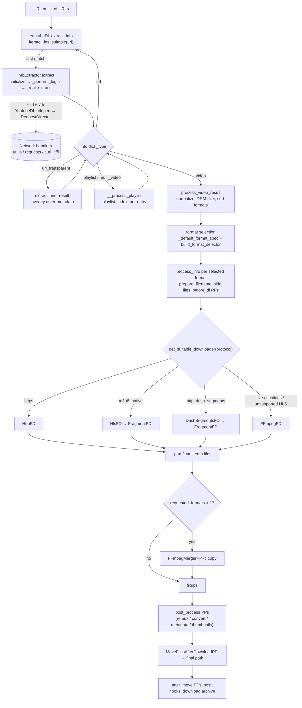
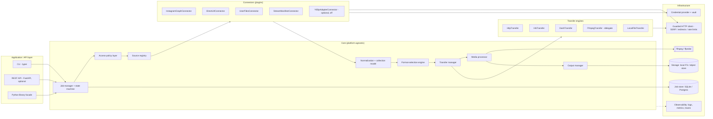
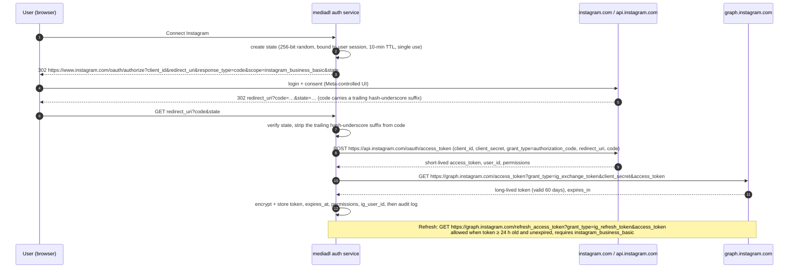
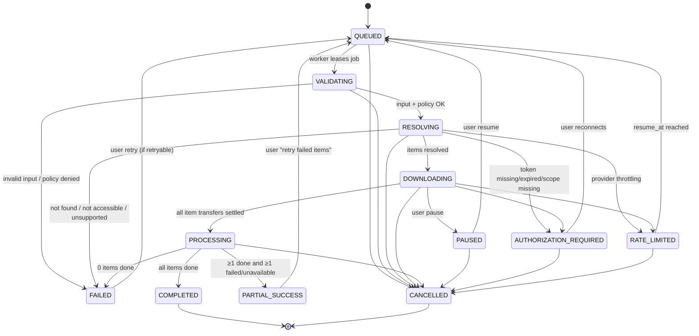
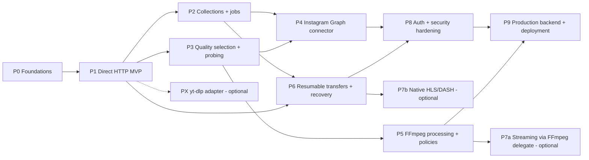

# Independent Media Downloader: yt-dlp Research Report and Architecture Specification

> **Status:** research complete; architecture proposed; implementation not started.
> **Audience:** engineering team or coding agent implementing the system incrementally.
> **Research date:** 2026-09-21.

## 0. Investigation baseline, evidence rules, and contents

### 0.1 Baseline

| Item | Value | How verified |
|---|---|---|
| Repository | https://github.com/yt-dlp/yt-dlp | `git clone --filter=blob:none` |
| Branch inspected | `master` | `git branch --show-current` |
| Commit inspected | `c7fb478d21e9e59524befbe23f7801bb267fb880` (2026-09-16T19:48:51+12:00, "[ie/youtube] Use Safari UA for web_embedded client (#17684)") | `git log -1` |
| Latest stable release | `2026.08.19`, published 2026-08-19T23:48:43Z; tag commit `3a08beaf031ab68f966401ead017ac81fe8486cf`. The tag's `version.py` records `RELEASE_GIT_HEAD = 594bd50c2c78ac432f81600d309fdc4e0a92d82c`, which is the parent of the release commit | GitHub Releases API + `git log` |
| Master versus release | master is **21 commits ahead** of the `2026.08.19` tag. `yt_dlp/version.py` on master still reads `2026.08.19` because the file is only rewritten at release time | `git rev-list --count 2026.08.19..HEAD` |
| Latest nightly | `2026.09.16.232951` (repo `yt-dlp/yt-dlp-nightly-builds`, published 2026-09-16T23:33:25Z) | GitHub Releases API |
| PyPI | `yt-dlp 2026.8.19`, `requires_python >=3.10`, license `Unlicense` | PyPI JSON API |
| Meta Graph API version seen in docs | `v25.0` | developers.facebook.com, fetched 2026-09-21 |
| Local verification tools | FFmpeg/FFprobe 9.0.1 (Homebrew build), Python 3.14.7 | Commands executed locally |

All source links are pinned to the inspected commit. Base URL:
`https://github.com/yt-dlp/yt-dlp/blob/c7fb478d21e9e59524befbe23f7801bb267fb880/`

### 0.2 Evidence tags used in this document

| Tag | Meaning |
|---|---|
| **[SRC]** | Confirmed by reading yt-dlp source at the pinned commit |
| **[DOC]** | Confirmed in official documentation (Meta, FFmpeg, IETF, yt-dlp README) on 2026-09-21 |
| **[RUN]** | Confirmed by running the command locally against synthetic fixtures |
| **[INF]** | Inferred from source or documentation but not executed end to end |
| **[PROP]** | Proposed design for the new application. **This is not existing yt-dlp functionality** |
| **[OPEN]** | Not verifiable with the sources available. Listed in §13.5 for follow-up |

### 0.3 Contents

1. Executive summary
2. yt-dlp repository structure and relevant files
3. End-to-end architecture and data flow
4. Media discovery, Instagram feasibility, supported content types, and limitations
5. Proposed independent architecture and module boundaries
6. Required credentials, permissions, and secure storage
7. Download, quality-selection, conversion, and output strategy
8. Minimal dependency and licensing analysis
9. Security, privacy, error handling, retries, testing, and observability
10. Step-by-step implementation roadmap
11. Example project directory structure
12. Pseudocode for the main workflow (plus configuration and FFmpeg integration)
13. Final checklist, open questions, and sources

---

## 1. Executive summary

### 1.1 What yt-dlp is, architecturally

yt-dlp is a **pipeline with four pluggable layers**, coordinated by one orchestrator class. **[SRC]**

1. **Extractors** ([`InfoExtractor`](https://github.com/yt-dlp/yt-dlp/blob/c7fb478d21e9e59524befbe23f7801bb267fb880/yt_dlp/extractor/common.py#L105), about 940 modules, 1,731 entries in `supportedsites.md`) turn a URL into a normalized **info dict**. The dict is either a single `video` result with a list of `formats`, a `playlist`/`multi_video` result with `entries`, or a `url`/`url_transparent` reference to be resolved again.
2. **The orchestrator** ([`YoutubeDL`](https://github.com/yt-dlp/yt-dlp/blob/c7fb478d21e9e59524befbe23f7801bb267fb880/yt_dlp/YoutubeDL.py#L204), 4,554 lines) selects the extractor, resolves references, normalizes and sorts formats, applies the format-selector language, renders output filenames, and runs the post-processor stages.
3. **Protocol downloaders** ([`downloader/`](https://github.com/yt-dlp/yt-dlp/tree/c7fb478d21e9e59524befbe23f7801bb267fb880/yt_dlp/downloader)) are chosen per format by `protocol` (`https`, `m3u8_native`, `http_dash_segments`, and others). They share a `.part`-file, retry, and progress-hook framework.
4. **Post-processors** ([`postprocessor/`](https://github.com/yt-dlp/yt-dlp/tree/c7fb478d21e9e59524befbe23f7801bb267fb880/yt_dlp/postprocessor)) form an ordered chain, mostly FFmpeg-based: merge, remux, fix-ups, metadata, thumbnails, and moving files into place.

A **network abstraction** ([`RequestDirector`/`RequestHandler`](https://github.com/yt-dlp/yt-dlp/blob/c7fb478d21e9e59524befbe23f7801bb267fb880/yt_dlp/networking/common.py#L51)) sits underneath all four layers. It has interchangeable `urllib`, `requests`, `curl_cffi`, and `websockets` backends.

**These concepts can be reimplemented independently, and this design adopts them:** the normalized result model, the extractor/connector registry, protocol-dispatched transfer engines, lexicographic format ranking, and staged post-processing.

### 1.2 Decisive findings for Instagram

* **yt-dlp's Instagram support does not use Meta's official Instagram Platform API.** **[SRC]** [`InstagramIE`](https://github.com/yt-dlp/yt-dlp/blob/c7fb478d21e9e59524befbe23f7801bb267fb880/yt_dlp/extractor/instagram.py#L277) calls these instead:
  * undocumented web endpoints: `/api/v1/media/{pk}/info/`, `/api/v1/web/get_ruling_for_content/`, and `/api/graphql` with a hard-coded `doc_id`;
  * a `sessionid` browser cookie when the user is "logged in";
  * a scraped `LSD` token;
  * **browser TLS impersonation** through `curl_cffi` for the logged-out GraphQL path;
  * an HTML fallback that parses `data-sjs` script JSON.

  The extractor was reworked on 2026-06-28 and patched four more times within four weeks. That churn shows how fragile this approach is.
* **yt-dlp does not download Instagram images as media.** **[SRC]** Only `video_versions` and `video_dash_manifest` become `formats`, and image candidates become `thumbnails`. Single-image posts raise [`"There is no video in this post"`](https://github.com/yt-dlp/yt-dlp/blob/c7fb478d21e9e59524befbe23f7801bb267fb880/yt_dlp/extractor/instagram.py#L530). Image-only story items are [filtered out](https://github.com/yt-dlp/yt-dlp/blob/c7fb478d21e9e59524befbe23f7801bb267fb880/yt_dlp/extractor/instagram.py#L758). **[INF]:** image children of carousels get no formats and fail format processing.
* **Official Meta access covers professional (Business/Creator) accounts only**, and only accounts that authorized your app. **[DOC]**
  * The IG Media node exposes `media_type` (`IMAGE`, `VIDEO`, `CAROUSEL_ALBUM`), `media_product_type` (`AD`, `FEED`, `STORY`, `REELS`), `media_url`, `thumbnail_url` (video only), and a `children` edge for albums.
  * `media_url` **is omitted when the media contains copyrighted material or was flagged**.
  * Personal accounts lost API access when the Basic Display API shut down on **2024-12-04**.
  * No official endpoint downloads arbitrary third parties' posts. Business Discovery returns metadata and metrics and states that a GET on returned media fails. oEmbed is restricted to embedding.
* **Consequence:** the Instagram connector must be a **new, independent connector on the official Graph API**, scoped to media owned by the authorizing professional account. Users who are not professional accounts can import their own originals or their official "Download your information" export through the user-provided-files connector.

### 1.3 Recommendations

| Decision | Recommendation |
|---|---|
| Core implementation | **Fully independent Python implementation (Strategy A).** Reuse yt-dlp *concepts*, not code |
| yt-dlp | **Optional runtime adapter (Strategy B)** behind a connector plugin boundary, disabled by default. Restrict it with `allowed_extractors`, run with `geo_bypass=False`, and never pass browser cookies. **Never** used for Instagram |
| Source copying (Strategy C) | Legally permissive (Unlicense), but not recommended. yt-dlp's internals depend on its own `utils` megamodule and info-dict conventions, and copied code inherits a maintenance burden |
| Default output policy | **Source-preserving.** Keep bytes exactly as retrieved. FFmpeg only assembles streams (A/V merge, segment assembly) with `-c copy` |
| Metadata | Sidecar JSON by default. Writing tags into the container changes the file's SHA-256 even with stream copy **[RUN]** |
| FFmpeg | Required only for merge, remux, transcode, and advanced streaming. Invoked as an external process with argument lists, timeouts, and a protocol allowlist. Check each build's license (§8.3) |
| Transfers | Bounded-memory streaming over `httpx` with an SSRF guard, manual redirect validation, and `If-Range`-validated resume. yt-dlp validates only `Content-Range` and has no `ETag`/`If-Range` logic **[SRC]** |

### 1.4 Hard scope boundaries (apply to every module)

The application **must not**:

* bypass DRM;
* bypass login challenges, identity verification, privacy settings, geographic restrictions, or provider rate limits;
* spoof `X-Forwarded-For`. yt-dlp does this by default on geo errors: [`__maybe_fake_ip_and_retry`](https://github.com/yt-dlp/yt-dlp/blob/c7fb478d21e9e59524befbe23f7801bb267fb880/yt_dlp/extractor/common.py#L790), with `geo_bypass` defaulting to `True`;
* rotate proxies or identities;
* impersonate browser TLS fingerprints to evade bot detection;
* import or reuse browser cookies to act as a logged-in user;
* call undocumented or private platform endpoints.

These are architectural constraints, not configuration options.

---

## 2. yt-dlp repository structure and relevant files

### 2.1 Packaging, Python requirements, and dependencies [SRC]

From [`pyproject.toml`](https://github.com/yt-dlp/yt-dlp/blob/c7fb478d21e9e59524befbe23f7801bb267fb880/pyproject.toml):

| Field | Value |
|---|---|
| Build backend | `hatchling>=1.27.0` |
| `requires-python` | `>=3.10`. Classifiers list CPython 3.10–3.14 and PyPy. The README says "Python versions 3.10+ (CPython) and 3.11+ (PyPy)" |
| `license` | `"Unlicense"`, `license-files = ["LICENSE"]` |
| Mandatory runtime `dependencies` | **`[]` (none)** |
| `default` extra | `brotli`/`brotlicffi`, `certifi`, `mutagen`, `pycryptodomex`, `requests>=2.32.2,<3`, `urllib3>=2.0.2,<3`, `websockets>=13.0`, `yt-dlp-ejs==0.8.0` |
| Other extras | `curl-cffi` (browser impersonation), `secretstorage` (Linux keyring for browser cookies), `deno` (JS runtime for YouTube challenges), plus `pin*` lock variants |
| Entry point | `yt-dlp = "yt_dlp:main"` |
| Generated artifact | `yt_dlp/extractor/lazy_extractors.py`, created by `devscripts/make_lazy_extractors.py` for fast startup |

Optional imports are centralised in [`yt_dlp/dependencies/__init__.py`](https://github.com/yt-dlp/yt-dlp/blob/c7fb478d21e9e59524befbe23f7801bb267fb880/yt_dlp/dependencies/__init__.py). Each one is a `try: import …` that falls back to `None`, which lets the core run with zero third-party packages.

### 2.2 Licenses [SRC][DOC]

* [`LICENSE`](https://github.com/yt-dlp/yt-dlp/blob/c7fb478d21e9e59524befbe23f7801bb267fb880/LICENSE): **The Unlicense**, a public-domain dedication with a permissive fallback and no warranty.
* A scan of `yt_dlp/**` for separate license headers found **no Python source file under a different license**. The only SPDX header is `Unlicense`, on generated YouTube JS solver files. The README says the `yt-dlp-ejs` package bundles MIT (astring) and ISC (meriyah) components.
* [`THIRD_PARTY_LICENSES.txt`](https://github.com/yt-dlp/yt-dlp/blob/c7fb478d21e9e59524befbe23f7801bb267fb880/THIRD_PARTY_LICENSES.txt) covers **the PyInstaller-bundled executables**, which include separately licensed components. Examples:
  * Python (PSF-2.0);
  * [mutagen **GPL-2.0-or-later**](https://github.com/yt-dlp/yt-dlp/blob/c7fb478d21e9e59524befbe23f7801bb267fb880/THIRD_PARTY_LICENSES.txt#L3638);
  * [GNU Readline **GPL-3.0-or-later**](https://github.com/yt-dlp/yt-dlp/blob/c7fb478d21e9e59524befbe23f7801bb267fb880/THIRD_PARTY_LICENSES.txt#L1026) ("Only included in Linux builds");
  * libintl LGPL-2.1+, libidn2/libunistring LGPL-3.0+, certifi MPL-2.0, OpenSSL 3 and BoringSSL Apache-2.0, curl-impersonate MIT, libstdc++/libgcc GPL-3.0 with GCC exception.
* **The source package is Unlicense. The official executables are aggregates that carry GPL/LGPL/MPL obligations.** §8 covers this in detail.

### 2.3 Annotated repository map [SRC]

```text
yt-dlp/ @ c7fb478
├── yt_dlp/                       ← the runtime package (ESSENTIAL)
│   ├── __init__.py               CLI entry: main() → _real_main() → parse_options() → YoutubeDL(opts).download(urls)
│   ├── __main__.py               `python -m yt_dlp`
│   ├── options.py                optparse CLI definition (create_parser); CLI-only
│   ├── YoutubeDL.py              ORCHESTRATOR: extractor dispatch, result resolution, format sort/select,
│   │                             filename templates, download dispatch, post-processor stages, archive, hooks
│   ├── extractor/                ~940 modules
│   │   ├── common.py             InfoExtractor base class + info-dict contract + manifest parsers (HLS/DASH/ISM/F4M/SMIL)
│   │   ├── __init__.py           gen_extractor_classes(), get_info_extractor(), plugin spec registration
│   │   ├── extractors.py         builds ordered _CLASS_LOOKUP (YouTube first, Generic last); lazy or eager import
│   │   ├── _extractors.py        explicit import list of every extractor class
│   │   ├── generic.py            fallback extractor (direct media, embeds, manifests on arbitrary pages)
│   │   ├── instagram.py          InstagramIE / InstagramIOSIE / InstagramStoryIE / InstagramUserIE / InstagramTagIE
│   │   └── lazy_extractors.py    GENERATED (not in git): _VALID_URL-only stubs for fast matching
│   ├── downloader/               protocol engines (FileDownloader subclasses)
│   │   ├── __init__.py           get_suitable_downloader(), PROTOCOL_MAP
│   │   ├── common.py             FileDownloader: .part naming, progress, sleep, rate limit, retries plumbing
│   │   ├── http.py               HttpFD: streaming, Range resume, chunked download
│   │   ├── fragment.py           FragmentFD: fragment loop, .ytdl resume state, concurrency, AES-128 decrypt
│   │   ├── hls.py / dash.py      HlsFD / DashSegmentsFD (native segment download)
│   │   ├── external.py           FFmpegFD, Aria2cFD, CurlFD, WgetFD, AxelFD, HttpieFD
│   │   └── f4m, ism, rtmp, mhtml, websocket, niconico, fc2, soop, bunnycdn, youtube_live_chat  (site/protocol specific)
│   ├── networking/               transport abstraction
│   │   ├── common.py             RequestDirector, RequestHandler (ABC), Request, Response, register_rh/preference
│   │   ├── _urllib.py            UrllibRH (stdlib; http, https, data, ftp; file:// only if enable_file_urls)
│   │   ├── _requests.py          RequestsRH (requests/urllib3; http, https)
│   │   ├── _curlcffi.py          CurlCFFIRH (impersonation)
│   │   ├── _websockets.py        websocket handler
│   │   ├── _helper.py            redirect method rules, SSL context, proxy helpers
│   │   ├── exceptions.py         RequestError → TransportError/HTTPError/IncompleteRead/SSLError/ProxyError …
│   │   └── impersonate.py        ImpersonateTarget / ImpersonateRequestHandler
│   ├── postprocessor/            post-processing chain
│   │   ├── common.py             PostProcessor base: run(info) -> (files_to_delete, info)
│   │   ├── ffmpeg.py             FFmpeg* PPs (merge, remux, convert, extract audio, metadata, fixups, subs, thumbnails, concat)
│   │   ├── embedthumbnail.py     EmbedThumbnailPP (ffmpeg, mutagen, AtomicParsley)
│   │   ├── movefilesafterdownload.py  moves temp → final paths
│   │   └── metadataparser, modify_chapters, sponsorblock, exec, xattrpp
│   ├── cookies.py                cookie jar + browser cookie extraction/decryption (Chromium, Firefox, Safari)
│   ├── cache.py                  JSON cache under $XDG_CACHE_HOME/yt-dlp
│   ├── utils/
│   │   ├── _utils.py             5.7k-line helper module: sanitize_filename/path, errors, RetryManager,
│   │   │                         FormatSorter, MEDIA_EXTENSIONS, determine_protocol, _UnsafeExtensionError …
│   │   ├── traversal.py          traverse_obj (declarative JSON path extraction)
│   │   ├── networking.py         header utilities, std_headers
│   │   ├── progress.py, _jsruntime.py, jslib/
│   ├── plugins.py                plugin discovery (namespace package yt_dlp_plugins)
│   ├── update.py                 self-updater (release channels, signature/hash checks)
│   ├── compat/, dependencies/    compatibility shims, optional-dependency detection
│   └── aes.py, jsinterp.py, socks.py, webvtt.py, minicurses.py, globals.py, __pyinstaller/
├── test/                         unit tests + network "download" tests generated from extractor _TESTS
├── devscripts/                   release tooling: lazy extractors, README/supportedsites generation, changelog, completions
├── bundle/                       PyInstaller & docker build definitions
├── README.md, supportedsites.md, Changelog.md, CONTRIBUTING.md, LICENSE, THIRD_PARTY_LICENSES.txt
└── pyproject.toml, uv.lock, Makefile
```

### 2.4 Module responsibilities, interfaces, and relationships [SRC]

| Module | Purpose | Principal interfaces | Depends on | Consumed by |
|---|---|---|---|---|
| [`YoutubeDL`](https://github.com/yt-dlp/yt-dlp/blob/c7fb478d21e9e59524befbe23f7801bb267fb880/yt_dlp/YoutubeDL.py#L204) | Orchestrator and single source of configuration (`params` dict). Registries: `_ies` (extractors) and `_pps[stage]` (post-processors for the stages `pre_process`, `after_filter`, `video`, `before_dl`, `post_process`, `after_move`, `after_video`, `playlist`) | [`extract_info`](https://github.com/yt-dlp/yt-dlp/blob/c7fb478d21e9e59524befbe23f7801bb267fb880/yt_dlp/YoutubeDL.py#L1675), [`process_ie_result`](https://github.com/yt-dlp/yt-dlp/blob/c7fb478d21e9e59524befbe23f7801bb267fb880/yt_dlp/YoutubeDL.py#L1908), [`process_video_result`](https://github.com/yt-dlp/yt-dlp/blob/c7fb478d21e9e59524befbe23f7801bb267fb880/yt_dlp/YoutubeDL.py#L2835), [`process_info`](https://github.com/yt-dlp/yt-dlp/blob/c7fb478d21e9e59524befbe23f7801bb267fb880/yt_dlp/YoutubeDL.py#L3334), [`dl`](https://github.com/yt-dlp/yt-dlp/blob/c7fb478d21e9e59524befbe23f7801bb267fb880/yt_dlp/YoutubeDL.py#L3286), [`post_process`](https://github.com/yt-dlp/yt-dlp/blob/c7fb478d21e9e59524befbe23f7801bb267fb880/yt_dlp/YoutubeDL.py#L3846), [`prepare_filename`](https://github.com/yt-dlp/yt-dlp/blob/c7fb478d21e9e59524befbe23f7801bb267fb880/yt_dlp/YoutubeDL.py#L1555), [`urlopen`](https://github.com/yt-dlp/yt-dlp/blob/c7fb478d21e9e59524befbe23f7801bb267fb880/yt_dlp/YoutubeDL.py#L4281), [`sanitize_info`](https://github.com/yt-dlp/yt-dlp/blob/c7fb478d21e9e59524befbe23f7801bb267fb880/yt_dlp/YoutubeDL.py#L3740), `add_progress_hook`, `add_post_processor` | Everything below | CLI (`__init__._real_main`), embedding applications |
| [`InfoExtractor`](https://github.com/yt-dlp/yt-dlp/blob/c7fb478d21e9e59524befbe23f7801bb267fb880/yt_dlp/extractor/common.py#L105) | Base class for site logic. Its docstring defines the **info-dict contract**, which is the de facto internal schema | Class attributes `_VALID_URL`, `_NETRC_MACHINE`, `_WORKING`, `_TESTS`, `_EMBED_REGEX`. Methods [`suitable`](https://github.com/yt-dlp/yt-dlp/blob/c7fb478d21e9e59524befbe23f7801bb267fb880/yt_dlp/extractor/common.py#L627), [`initialize`](https://github.com/yt-dlp/yt-dlp/blob/c7fb478d21e9e59524befbe23f7801bb267fb880/yt_dlp/extractor/common.py#L653) (→ `_perform_login`, `_real_initialize`), [`extract`](https://github.com/yt-dlp/yt-dlp/blob/c7fb478d21e9e59524befbe23f7801bb267fb880/yt_dlp/extractor/common.py#L756) (→ `_real_extract`), network helpers (`_download_webpage`, `_download_json`, [`_request_webpage`](https://github.com/yt-dlp/yt-dlp/blob/c7fb478d21e9e59524befbe23f7801bb267fb880/yt_dlp/extractor/common.py#L864)), manifest parsers ([`_extract_m3u8_formats_and_subtitles`](https://github.com/yt-dlp/yt-dlp/blob/c7fb478d21e9e59524befbe23f7801bb267fb880/yt_dlp/extractor/common.py#L2176), [`_extract_mpd_formats_and_subtitles`](https://github.com/yt-dlp/yt-dlp/blob/c7fb478d21e9e59524befbe23f7801bb267fb880/yt_dlp/extractor/common.py#L2805)), result builders ([`url_result`](https://github.com/yt-dlp/yt-dlp/blob/c7fb478d21e9e59524befbe23f7801bb267fb880/yt_dlp/extractor/common.py#L1275), [`playlist_result`](https://github.com/yt-dlp/yt-dlp/blob/c7fb478d21e9e59524befbe23f7801bb267fb880/yt_dlp/extractor/common.py#L1300)), [`raise_login_required`](https://github.com/yt-dlp/yt-dlp/blob/c7fb478d21e9e59524befbe23f7801bb267fb880/yt_dlp/extractor/common.py#L1245) | `YoutubeDL` (as `_downloader`), `utils`, `networking` | `YoutubeDL.extract_info` |
| Extractor registry ([`extractors.py`](https://github.com/yt-dlp/yt-dlp/blob/c7fb478d21e9e59524befbe23f7801bb267fb880/yt_dlp/extractor/extractors.py#L25), [`__init__.py`](https://github.com/yt-dlp/yt-dlp/blob/c7fb478d21e9e59524befbe23f7801bb267fb880/yt_dlp/extractor/__init__.py#L17)) | Ordered lookup: YouTube first, `GenericIE` last. **First match wins.** Uses lazy stubs when `lazy_extractors.py` exists | `gen_extractor_classes()`, `get_info_extractor(name)`, plugin spec with suffix `IE` | `plugins.py`, `globals.py` | `YoutubeDL.add_default_info_extractors` |
| [`downloader/__init__.py`](https://github.com/yt-dlp/yt-dlp/blob/c7fb478d21e9e59524befbe23f7801bb267fb880/yt_dlp/downloader/__init__.py#L4) | Chooses the transfer engine per format: `protocol` → [`PROTOCOL_MAP`](https://github.com/yt-dlp/yt-dlp/blob/c7fb478d21e9e59524befbe23f7801bb267fb880/yt_dlp/downloader/__init__.py#L40). Special cases: external downloaders, live → FFmpeg, section downloads → FFmpeg, multi-protocol `a+b` → FFmpeg merge-on-the-fly | `get_suitable_downloader(info, params)` | `utils.determine_protocol` | `YoutubeDL.dl`, `process_info` |
| [`FileDownloader`](https://github.com/yt-dlp/yt-dlp/blob/c7fb478d21e9e59524befbe23f7801bb267fb880/yt_dlp/downloader/common.py#L37) | Common engine base: skip if the file exists, sleep intervals (including site `available_at`), progress reporting, [`temp_name`](https://github.com/yt-dlp/yt-dlp/blob/c7fb478d21e9e59524befbe23f7801bb267fb880/yt_dlp/downloader/common.py#L217) (`.part`), file-access retries | [`download(filename, info)`](https://github.com/yt-dlp/yt-dlp/blob/c7fb478d21e9e59524befbe23f7801bb267fb880/yt_dlp/downloader/common.py#L430) → `real_download` → `(success, real_download)` | `YoutubeDL` (`urlopen`, reporting) | All engines |
| [`HttpFD`](https://github.com/yt-dlp/yt-dlp/blob/c7fb478d21e9e59524befbe23f7801bb267fb880/yt_dlp/downloader/http.py#L23) | Progressive HTTP(S) with resume and optional chunking (`http_chunk_size`) | `real_download` | `networking`, `RetryManager` | `PROTOCOL_MAP` default |
| [`FragmentFD`](https://github.com/yt-dlp/yt-dlp/blob/c7fb478d21e9e59524befbe23f7801bb267fb880/yt_dlp/downloader/fragment.py#L26) | Fragment loop, `.ytdl` JSON resume index, retries, skip policy, [thread-pool concurrency](https://github.com/yt-dlp/yt-dlp/blob/c7fb478d21e9e59524befbe23f7801bb267fb880/yt_dlp/downloader/fragment.py#L367), AES-128 decryption | `_prepare_frag_download`, `_download_fragment`, `_append_fragment`, `_finish_frag_download` | `HttpFD` (quiet), `pycryptodomex` (optional) | `HlsFD`, `DashSegmentsFD`, `IsmFD`, … |
| [`HlsFD`](https://github.com/yt-dlp/yt-dlp/blob/c7fb478d21e9e59524befbe23f7801bb267fb880/yt_dlp/downloader/hls.py#L22) | Native HLS media-playlist downloading. [`can_download`](https://github.com/yt-dlp/yt-dlp/blob/c7fb478d21e9e59524befbe23f7801bb267fb880/yt_dlp/downloader/hls.py#L41) rejects live streams and non-AES-128 encryption, and [`_has_drm`](https://github.com/yt-dlp/yt-dlp/blob/c7fb478d21e9e59524befbe23f7801bb267fb880/yt_dlp/downloader/hls.py#L32) detects FairPlay, PlayReady, and Flash Access. Unsupported playlists fall back to `FFmpegFD` | `real_download` | `FragmentFD`, `FFmpegFD` | `PROTOCOL_MAP['m3u8_native']` |
| [`DashSegmentsFD`](https://github.com/yt-dlp/yt-dlp/blob/c7fb478d21e9e59524befbe23f7801bb267fb880/yt_dlp/downloader/dash.py#L9) | Downloads the `fragments` list prepared by the MPD parser | `real_download` | `FragmentFD` | `PROTOCOL_MAP['http_dash_segments']` |
| [`FFmpegFD`](https://github.com/yt-dlp/yt-dlp/blob/c7fb478d21e9e59524befbe23f7801bb267fb880/yt_dlp/downloader/external.py#L377) | Delegates the whole transfer to FFmpeg. Passes [`-c copy`](https://github.com/yt-dlp/yt-dlp/blob/c7fb478d21e9e59524befbe23f7801bb267fb880/yt_dlp/downloader/external.py#L514) and maps streams from multiple inputs | `_call_downloader`, `can_merge_formats` | `ffmpeg` binary | Live HLS/DASH, sections, `m3u8` protocol |
| [`RequestDirector`](https://github.com/yt-dlp/yt-dlp/blob/c7fb478d21e9e59524befbe23f7801bb267fb880/yt_dlp/networking/common.py#L51) and [`RequestHandler`](https://github.com/yt-dlp/yt-dlp/blob/c7fb478d21e9e59524befbe23f7801bb267fb880/yt_dlp/networking/common.py#L149) | Transport-agnostic HTTP. Handlers declare `_SUPPORTED_URL_SCHEMES`, `_SUPPORTED_PROXY_SCHEMES`, and `_SUPPORTED_FEATURES`. The director ranks handlers by preference functions, calls `validate`, then `send`. Errors are normalized in [`networking/exceptions.py`](https://github.com/yt-dlp/yt-dlp/blob/c7fb478d21e9e59524befbe23f7801bb267fb880/yt_dlp/networking/exceptions.py#L11) | [`Request`](https://github.com/yt-dlp/yt-dlp/blob/c7fb478d21e9e59524befbe23f7801bb267fb880/yt_dlp/networking/common.py#L385), [`Response`](https://github.com/yt-dlp/yt-dlp/blob/c7fb478d21e9e59524befbe23f7801bb267fb880/yt_dlp/networking/common.py#L512), `RequestDirector.send` | `urllib`, `requests`, `curl_cffi`, `websockets` | [`YoutubeDL.urlopen`](https://github.com/yt-dlp/yt-dlp/blob/c7fb478d21e9e59524befbe23f7801bb267fb880/yt_dlp/YoutubeDL.py#L4281), [`build_request_director`](https://github.com/yt-dlp/yt-dlp/blob/c7fb478d21e9e59524befbe23f7801bb267fb880/yt_dlp/YoutubeDL.py#L4345) |
| [`PostProcessor`](https://github.com/yt-dlp/yt-dlp/blob/c7fb478d21e9e59524befbe23f7801bb267fb880/yt_dlp/postprocessor/common.py#L36) | Chain element. [`run(info) -> (files_to_delete, info)`](https://github.com/yt-dlp/yt-dlp/blob/c7fb478d21e9e59524befbe23f7801bb267fb880/yt_dlp/postprocessor/common.py#L135). `_restrict_to(video, audio, images)` controls applicability | `run`, hooks | `YoutubeDL` | `YoutubeDL.run_pp` / `run_all_pps` |
| [`FFmpegPostProcessor`](https://github.com/yt-dlp/yt-dlp/blob/c7fb478d21e9e59524befbe23f7801bb267fb880/yt_dlp/postprocessor/ffmpeg.py#L86) family | [`FFmpegMergerPP`](https://github.com/yt-dlp/yt-dlp/blob/c7fb478d21e9e59524befbe23f7801bb267fb880/yt_dlp/postprocessor/ffmpeg.py#L822) (`-c copy` plus `-map i:v:0`/`i:a:0`, `aac_adtstoasc` for HLS AAC), [`FFmpegVideoRemuxerPP`](https://github.com/yt-dlp/yt-dlp/blob/c7fb478d21e9e59524befbe23f7801bb267fb880/yt_dlp/postprocessor/ffmpeg.py#L573) (stream copy), [`FFmpegVideoConvertorPP`](https://github.com/yt-dlp/yt-dlp/blob/c7fb478d21e9e59524befbe23f7801bb267fb880/yt_dlp/postprocessor/ffmpeg.py#L538) (re-encode), [`FFmpegMetadataPP`](https://github.com/yt-dlp/yt-dlp/blob/c7fb478d21e9e59524befbe23f7801bb267fb880/yt_dlp/postprocessor/ffmpeg.py#L662), fix-ups (for example [`FFmpegFixupM3u8PP`](https://github.com/yt-dlp/yt-dlp/blob/c7fb478d21e9e59524befbe23f7801bb267fb880/yt_dlp/postprocessor/ffmpeg.py#L878)), [`FFmpegThumbnailsConvertorPP`](https://github.com/yt-dlp/yt-dlp/blob/c7fb478d21e9e59524befbe23f7801bb267fb880/yt_dlp/postprocessor/ffmpeg.py#L1062) | `run_ffmpeg`, `run_ffmpeg_multiple_files`, `get_audio_codec` | `ffmpeg`, `ffprobe` | `YoutubeDL.process_info` |
| [`cookies.py`](https://github.com/yt-dlp/yt-dlp/blob/c7fb478d21e9e59524befbe23f7801bb267fb880/yt_dlp/cookies.py#L93) | Netscape cookie-file jar ([`YoutubeDLCookieJar`](https://github.com/yt-dlp/yt-dlp/blob/c7fb478d21e9e59524befbe23f7801bb267fb880/yt_dlp/cookies.py#L1276)) and [`extract_cookies_from_browser`](https://github.com/yt-dlp/yt-dlp/blob/c7fb478d21e9e59524befbe23f7801bb267fb880/yt_dlp/cookies.py#L116) for [`SUPPORTED_BROWSERS`](https://github.com/yt-dlp/yt-dlp/blob/c7fb478d21e9e59524befbe23f7801bb267fb880/yt_dlp/cookies.py#L50) (Chromium family, Firefox, Safari). **It decrypts browser cookie stores** with the OS keyring/Keychain/DPAPI | `load_cookies`, `extract_cookies_from_browser` | `sqlite3`, keyrings, `aes.py` | `YoutubeDL.cookiejar` |
| [`cache.py`](https://github.com/yt-dlp/yt-dlp/blob/c7fb478d21e9e59524befbe23f7801bb267fb880/yt_dlp/cache.py#L13) | Small JSON key-value cache (`$XDG_CACHE_HOME/yt-dlp/<section>/<key>.json`). Entries carry the yt-dlp version and support `min_ver` invalidation. Used by extractors for tokens and player data | `store`, `load`, `remove` | filesystem | `InfoExtractor.cache` |
| [`utils/_utils.py`](https://github.com/yt-dlp/yt-dlp/blob/c7fb478d21e9e59524befbe23f7801bb267fb880/yt_dlp/utils/_utils.py) | Shared helpers: [`sanitize_filename`](https://github.com/yt-dlp/yt-dlp/blob/c7fb478d21e9e59524befbe23f7801bb267fb880/yt_dlp/utils/_utils.py#L630), [`sanitize_path`](https://github.com/yt-dlp/yt-dlp/blob/c7fb478d21e9e59524befbe23f7801bb267fb880/yt_dlp/utils/_utils.py#L705), the error hierarchy ([`ExtractorError`](https://github.com/yt-dlp/yt-dlp/blob/c7fb478d21e9e59524befbe23f7801bb267fb880/yt_dlp/utils/_utils.py#L979), [`DownloadError`](https://github.com/yt-dlp/yt-dlp/blob/c7fb478d21e9e59524befbe23f7801bb267fb880/yt_dlp/utils/_utils.py#L1056), …), [`RetryManager`](https://github.com/yt-dlp/yt-dlp/blob/c7fb478d21e9e59524befbe23f7801bb267fb880/yt_dlp/utils/_utils.py#L5253), [`FormatSorter`](https://github.com/yt-dlp/yt-dlp/blob/c7fb478d21e9e59524befbe23f7801bb267fb880/yt_dlp/utils/_utils.py#L5354), [`MEDIA_EXTENSIONS`](https://github.com/yt-dlp/yt-dlp/blob/c7fb478d21e9e59524befbe23f7801bb267fb880/yt_dlp/utils/_utils.py#L5101), [`determine_protocol`](https://github.com/yt-dlp/yt-dlp/blob/c7fb478d21e9e59524befbe23f7801bb267fb880/yt_dlp/utils/_utils.py#L3183), [`_UnsafeExtensionError`](https://github.com/yt-dlp/yt-dlp/blob/c7fb478d21e9e59524befbe23f7801bb267fb880/yt_dlp/utils/_utils.py#L5117) (extension allowlist; ref. GHSA-79w7-vh3h-8g4j) | — | stdlib | Everything |
| [`utils/traversal.py`](https://github.com/yt-dlp/yt-dlp/blob/c7fb478d21e9e59524befbe23f7801bb267fb880/yt_dlp/utils/traversal.py#L38) | `traverse_obj`: declarative, fault-tolerant JSON path extraction. This is what makes extractors short | `traverse_obj(obj, *paths, …)` | stdlib | Extractors |
| [`plugins.py`](https://github.com/yt-dlp/yt-dlp/blob/c7fb478d21e9e59524befbe23f7801bb267fb880/yt_dlp/plugins.py#L194) | Discovers `yt_dlp_plugins.extractor.*IE` and `postprocessor.*PP` in namespace packages or zips | `load_plugins`, `register_plugin_spec` | importlib | Extractor/PP registries |
| [`__init__.py`](https://github.com/yt-dlp/yt-dlp/blob/c7fb478d21e9e59524befbe23f7801bb267fb880/yt_dlp/__init__.py#L964), [`options.py`](https://github.com/yt-dlp/yt-dlp/blob/c7fb478d21e9e59524befbe23f7801bb267fb880/yt_dlp/options.py#L247) | CLI: option parsing and validation, building the post-processor list, then calling `YoutubeDL.download` | `main`, `_real_main`, `parse_options` | Everything | End users |
| `test/` | `test_download.py` [generates network tests](https://github.com/yt-dlp/yt-dlp/blob/c7fb478d21e9e59524befbe23f7801bb267fb880/test/test_download.py#L80) from each extractor's `_TESTS` (marked `download`). Unit tests run against local fixtures, for example the [Range-capable local HTTP server in `test_downloader_http.py`](https://github.com/yt-dlp/yt-dlp/blob/c7fb478d21e9e59524befbe23f7801bb267fb880/test/test_downloader_http.py#L26), `testdata/m3u8`, `testdata/mpd` | pytest | — | CI |

### 2.5 Essential runtime versus optional parts [SRC][INF]

| Category | Members |
|---|---|
| **Essential core** (a direct-URL download works with only these) | `YoutubeDL.py`, `extractor/common.py` + registry + `generic.py`, `downloader/{common,http}.py`, `networking/{common,_urllib,_helper,exceptions}.py`, `utils/`, `postprocessor/{common,movefilesafterdownload}.py`, `cache.py`, `cookies.py` (the jar class is always constructed) |
| **Essential for "best quality" on many sites** | `downloader/{fragment,hls,dash,external}.py`, `postprocessor/ffmpeg.py`, and the external **FFmpeg/FFprobe binaries**. Without FFmpeg, [`_default_format_spec`](https://github.com/yt-dlp/yt-dlp/blob/c7fb478d21e9e59524befbe23f7801bb267fb880/yt_dlp/YoutubeDL.py#L2317) falls back to `best/bestvideo+bestaudio` and warns that the result may not be the best available |
| **Optional site-specific** | The ~940 extractor modules and site-specific downloaders (`niconico`, `fc2`, `soop`, `bunnycdn`, `youtube_live_chat`, …) |
| **Optional third-party** | `requests`/`urllib3` (preferred HTTP backend), `curl_cffi` (impersonation), `websockets`, `brotli`, `certifi`, `pycryptodomex`, `mutagen`, `secretstorage`, `xattr`, `yt-dlp-ejs` + JS runtime |
| **CLI-only** | `__init__.py` option handling, `options.py`, `minicurses.py`, `update.py` |
| **Development/build** | `devscripts/`, `bundle/`, `test/`, `Makefile`, `uv.lock` |

---

## 3. End-to-end architecture and data flow (yt-dlp, as implemented)

Everything in this section describes **existing yt-dlp behaviour** at the pinned commit. **[SRC]** unless tagged otherwise.

### 3.1 Stage-by-stage trace

| # | Stage | Responsible code | Input → output | Notes |
|---|---|---|---|---|
| 1 | CLI entry | [`_real_main`](https://github.com/yt-dlp/yt-dlp/blob/c7fb478d21e9e59524befbe23f7801bb267fb880/yt_dlp/__init__.py#L964) → `parse_options` → `YoutubeDL(ydl_opts)` → [`download(url_list)`](https://github.com/yt-dlp/yt-dlp/blob/c7fb478d21e9e59524befbe23f7801bb267fb880/yt_dlp/YoutubeDL.py#L3701) | argv → `params` dict | `download()` wraps `extract_info(url, force_generic_extractor=…)` in `__download_wrapper`, which handles `UnavailableVideoError` and `DownloadCancelled` |
| 2 | URL recognition and extractor selection | [`extract_info`](https://github.com/yt-dlp/yt-dlp/blob/c7fb478d21e9e59524befbe23f7801bb267fb880/yt_dlp/YoutubeDL.py#L1675) iterates `self._ies` in registry order and calls `ie.suitable(url)` (a regex on `_VALID_URL`) | URL → first matching `InfoExtractor` | Warns if `_WORKING=False`. Short-circuits if `get_temp_id(url)` is in the download archive. `allowed_extractors` restricts the set |
| 3 | Extractor initialization and authentication | [`InfoExtractor.initialize`](https://github.com/yt-dlp/yt-dlp/blob/c7fb478d21e9e59524befbe23f7801bb267fb880/yt_dlp/extractor/common.py#L653) | — | `_initialize_geo_bypass` → `_initialize_pre_login` → `_perform_login(username, password)` (only if the extractor defines `_NETRC_MACHINE` and overrides it) → `_real_initialize`. Credentials come from params or netrc ([`_get_login_info`](https://github.com/yt-dlp/yt-dlp/blob/c7fb478d21e9e59524befbe23f7801bb267fb880/yt_dlp/extractor/common.py#L1424)) |
| 4 | Resource retrieval (API, page, manifest) | `_real_extract` (site code). Uses `_download_webpage`/`_download_json` → [`_request_webpage`](https://github.com/yt-dlp/yt-dlp/blob/c7fb478d21e9e59524befbe23f7801bb267fb880/yt_dlp/extractor/common.py#L864) → [`YoutubeDL.urlopen`](https://github.com/yt-dlp/yt-dlp/blob/c7fb478d21e9e59524befbe23f7801bb267fb880/yt_dlp/YoutubeDL.py#L4281) → `RequestDirector.send` | URL → HTML/JSON/XML | Cookies are applied from the global jar. [`extract`](https://github.com/yt-dlp/yt-dlp/blob/c7fb478d21e9e59524befbe23f7801bb267fb880/yt_dlp/extractor/common.py#L756) retries once on `GeoRestrictedError` with a **fake `X-Forwarded-For`** when `geo_bypass` is on (the default). It wraps `KeyError`/`StopIteration` as `ExtractorError` |
| 5 | Manifest parsing | `_extract_m3u8_formats_and_subtitles` / [`_parse_m3u8_formats_and_subtitles`](https://github.com/yt-dlp/yt-dlp/blob/c7fb478d21e9e59524befbe23f7801bb267fb880/yt_dlp/extractor/common.py#L2223), `_extract_mpd_formats_and_subtitles` / [`_parse_mpd_periods`](https://github.com/yt-dlp/yt-dlp/blob/c7fb478d21e9e59524befbe23f7801bb267fb880/yt_dlp/extractor/common.py#L2871), plus ISM/F4M/SMIL parsers | manifest → list of format dicts (`protocol`, `fragments`, `manifest_url`, codecs, bitrate, resolution) | DASH formats are usually **video-only or audio-only** (`vcodec`/`acodec='none'`) |
| 6 | Result-type resolution | [`process_ie_result`](https://github.com/yt-dlp/yt-dlp/blob/c7fb478d21e9e59524befbe23f7801bb267fb880/yt_dlp/YoutubeDL.py#L1908) | info dict → resolved dict | `video` → stage 7. `url` → recursive `extract_info`. `url_transparent` → extract inner result, then overlay outer metadata. `playlist`/`multi_video` → [`__process_playlist`](https://github.com/yt-dlp/yt-dlp/blob/c7fb478d21e9e59524befbe23f7801bb267fb880/yt_dlp/YoutubeDL.py#L2080), which assigns `playlist_index`/`playlist_autonumber`, honours `playlist_items`, and counts failures against `skip_playlist_after_errors` |
| 7 | Metadata normalization | [`process_video_result`](https://github.com/yt-dlp/yt-dlp/blob/c7fb478d21e9e59524befbe23f7801bb267fb880/yt_dlp/YoutubeDL.py#L2835) | raw video dict → normalized dict | Requires `id`. Coerces string and numeric fields, fills chapters, sanitizes thumbnails, derives `upload_date` and similar fields (`_fill_common_fields`), and selects subtitles (`process_subtitles`) |
| 8 | Format discovery and cleanup | same function | `formats` → cleaned, sorted list | Drops `has_drm` formats unless `allow_unplayable_formats`. Drops formats without a `url`. Fills `resolution`, `dynamic_range`, `aspect_ratio`, and `filesize_approx = tbr × duration` for non-manifest formats. Attaches per-format `http_headers` via [`_calc_headers`](https://github.com/yt-dlp/yt-dlp/blob/c7fb478d21e9e59524befbe23f7801bb267fb880/yt_dlp/YoutubeDL.py#L2686) (cookies included). Sorts with `FormatSorter`, de-duplicates `format_id`, and optionally probes with `_check_formats` |
| 9 | Filters and pre-processors | `pre_process` (`pre_process`, `after_filter` stages), `_match_entry` (`match_filter`, date/duration filters) | — | A filter can skip the item |
| 10 | Quality ranking and selection | [`_default_format_spec`](https://github.com/yt-dlp/yt-dlp/blob/c7fb478d21e9e59524befbe23f7801bb267fb880/yt_dlp/YoutubeDL.py#L2317), [`build_format_selector`](https://github.com/yt-dlp/yt-dlp/blob/c7fb478d21e9e59524befbe23f7801bb267fb880/yt_dlp/YoutubeDL.py#L2341), `_select_formats`, [`FormatSorter`](https://github.com/yt-dlp/yt-dlp/blob/c7fb478d21e9e59524befbe23f7801bb267fb880/yt_dlp/utils/_utils.py#L5354) | sorted formats + selector → `formats_to_download` | Default spec is `bestvideo*+bestaudio/best` when FFmpeg can merge. It is `best/bestvideo+bestaudio` when writing to stdout, for live without `live_from_start`, or when FFmpeg is missing. Default sort order: `hidden, aud_or_vid, hasvid, ie_pref, lang, quality, res, fps, hdr:12, vcodec, channels, acodec, size, br, asr, proto, ext, hasaud, source, id`. The codec order prefers `av01 > vp9.2 > vp9 > h265 > h264 > vp8 …`; the protocol order prefers `https > http > m3u8 > dash …` |
| 11 | Per-format fan-out | end of `process_video_result` | each (format × requested time range) → `process_info(new_info)` | Collects `requested_downloads` and runs `after_video` PPs. Records the download archive only if every format succeeded |
| 12 | Output planning | [`process_info`](https://github.com/yt-dlp/yt-dlp/blob/c7fb478d21e9e59524befbe23f7801bb267fb880/yt_dlp/YoutubeDL.py#L3334) → [`prepare_filename`](https://github.com/yt-dlp/yt-dlp/blob/c7fb478d21e9e59524befbe23f7801bb267fb880/yt_dlp/YoutubeDL.py#L1555) / [`prepare_outtmpl`](https://github.com/yt-dlp/yt-dlp/blob/c7fb478d21e9e59524befbe23f7801bb267fb880/yt_dlp/YoutubeDL.py#L1267) | info → `full_filename`, `temp_filename` | Default template [`%(title)s [%(id)s].%(ext)s`](https://github.com/yt-dlp/yt-dlp/blob/c7fb478d21e9e59524befbe23f7801bb267fb880/yt_dlp/utils/_utils.py#L2866). Fields are sanitized with `sanitize_filename`. `paths` has `home`/`temp` roots |
| 13 | Side files | `_write_description`, `_write_subtitles`, `_write_thumbnails`, `_write_info_json`, link files | → description/subs/thumbnails/`.info.json` | Registered in `files_to_move`. Then the `before_dl` PPs run. `skip_download` stops here |
| 14 | Transfer planning | [`get_suitable_downloader`](https://github.com/yt-dlp/yt-dlp/blob/c7fb478d21e9e59524befbe23f7801bb267fb880/yt_dlp/downloader/__init__.py#L4) → [`_get_suitable_downloader`](https://github.com/yt-dlp/yt-dlp/blob/c7fb478d21e9e59524befbe23f7801bb267fb880/yt_dlp/downloader/__init__.py#L84) | format → engine class | `determine_protocol` (explicit `protocol`, else from URL/ext). Live HLS/DASH → `FFmpegFD`. `m3u8_native` → `HlsFD`, unless an external downloader handles fragment URLs. Section downloads → `FFmpegFD`. Unknown protocols → `HttpFD` |
| 15 | Direct HTTP download | [`HttpFD.real_download`](https://github.com/yt-dlp/yt-dlp/blob/c7fb478d21e9e59524befbe23f7801bb267fb880/yt_dlp/downloader/http.py#L23) | URL → `<name>.part` → `<name>` | Resume offset is the size of the existing `.part` file. The resume is valid only if the response [`Content-Range` matches the requested range](https://github.com/yt-dlp/yt-dlp/blob/c7fb478d21e9e59524befbe23f7801bb267fb880/yt_dlp/downloader/http.py#L120). On [HTTP 416](https://github.com/yt-dlp/yt-dlp/blob/c7fb478d21e9e59524befbe23f7801bb267fb880/yt_dlp/downloader/http.py#L149) it re-requests without `Range` and treats the file as complete if `Content-Length` is within **±100 bytes**. Retries via `RetryManager(params['retries'])`. Raises `ContentTooShortError` on short bodies. Sets the file's mtime from `Last-Modified`. **No `ETag`/`If-Range` validation exists** (grep found no matches in `downloader/` or `networking/`) |
| 16 | Segmented HLS/DASH | [`FragmentFD`](https://github.com/yt-dlp/yt-dlp/blob/c7fb478d21e9e59524befbe23f7801bb267fb880/yt_dlp/downloader/fragment.py#L26), `HlsFD`, `DashSegmentsFD` | fragments → appended into one `.part` | Persists the resume index in a `.ytdl` JSON file ([`_write_ytdl_file`](https://github.com/yt-dlp/yt-dlp/blob/c7fb478d21e9e59524befbe23f7801bb267fb880/yt_dlp/downloader/fragment.py#L95)). Supports `fragment_retries`, `skip_unavailable_fragments`, `concurrent_fragment_downloads`, AES-128 decryption, and `EXT-X-MAP`/`BYTERANGE` |
| 17 | Separate audio/video | `process_info` `requested_formats` branch ([merger setup](https://github.com/yt-dlp/yt-dlp/blob/c7fb478d21e9e59524befbe23f7801bb267fb880/yt_dlp/YoutubeDL.py#L3521)) | `bv+ba` → `name.f<vid>.<ext>` + `name.f<aid>.<ext>` → merged | If `FFmpegFD` can take all inputs at once it downloads and merges in one step. Otherwise each part downloads separately, then `FFmpegMergerPP` is queued in `__postprocessors` with `__files_to_merge` |
| 18 | Fix-ups | [`fixup()`](https://github.com/yt-dlp/yt-dlp/blob/c7fb478d21e9e59524befbe23f7801bb267fb880/yt_dlp/YoutubeDL.py#L3606) | — | Conditional FFmpeg stream-copy repairs: stretched aspect ratio, DASH m4a container, MPEG-TS-in-MP4 from `hlsnative`, duplicate MOOV atoms, websocket timestamps |
| 19 | Post-processing, remux, transcode, metadata, thumbnails | [`post_process`](https://github.com/yt-dlp/yt-dlp/blob/c7fb478d21e9e59524befbe23f7801bb267fb880/yt_dlp/YoutubeDL.py#L3846) → `run_all_pps('post_process', additional_pps=__postprocessors)` → [`MoveFilesAfterDownloadPP`](https://github.com/yt-dlp/yt-dlp/blob/c7fb478d21e9e59524befbe23f7801bb267fb880/yt_dlp/postprocessor/movefilesafterdownload.py#L11) → `after_move` PPs | temp file → final file | Each PP returns `files_to_delete`. `run_pp` deletes them unless `keepvideo` is set |
| 20 | Errors and retries | [`_handle_extraction_exceptions`](https://github.com/yt-dlp/yt-dlp/blob/c7fb478d21e9e59524befbe23f7801bb267fb880/yt_dlp/YoutubeDL.py#L1725), `trouble()`, `RetryManager`, [`_catch_unsafe_extension_error`](https://github.com/yt-dlp/yt-dlp/blob/c7fb478d21e9e59524befbe23f7801bb267fb880/yt_dlp/YoutubeDL.py#L190) | — | `ReExtractInfo` loops extraction. It is raised when a wait period ends, when a DASH fragment generator must be re-extracted (`dash.py`), and for `ThrottledDownload` (download speed below `--throttled-rate`). `ExtractorError` is reported. `ignoreerrors` turns errors into continued processing. Unusual extensions are refused |
| 21 | Caching | [`Cache`](https://github.com/yt-dlp/yt-dlp/blob/c7fb478d21e9e59524befbe23f7801bb267fb880/yt_dlp/cache.py#L13) | — | Used by extractors (not by the transfer layer) |
| 22 | Cleanup and resumption | `FragmentFD._finish_frag_download` removes `.ytdl` and fragments. `HttpFD` renames `.part` on success | — | A later run with `continuedl` (the default) resumes from `.part`/`.ytdl` |

### 3.2 End-to-end data flow



### 3.3 Intermediate data structures

yt-dlp passes **plain, mutable `dict`s** (the "info dict") through every stage. The shape is defined only by the [`InfoExtractor` docstring](https://github.com/yt-dlp/yt-dlp/blob/c7fb478d21e9e59524befbe23f7801bb267fb880/yt_dlp/extractor/common.py#L105). There is no typed schema. **[SRC]**

```jsonc
// Simplified from the InfoExtractor contract; comments mark who writes each field
{
  "_type": "video",                 // extractor: video | playlist | multi_video | url | url_transparent
  "id": "…", "title": "…",          // extractor (required)
  "formats": [                      // extractor; ordered worst → best, later re-sorted
    {"format_id": "dash-v1080", "url": "https://…", "protocol": "http_dash_segments",
     "fragments": [{"url": "…"} /* or "path" relative to fragment_base_url */],
     "ext": "mp4", "vcodec": "avc1.640028", "acodec": "none",
     "width": 1080, "height": 1920, "fps": 30, "tbr": 3500,
     "filesize": null, "has_drm": false, "http_headers": {"Referer": "…"}}
  ],
  "thumbnails": [{"url": "…", "width": 1080, "height": 1350}],
  "timestamp": 1718000000, "uploader": "…", "description": "…",
  // YoutubeDL adds:
  "extractor": "Instagram", "extractor_key": "Instagram", "webpage_url": "…",
  "requested_formats": [/* chosen video fmt, chosen audio fmt */],
  "requested_downloads": [/* per-download results incl. filepath */],
  "filepath": "/…/Title [id].mp4",
  // private bookkeeping keys (double-underscore), stripped by sanitize_info():
  "__postprocessors": [], "__files_to_merge": [], "__files_to_move": {}, "__real_download": true,
  "__write_download_archive": true, "__finaldir": "/…"
}
```

Key observations for the new design:

* **Source metadata, derived metadata, and runtime bookkeeping share one namespace.** The new design keeps them in separate typed objects (§5.4).
* **Images are not first-class.** A "video" with only image formats triggers a warning ("only images are available for download"), and site extractors often put images only in `thumbnails`.
* **Collections are playlists of videos.** Ordering is `playlist_index`, and per-entry failure is counted against `skip_playlist_after_errors`.

### 3.4 General downloader behaviour versus service-specific behaviour

| Layer | Nature | Stability (evidence) |
|---|---|---|
| Info-dict contract, result types, `process_*` pipeline, PP stages | General | **Stable.** The contract is shared with youtube-dl heritage; comments reference youtube-dl issues from years ago |
| `RequestDirector`/`RequestHandler` | General | **Stable interface**, with backends evolving |
| `FileDownloader`/`HttpFD`/`FragmentFD`/`HlsFD`/`DashSegmentsFD` | General protocol logic | **Stable.** Tied to HTTP, HLS ([RFC 8216](https://www.rfc-editor.org/rfc/rfc8216)), and DASH semantics |
| `FormatSorter` fields and selector grammar | General | **Stable**, and documented in the README "FORMAT SELECTION" section |
| Manifest parsers in `extractor/common.py` | General | **Moderately stable.** Spec-driven, with many site quirks |
| Site extractors (for example `instagram.py`) | **Service-specific** | **Volatile.** `instagram.py` history: `f49b551a0` 2026-06-28 "Rework extractor", then `8b8e3e3cb` 07-01, `ac4c955ea` 07-03, `161dd9fd0` 07-03, `1f1101d0d` 07-21. Hard-coded values that break when the platform changes: GraphQL `doc_id` `27130156389949648`, app IDs, `X-ASBD-ID`, friendly query names |
| `cookies.py` browser extraction | Platform-OS-specific | Volatile: it tracks browser storage and encryption changes |

---

## 4. Media discovery, Instagram feasibility, supported content types, and limitations

### 4.1 Media access methods: technical differences

| Access method | What it is | Detection | Retrieval mechanism | Pitfalls | yt-dlp handling [SRC] | New app handling [PROP] |
|---|---|---|---|---|---|---|
| **Direct media URL** | URL that returns the media bytes (`image/jpeg`, `video/mp4`, …) | `HEAD`/`GET` → media `Content-Type`, magic bytes | Single streaming GET, resumable with `Range` | Mislabelled `Content-Type`, HTML error pages returned with status 200, huge files | `GenericIE` direct detection → `HttpFD` | `DirectUrlConnector` → `HttpTransfer`. Sniff magic bytes and enforce size and type policy |
| **Authorized page metadata** | HTML with OpenGraph (`og:video`, `og:image`) or JSON-LD `VideoObject`/`ImageObject` | Parse `<meta>` and `<script type="application/ld+json">` | Fetch page → extract candidate URLs → direct retrieval | Pages often expose only previews. Scraping may violate the site's terms | `_og_search_*`, `_search_json_ld`, `GenericIE` | **Optional**, per-domain opt-in (`PageMetadataConnector`) for sites whose terms allow it. Off by default |
| **Documented API** | Provider API returning JSON with media URLs and metadata | Connector-specific | OAuth or app token → GET resource → normalize | Tokens, scopes, quotas, pagination, schema versioning | Site extractors (mixed documented and undocumented) | **Primary mechanism** for platforms (for example `InstagramGraphConnector`) |
| **Redirects** | 301/302/303/307/308 chains to CDN hosts | `Location` header | Follow manually with validation | SSRF through redirect to internal IPs, HTTPS→HTTP downgrade, credential leakage across hosts | Handlers follow redirects ([`get_redirect_method`](https://github.com/yt-dlp/yt-dlp/blob/c7fb478d21e9e59524befbe23f7801bb267fb880/yt_dlp/networking/_helper.py#L84)). No private-address filtering exists in `networking/` | Manual redirect loop (max 5). Re-run the SSRF guard on every hop. Drop `Authorization` and cookies on cross-origin hops (§6.7) |
| **Expiring signed URLs** | CDN URL with signature and expiry query parameters | 403/410 after a while. Expiry parameter (provider-specific) | Download promptly. On expiry, **ask the connector to re-resolve** through the same authorized API | Resume across a re-signed URL needs validator checks | `ReExtractInfo` exists for re-extraction flows | `RefreshableRef`: on 401/403/410 the transfer engine calls `connector.refresh(asset)` once, then resumes only if `ETag`/length still match (§7.6) |
| **HLS playlists** ([RFC 8216](https://www.rfc-editor.org/rfc/rfc8216)) | `.m3u8` master playlist → variant media playlists → segments (TS or fMP4 with `EXT-X-MAP`) | `Content-Type: application/vnd.apple.mpegurl`, `#EXTM3U` | Choose variant (and `EXT-X-MEDIA` audio rendition) → download segments in order → remux | Encryption (`EXT-X-KEY`), DRM key formats, live playlists, discontinuities, byte ranges | `_parse_m3u8_formats_and_subtitles`, `HlsFD`, `FFmpegFD` | `HlsTransfer` (native, Phase 7b) or FFmpeg delegate (Phase 7a). **Refuse** SAMPLE-AES and DRM key formats |
| **DASH manifests** (ISO/IEC 23009-1) | MPD XML: Period → AdaptationSet → Representation, `SegmentTemplate`/`SegmentList`/`SegmentBase` | `application/dash+xml`, `<MPD` | Choose one video and one audio Representation → download init + media segments → concatenate per track → merge | `ContentProtection` (DRM), multi-period, templates with `$Time$`, live `type="dynamic"` | `_parse_mpd_periods`, `DashSegmentsFD` | `DashTransfer`. Parse with `defusedxml`. **Refuse** any Representation under `ContentProtection` |
| **Separate audio/video** | Video-only and audio-only representations (typical for DASH, sometimes HLS) | `vcodec`/`acodec` = `none` | Download both → `ffmpeg -c copy` merge | Codec/container incompatibility (for example Opus into MP4 on older players) | `bv*+ba` default + `FFmpegMergerPP` | `PairSelection` in the quality engine + `MediaProcessor.merge` (stream copy) |
| **Playlists** | Ordered list of independent items | Connector-specific | Resolve lazily, per-item jobs | Very large sizes, pagination, partial failures | `_type: playlist`, `__process_playlist` | `Collection(kind=PLAYLIST)` with per-item status |
| **Multi-asset collections** | One logical post containing several assets (for example an Instagram carousel) | API `children` edge | Resolve children in API order → one output per child | Mixed media types. Some children may be unavailable | Modelled as a playlist of "videos". Image children have no formats [INF] | `Collection(kind=CAROUSEL)` of typed `Asset`s (IMAGE/VIDEO) with an explicit `position`, reported per child |

### 4.2 Unified internal representation [PROP]

All the methods above normalize to the same four types, defined fully in §5.4:

* `ResolvedItem` → either one `Asset` or one `Collection` (an ordered list of `Asset`s).
* `Asset` has a `kind` of `IMAGE`, `VIDEO`, or `AUDIO` (never "video by default"), a `position`, source metadata, and one or more `Representation`s.
* `Representation` holds the retrieval `locator`: `HttpLocator(url, headers, expires_at)`, `HlsLocator(master_url, variant_id)`, `DashLocator(mpd_url, rep_ids)`, or `LocalFileLocator(path)`. It also holds the technical attributes used for ranking, and `components` for separate audio/video.
* `SourceRef` holds `connector_id` + a stable provider `media_id` + `parent_id`/`position`. It lets any expired locator be **re-resolved** through the same authorized path.

### 4.3 Choosing a retrieval mechanism, and handling expired references [PROP]

1. The connector returns representations whose locator type determines the transfer engine (`HttpLocator` → `HttpTransfer`, `HlsLocator` → `HlsTransfer`/`FfmpegTransfer`, …). **The engine is chosen by locator type, never by site.**
2. The engine starts a transfer. On `401`/`403`/`410`, or a locator whose `expires_at` has passed, it raises `LocatorExpired`.
3. The transfer manager calls `connector.refresh(source_ref)`. This is a **permitted, documented call**, for example Instagram `GET /{media-id}?fields=media_url`. It then retries **once** with the new locator. Resume is kept only if the validators (`ETag` or exact total length) match the partial file. Otherwise the transfer restarts.
4. If `refresh` fails with an authorization error, the job moves to `AUTHORIZATION_REQUIRED`. It never retries with different credentials, cookies, or identities.

### 4.4 Explicitly unsupported access techniques (design constraints)

The application will not implement any of the following:

* DRM circumvention, including SAMPLE-AES/FairPlay/PlayReady/Widevine key handling and `ContentProtection` streams;
* login-challenge automation;
* CAPTCHA solving;
* identity or age verification bypass;
* private-account or "close friends" access without the owner's authorization;
* geo-restriction evasion (fake `X-Forwarded-For`, VPN/proxy advice, proxy rotation);
* browser TLS/HTTP fingerprint impersonation used to look like a browser;
* scraping undocumented private endpoints;
* reuse of browser session cookies;
* evading rate limits.

yt-dlp contains mechanisms in several of these categories: `geo_bypass`, `--impersonate`, `--cookies-from-browser`, and the Instagram private endpoints. **None of them is ported or exposed.**

### 4.5 Instagram

#### 4.5.1 yt-dlp's Instagram extractors: verified capabilities [SRC]

| Extractor | URL pattern (`_VALID_URL`) | Access method | Auth | Images | Status |
|---|---|---|---|---|---|
| [`InstagramIE`](https://github.com/yt-dlp/yt-dlp/blob/c7fb478d21e9e59524befbe23f7801bb267fb880/yt_dlp/extractor/instagram.py#L277) | `instagram.com[/<user>]/(p\|tv\|reel\|reels)/<shortcode>` (excludes `/share/` and `/reels/audio/`) | **Logged in:** `GET https://www.instagram.com/api/v1/media/{pk}/info/` (`i.instagram.com` if app is `ios`) with `X-IG-App-ID` (web `936619743392459`, iOS `124024574287414`). **Logged out:** [`_real_initialize`](https://github.com/yt-dlp/yt-dlp/blob/c7fb478d21e9e59524befbe23f7801bb267fb880/yt_dlp/extractor/instagram.py#L422) scrapes an `LSD` token from the homepage → `GET /api/v1/web/get_ruling_for_content/` → `POST /api/graphql` with [`doc_id=27130156389949648`](https://github.com/yt-dlp/yt-dlp/blob/c7fb478d21e9e59524befbe23f7801bb267fb880/yt_dlp/extractor/instagram.py#L487), **only if browser impersonation is available** ([line 488](https://github.com/yt-dlp/yt-dlp/blob/c7fb478d21e9e59524befbe23f7801bb267fb880/yt_dlp/extractor/instagram.py#L488)) → fallback parses `data-sjs` JSON in `/p/<shortcode>` HTML | Browser `sessionid` cookie (via `--cookies`/`--cookies-from-browser`). Shortcode → numeric `pk` via a base-64 alphabet | **No.** Single-image post → [`raise_no_formats('There is no video in this post')`](https://github.com/yt-dlp/yt-dlp/blob/c7fb478d21e9e59524befbe23f7801bb267fb880/yt_dlp/extractor/instagram.py#L530) | Working (reworked 2026-06-28) |
| — carousel handling | same | [`_extract_product`](https://github.com/yt-dlp/yt-dlp/blob/c7fb478d21e9e59524befbe23f7801bb267fb880/yt_dlp/extractor/instagram.py#L184): `carousel_media` → `_type: 'playlist'`, one entry per child in the array's order | same | Image children produce entries with `formats: []` and only `thumbnails` from `image_versions2.candidates`. In `process_video_result` → `raise_no_formats` for those entries **[INF]** | — |
| — format construction | — | [`_extract_product_media`](https://github.com/yt-dlp/yt-dlp/blob/c7fb478d21e9e59524befbe23f7801bb267fb880/yt_dlp/extractor/instagram.py#L150): progressive `video_versions[]` (url, width, height, `vcodec` from `video_codec`, `acodec='none'` when `has_audio` is false) + inline `video_dash_manifest` parsed as DASH (separate video/audio) | — | Thumbnails ordered largest-first | — |
| [`InstagramStoryIE`](https://github.com/yt-dlp/yt-dlp/blob/c7fb478d21e9e59524befbe23f7801bb267fb880/yt_dlp/extractor/instagram.py#L702) | `/stories/<user>[/<id>]`, `/stories/highlights/<id>` | `GET /api/v1/feed/reels_media/?reel_ids=…` | Requires login cookies ("You need to log in to access this content") | **Dropped:** only items with `formats` are kept | Working |
| [`InstagramUserIE`](https://github.com/yt-dlp/yt-dlp/blob/c7fb478d21e9e59524befbe23f7801bb267fb880/yt_dlp/extractor/instagram.py#L632) | profile URL | legacy `graphql/query` + `query_hash` | — | — | **`_WORKING = False`** ("Currently broken" in `supportedsites.md`) |
| `InstagramTagIE` | `/explore/tags/<tag>` | legacy `graphql/query` + `query_hash` | — | — | Listed as supported |
| `InstagramIOSIE` | `instagram://media?id=…` | converts to web URL | — | — | — |

Other verified behaviour:

* It detects invalidated cookies (login redirect) and clears `sessionid` from the jar.
* For anonymous requests it reports: "You have exceeded the rate-limit for accessing posts anonymously" ([line 510](https://github.com/yt-dlp/yt-dlp/blob/c7fb478d21e9e59524befbe23f7801bb267fb880/yt_dlp/extractor/instagram.py#L510)).
* Comments come from `/api/v1/media/{pk}/comments/`.
* Its only documented extractor argument is `app_id` (README "#### instagram").

**Assessment:** yt-dlp's Instagram path (a) uses undocumented endpoints and hard-coded client identifiers, (b) relies on browser session cookies and TLS impersonation, and (c) does not retrieve images. It is **incompatible with this project's constraints** and does not meet the image requirements. It must not be used as the Instagram connector, including through the optional yt-dlp adapter.

#### 4.5.2 Meta's official Instagram Platform: verified facts [DOC] (fetched 2026-09-21)

| Topic | Instagram API with **Instagram Login** | Instagram API with **Facebook Login for Business** |
|---|---|---|
| Host | `graph.instagram.com` | `graph.facebook.com` |
| Token | Instagram User access token | Facebook User or Page access token |
| Account requirement | Instagram **professional** account (Business or Creator). "Personal consumer accounts are not supported" | Professional account **linked to a Facebook Page** |
| Read permission(s) | `instagram_business_basic` | `instagram_basic` + `pages_read_engagement` (the media edge also accepts `pages_show_list`). Business Manager roles may also need `ads_management`/`ads_read`/`business_management` |
| Other scopes | `instagram_business_content_publish`, `instagram_business_manage_messages`, `instagram_business_manage_comments`. The old scope values were deprecated on **2025-01-27** | — |
| Cannot do | "cannot access ads or tagging" | Hashtag search and product tagging supported |
| Access levels | **Standard Access**: only people with roles on the app. **Advanced Access** is needed to serve accounts you don't own or manage, and requires **App Review + Business Verification** | same |
| Rate limit | Documented formula: "Calls within 24 hours = 4800 * Number of Impressions" | same |

**IG Media node** ([reference](https://developers.facebook.com/docs/instagram-platform/reference/instagram-media)):

* `id`;
* `media_type`: `CAROUSEL_ALBUM` \| `IMAGE` \| `VIDEO`;
* `media_product_type`: `AD` \| `FEED` \| `STORY` \| `REELS`;
* `media_url`;
* `thumbnail_url`: VIDEO only;
* `permalink`, `shortcode`;
* `timestamp`: ISO 8601, UTC;
* `caption`: not returned for album children;
* `username`, `owner`, `alt_text`;
* `is_shared_to_feed`: Reels;
* counts (`like_count`, `comments_count`, `view_count`, …);
* `media_audio_type`, `copyright_check_information`, `is_ai_generated`, and others;
* edges: `children`, `comments`, `insights`, `collaborators`.

Critical notes:

* "The `media_url` field is omitted from responses if the media contains copyrighted material or has been flagged for a copyright violation."
* Album children: "Some fields, such as `permalink`, cannot be used on photos within albums (children)" ([children edge](https://developers.facebook.com/docs/instagram-platform/instagram-graph-api/reference/ig-media/children/)).
* **The order of `children` is not documented.**
* Live video media can only be read during the broadcast.

**IG User media edge** ([reference](https://developers.facebook.com/docs/instagram-platform/instagram-graph-api/reference/ig-user/media/)):

* "Returns a maximum of 10K of the most recently created media."
* Story media is **not** returned by it; use the stories edge.
* The Facebook Login reference documents time-based `since`/`until` pagination.

**Stories edge** ([reference](https://developers.facebook.com/docs/instagram-platform/instagram-graph-api/reference/ig-user/stories/)):

* "Stories are only available for 24 hours."
* It excludes live-video stories and reshared stories.
* It is documented with Facebook Login permissions. **[OPEN]** Whether the Instagram Login config exposes an equivalent edge.

**Business Discovery** ([reference](https://developers.facebook.com/docs/instagram-platform/instagram-api-with-facebook-login/business-discovery)):

* Returns metadata and metrics about *other* professional accounts. It is available with Facebook Login and needs `instagram_basic`, `instagram_manage_insights`, and `pages_read_engagement`.
* It explicitly "does not grant you permission to access media objects directly — performing a GET on any returned IG Media will fail."
* Age-gated accounts are excluded.
* `media_url` is not listed for business-discovery media.

**oEmbed** ([reference](https://developers.facebook.com/docs/instagram-platform/oembed)):

* Returns embed HTML for posts, reels, and profiles.
* It is "**only** meant to be used for embedding". Using its data for any purpose other than "providing a front-end view … is strictly prohibited."

**Basic Display API** ([announcement](https://developers.facebook.com/blog/post/2024/09/04/update-on-instagram-basic-display-api/)):

* "Starting on December 4th, 2024, Instagram Basic Display API will no longer be available."
* It was the last official path for personal accounts.

**Content publishing** (context only):

* "Carousels are limited to 10 images, videos, or a mix of the two."
* "JPEG is the only image format supported."
* These are *publishing* constraints. Do not hard-code them as read-side limits.

**Terms:** Instagram's [Terms of Use](https://help.instagram.com/581066165581870) prohibit "collecting information in an automated way without our express permission". This text was verified through secondary copies because the Help Center page renders client-side.

#### 4.5.3 Feasibility matrix

Legend: ✅ supported · ⚠️ supported with conditions · ❌ not supported · — not applicable

| Content | yt-dlp (verified) | Official API (Instagram Login) | Official API (Facebook Login) | **Proposed app** |
|---|---|---|---|---|
| Single-image post (own professional account) | ❌ ("There is no video in this post") | ✅ `media_type=IMAGE`, `media_url` | ✅ | ✅ `Asset(kind=IMAGE)` |
| Single-video post | ✅ via private endpoints | ✅ `media_type=VIDEO`, `media_url` + `thumbnail_url` | ✅ | ✅ `Asset(kind=VIDEO)`, cover image as a separate optional `Asset` |
| Image-only carousel | ❌ entries without formats **[INF]** | ✅ `CAROUSEL_ALBUM` + `children{media_type,media_url}` | ✅ | ✅ `Collection(CAROUSEL)` |
| Video-only carousel | ✅ (playlist of videos) | ✅ | ✅ | ✅ |
| Mixed image/video carousel | ⚠️ videos only; image children fail **[INF]** | ✅ | ✅ | ✅ one output per child, per-child status |
| Reels | ✅ via private endpoints | ✅ `media_product_type=REELS`. `media_url` may be omitted for copyrighted/flagged content | ✅ | ⚠️ ✅ when `media_url` is present, otherwise `UNAVAILABLE_COPYRIGHT` |
| Stories (own, < 24 h) | ⚠️ videos only, cookies required | **[OPEN]** | ✅ stories edge, 24 h window, no live or reshared stories | ⚠️ Facebook Login config only, until verified for Instagram Login |
| Live video | — | Readable only during the broadcast | same | ❌ (out of scope for v1) |
| Ads (`AD`) | — | ❌ "cannot access ads" | ⚠️ ads permissions | ❌ v1 |
| Other professional accounts' media | ✅ via private endpoints (public posts) | ❌ | ❌ Business Discovery gives metadata only; GET on media fails | ❌ |
| Private accounts / personal accounts | ✅ with the viewer's cookies | ❌ | ❌ | ❌ (use user-provided files or the data export) |
| Deleted content | ❌ | ❌ Graph error **[INF]** (exact code to be confirmed) | ❌ | ❌ reported as `NOT_FOUND` |
| Content by URL pasted by the user | ✅ | ⚠️ only if it belongs to the authorized account (match on `permalink`/`shortcode`) | ⚠️ same | ⚠️ `NOT_ACCESSIBLE_WITH_AUTHORIZED_ACCOUNT` otherwise |
| User-supplied originals or "Download your information" export | — | — | — | ✅ `UserFilesConnector`. The export is an official user-initiated feature ([Instagram Help](https://help.instagram.com/181231772500920/)). Its archive layout is **[OPEN]** and must be verified with a real export |

#### 4.5.4 Distinguishing access classes

1. **Professional-account API access.** The account owner authorizes your registered app through OAuth. The app can read *that account's* media. This is the **only automated Instagram path in scope**.
2. **Public-resource availability.** A post visible in a logged-out browser is **not** thereby available through any official API or licensed for automated download. The app must not infer permission from visibility.
3. **Authenticated resource access.** Access with a *user's* session (cookies) is **not** an authorized integration. It is excluded.
4. **User-supplied original files.** The user uploads their own files, or the official data export. These are often the **highest-quality copies available**, because they come from the user's own device (originals) rather than from platform renditions.

#### 4.5.5 Limitations that the design must surface explicitly

| Limitation | Evidence | Design response |
|---|---|---|
| Personal accounts have no API access | [DOC] overview; Basic Display shutdown | Offer the `UserFilesConnector` and data-export import. Explain the account-conversion requirement in the UI |
| Private content of other users | [DOC] only authorized accounts | Not supported |
| Stories expire after 24 h | [DOC] stories edge | Schedule-based capture is **opt-in** for the account owner (Facebook Login config). No retroactive access |
| Deleted content | [INF] API returns error | `NOT_FOUND`, per asset |
| `media_url` signed/expiring | [INF] CDN URLs; lifetime not documented | Treat as short-lived. Download immediately after resolving. `refresh()` via `GET /{media-id}?fields=media_url` |
| Unavailable video representations | [DOC] `media_url` omitted for copyright/flag | Per-asset `UNAVAILABLE_COPYRIGHT` with `thumbnail_url` optionally saved as a *labelled preview*, never as the video |
| Licensed audio | [DOC] omission rule; `media_audio_type` exists, semantics **[OPEN]** | Record `media_audio_type` as source metadata. Do not attempt audio separation or retrieval elsewhere |
| Accessible rendition ≠ original upload | [DOC] no resolution/bitrate fields on IG Media; [INF] platform transcodes | Always label outputs as `platform_rendition`. Probe actual properties after download (§7.1). Never claim "original quality" |
| Only one rendition per asset | [DOC] single `media_url` | The quality engine trivially selects it, but still validates it (type, dimensions) |
| Carousel order not documented | [DOC] children edge | Preserve API response order; record `position_basis="api_response_order"`. **[OPEN]** Verify against real posts (§13.5) |
| 10K most-recent-media cap | [DOC] media edge | A URL-to-media index cannot reach older media. Report `NOT_IN_INDEX_WINDOW` |

#### 4.5.6 Proposed Instagram connector [PROP]

```text
InstagramGraphConnector  (connector_id = "instagram_graph")
├── auth modes: "instagram_login" (graph.instagram.com)  | "facebook_login" (graph.facebook.com)
├── accepts:   instagram.com/(p|reel|reels|tv)/<shortcode> URLs, "ig-media:<id>" refs, or picker selections
├── resolve(url):
│     1. canonicalize URL (strip query/fragment, lowercase host, normalize /reels/→/reel/)
│     2. look up MediaIndex[(connection_id, shortcode)] ; on miss → refresh index by paging
│        GET /me/media?fields=id,shortcode,permalink,timestamp,media_type,media_product_type (follow paging.next)
│     3. not found → NOT_ACCESSIBLE_WITH_AUTHORIZED_ACCOUNT (never fall back to scraping)
│     4. GET /{media-id}?fields=id,media_type,media_product_type,media_url,thumbnail_url,permalink,
│             shortcode,timestamp,caption,username,alt_text,is_shared_to_feed,media_audio_type,
│             children{id,media_type,media_url,thumbnail_url,alt_text}
│        ([OPEN] confirm each field is permitted on children; fall back to GET /{id}/children then per-child GET)
│     5. normalize → Asset | Collection(CAROUSEL)
├── refresh(source_ref): GET /{media-id}?fields=media_url[,thumbnail_url]
├── list_media(since, until, cursor)  → feeds the picker UI
└── errors: Graph error codes → typed errors (AUTH_EXPIRED, PERMISSION_MISSING, RATE_LIMITED, NOT_FOUND, …)
```

Normalization rules:

| IG field | Domain field | Class |
|---|---|---|
| `id` | `SourceRef.media_id` | source-supplied |
| `media_type` | `Asset.kind` (`IMAGE`→IMAGE, `VIDEO`→VIDEO). `CAROUSEL_ALBUM` → `Collection(kind=CAROUSEL)` | source-supplied |
| `media_product_type` | `Asset.surface` (`FEED`/`REELS`/`STORY`/`AD`) | source-supplied |
| `media_url` | `Representation(role=PRIMARY, locator=HttpLocator(url, expires_at=None))`. Missing → `Asset.availability=UNAVAILABLE_COPYRIGHT` | source-supplied |
| `thumbnail_url` | `Representation(role=PREVIEW)` on the VIDEO asset (not downloaded unless `save_previews=true`) | source-supplied |
| `children[i]` | `Collection.assets[i]` with `position=i+1`, `position_basis=api_response_order` | source-supplied + app-generated |
| `caption`, `timestamp`, `username`, `permalink`, `shortcode`, `alt_text`, `is_shared_to_feed`, `media_audio_type` | `SourceMetadata` (verbatim, with `fetched_at`) | source-supplied |

---

## 5. Proposed independent architecture and module boundaries [PROP]

Everything in §5–§12 is **proposed design**. None of it exists in yt-dlp.

### 5.1 Design principles

1. **Connectors know platforms; the core knows protocols.** A connector turns a request into typed `Asset`/`Collection` objects with locators. Transfer, processing, naming, and storage never branch on platform.
2. **Typed domain objects** replace yt-dlp's mutable info dict. Source-supplied metadata, app-generated metadata, and runtime bookkeeping live in separate types.
3. **Images, videos, and audio are peers.** Collections are ordered, may be heterogeneous, and report success per asset.
4. **Policy is enforced at chokepoints:** request admission, every outbound URL, every asset, and every filesystem write. It is not scattered through the code.
5. **Preserve bytes by default.** Every transformation is explicit, recorded, and reversible (the original is kept unless the policy says otherwise).
6. **Idempotent, resumable jobs** with persisted state. Workers are stateless.

### 5.2 Component diagram



### 5.3 Module specifications

| Module | Responsibilities | Inputs | Outputs | Depends on | Error contract (raises) |
|---|---|---|---|---|---|
| **Application/API** (`mediadl.app`, `mediadl.cli`, `mediadl.api`) | Parse user intent, authenticate the *app user*, submit jobs, stream progress, expose results. No business logic | CLI args / HTTP requests | `JobHandle`, progress events, result manifests | Job manager, credential provider (connect/disconnect flows) | `InputError`, `AuthenticationError`, maps domain errors → HTTP status/exit codes |
| **Source registry** (`mediadl.sources.registry`) | Load connectors from entry points (`mediadl.connectors`) filtered by a config allowlist. Match a request to exactly one connector (priority, then specificity). Expose capabilities | `SourceRequest` | `SourceConnector` | Connector plugins | `UnsupportedSourceError`, `AmbiguousSourceError` |
| **Access-policy layer** (`mediadl.policy`) | (1) Request admission: is the user allowed to use this connector? Quotas? (2) URL policy: scheme, host allowlist, SSRF. (3) Asset policy: DRM, availability, size and duration caps, media-kind allowlist. (4) Path policy: output root containment | principal, request/URL/asset/path | `PolicyDecision(allow, code, reason)` | Config, quota store | `PolicyDeniedError(code)`: never retryable |
| **Credential provider** (`mediadl.auth`) | Store, encrypt, fetch, refresh, and revoke connector credentials. Check scopes. Redact | `connection_id`, required scopes | `AccessCredential` (short-lived in-memory handle) | Vault (keyring / KMS), DB | `AuthRequiredError`, `AuthExpiredError`, `PermissionMissingError(scopes)` |
| **Connectors** (`mediadl.connectors.*`) | Platform-specific resolution **only via authorized mechanisms**. Normalize to domain objects. `refresh()` expired locators. Map provider errors to typed errors | `SourceRequest`, `AccessContext` | `ResolvedItem`, refreshed `Asset` | Guarded HTTP client, credential provider | `NotFoundError`, `NotAccessibleError`, `RateLimitedError(retry_after)`, `UpstreamError`, `ContentUnavailableError(reason)` |
| **Normalization and collection model** (`mediadl.domain`) | Validate connector output (positions contiguous from 1, unique asset IDs, kinds valid). Canonicalize metadata. Stamp app-generated fields | raw connector objects | validated `Asset`/`Collection` | — | `ConnectorContractError` (bug; not retryable) |
| **Format-selection engine** (`mediadl.selection`) | Filter, then rank, the representations of each asset. Pair video+audio. Apply the output policy | `Asset`, `SelectionPolicy` | `SelectedRendition` (+ explanation) | — | `NoAcceptableRepresentationError(reasons)` |
| **Transfer manager** (`mediadl.transfer`) | Build a `TransferPlan` per rendition. Choose the engine by locator type. Enforce concurrency and rate limits. Refresh on expiry. Resume. Verify integrity | `SelectedRendition`, job context | `TransferResult(temp_paths, bytes, sha256, validators)` | Engines, guarded client, connector `refresh` | `TransferError` subclasses: `NetworkError`, `IntegrityError`, `LocatorExpiredError`, `SizeLimitError` |
| **Protocol engines** (`mediadl.transfer.engines.*`) | `HttpTransfer` (streaming, `If-Range` resume), `HlsTransfer`/`DashTransfer` (segment plans), `FfmpegTransfer` (delegate), `LocalFileTransfer` (copy with hash) | `TransferPlan`, `TempSink` | bytes on disk + validators | guarded client / ffmpeg | as above |
| **Media processor** (`mediadl.processing`) | `probe`, `merge` (stream copy), `remux`, `transcode` (policy-driven), `verify_decodable`, image handling. Runs FFmpeg safely | local temp files, `ProcessingPlan` | processed temp files + `ProcessingStep` records | ffmpeg/ffprobe, Pillow (optional) | `ToolMissingError`, `ProcessingError(stderr_tail)`, `ProcessingTimeoutError`, `MaliciousInputError` |
| **Output manager** (`mediadl.output`) | Filename templating, sanitization, collision handling, atomic finalize, sidecar JSON, collection manifest, optional ZIP | processed files, naming context | `OutputRecord`s, `CollectionManifest` | Storage backend | `PathRejectedError`, `StorageFullError`, `CollisionError` |
| **Storage** (`mediadl.storage`) | Abstract local FS / S3-compatible object store. Quotas. Retention sweeps | paths/keys, streams | stored objects | FS / object store SDK | `StorageError` |
| **Job manager** (`mediadl.jobs`) | Persistent state machine (§9.1), idempotency keys, leases and heartbeats, pause/cancel, partial success, retry scheduling | job requests, worker events | job state, events | Job store (SQLite/Postgres) | `InvalidTransitionError`, `JobNotFoundError`, `ConcurrencyConflictError` |
| **Observability** (`mediadl.obs`) | Structured redacted logs, metrics, traces, audit log (connect/disconnect/delete) | events | exporters | structlog/logging, prometheus-client, OTel (optional) | never raises into callers |

### 5.4 Domain model

The core domain uses **stdlib `dataclasses`**, so it has no third-party dependency. Pydantic is used only at the edges (config, REST schemas).

```python
# src/mediadl/domain/models.py
from __future__ import annotations

import enum
from collections.abc import Mapping
from dataclasses import dataclass, field
from datetime import datetime
from pathlib import PurePosixPath
from typing import Literal


class MediaKind(enum.StrEnum):
    IMAGE = 'image'
    VIDEO = 'video'
    AUDIO = 'audio'


class CollectionKind(enum.StrEnum):
    CAROUSEL = 'carousel'        # one post, many assets (Instagram CAROUSEL_ALBUM)
    PLAYLIST = 'playlist'        # many independent items
    UPLOAD_BATCH = 'upload_batch'


class Availability(enum.StrEnum):
    AVAILABLE = 'available'
    UNAVAILABLE_COPYRIGHT = 'unavailable_copyright'   # e.g. IG omits media_url
    UNAVAILABLE_DRM = 'unavailable_drm'
    NOT_FOUND = 'not_found'
    NOT_ACCESSIBLE = 'not_accessible'                 # exists, but not via the authorized account
    UNSUPPORTED_TYPE = 'unsupported_type'


class RepresentationRole(enum.StrEnum):
    PRIMARY = 'primary'      # candidate for the asset itself
    PREVIEW = 'preview'      # thumbnail/cover; never substituted for the asset
    COMPONENT = 'component'  # video-only or audio-only stream that must be paired


@dataclass(frozen=True, slots=True)
class SourceRef:
    connector_id: str            # e.g. "instagram_graph"
    media_id: str                # provider's stable ID (IG Media id), NOT a URL
    parent_id: str | None = None # carousel/album id
    position: int | None = None  # 1-based position inside parent
    canonical_url: str | None = None


# ---- Locators: how bytes are reached; chosen engine depends only on this type ----
@dataclass(frozen=True, slots=True)
class HttpLocator:
    url: str
    headers: Mapping[str, str] = field(default_factory=dict)
    expires_at: datetime | None = None
    send_credentials: bool = False           # CDN downloads must not carry API tokens


@dataclass(frozen=True, slots=True)
class HlsLocator:
    playlist_url: str
    variant_uri: str | None = None           # chosen media playlist (None = master)
    audio_rendition_uri: str | None = None
    headers: Mapping[str, str] = field(default_factory=dict)


@dataclass(frozen=True, slots=True)
class DashLocator:
    mpd_url: str
    representation_ids: tuple[str, ...]
    headers: Mapping[str, str] = field(default_factory=dict)


@dataclass(frozen=True, slots=True)
class LocalFileLocator:
    relative_path: PurePosixPath             # relative to an approved import root


Locator = HttpLocator | HlsLocator | DashLocator | LocalFileLocator


@dataclass(frozen=True, slots=True)
class TechnicalInfo:
    """Properties *declared by the source*; None = unknown. Probed values live in ProbeResult."""
    mime_type: str | None = None
    container: str | None = None
    width: int | None = None
    height: int | None = None
    duration_s: float | None = None
    fps: float | None = None
    video_codec: str | None = None
    audio_codec: str | None = None
    bitrate_kbps: float | None = None
    audio_channels: int | None = None
    sample_rate_hz: int | None = None
    dynamic_range: Literal['SDR', 'HDR10', 'HLG', 'DV'] | None = None
    filesize_bytes: int | None = None
    filesize_is_estimate: bool = False
    has_video: bool | None = None
    has_audio: bool | None = None


@dataclass(frozen=True, slots=True)
class Representation:
    rep_id: str                               # stable within the asset
    kind: MediaKind
    role: RepresentationRole
    protocol: Literal['https', 'hls', 'dash', 'file']
    locator: Locator
    declared: TechnicalInfo = field(default_factory=TechnicalInfo)
    drm: bool = False
    source_preference: int = 0                # connector hint; higher = preferred
    label: str = ''                           # e.g. "1080x1920 h264 aac"


@dataclass(frozen=True, slots=True)
class SourceMetadata:
    """Verbatim provider fields. Never mixed with app-generated data."""
    fields: Mapping[str, object]
    fetched_at: datetime
    api_version: str | None = None


@dataclass(frozen=True, slots=True)
class Asset:
    asset_id: str                             # f"{connector_id}:{media_id}"
    ref: SourceRef
    kind: MediaKind
    position: int                             # 1 for single assets
    availability: Availability
    representations: tuple[Representation, ...]
    metadata: SourceMetadata
    surface: str | None = None                # FEED / REELS / STORY / …
    unavailable_reason: str | None = None


@dataclass(frozen=True, slots=True)
class Collection:
    collection_id: str
    ref: SourceRef
    kind: CollectionKind
    assets: tuple[Asset, ...]                 # sorted by position, contiguous 1..n
    position_basis: Literal['api_response_order', 'playlist_index', 'user_order']
    metadata: SourceMetadata


ResolvedItem = Asset | Collection
```

App-generated records live in a separate module, `mediadl.domain.records`:

```python
@dataclass(frozen=True, slots=True)
class SelectedRendition:
    asset_id: str
    primary: Representation
    paired_audio: Representation | None
    policy_name: str
    score: tuple[float, ...]
    reasons: tuple[str, ...]                  # human-readable ranking explanation


@dataclass(frozen=True, slots=True)
class ProbeResult:                             # from ffprobe / Pillow, AFTER download
    format_name: str
    duration_s: float | None
    streams: tuple[Mapping[str, object], ...]
    width: int | None
    height: int | None
    video_codec: str | None
    audio_codec: str | None
    tool_version: str


@dataclass(frozen=True, slots=True)
class ProcessingStep:
    operation: Literal['none', 'merge', 'remux', 'transcode', 'image_convert', 'metadata_embed']
    stream_copy: bool                         # True = no re-encode
    tool: str                                 # "ffmpeg 9.0.1"
    argv_redacted: tuple[str, ...]
    input_sha256: tuple[str, ...]
    output_sha256: str
    duration_ms: int


@dataclass(frozen=True, slots=True)
class OutputRecord:
    asset_id: str
    position: int
    relative_path: str
    size_bytes: int
    sha256: str
    mime_type: str
    selected_rep_id: str
    probe: ProbeResult | None
    processing: tuple[ProcessingStep, ...]
    downloaded_at: datetime
    rendition_basis: Literal['platform_rendition', 'user_original', 'direct_source']
```

### 5.5 Interfaces

```python
# src/mediadl/sources/base.py
from collections.abc import Mapping
from dataclasses import dataclass, field
from pathlib import Path
from typing import ClassVar, Protocol, runtime_checkable

from mediadl.domain.models import (Asset, MediaKind, Representation, ResolvedItem, SourceRef)
from mediadl.domain.records import OutputRecord, ProbeResult, ProcessingStep


@dataclass(frozen=True, slots=True)
class ConnectorCapabilities:
    media_kinds: frozenset[MediaKind]
    auth_modes: frozenset[str]                # {"none"}, {"instagram_login", "facebook_login"}, …
    supports_refresh: bool
    supports_listing: bool
    allowed_media_hosts: tuple[str, ...]      # host suffixes the transfer layer may contact


@dataclass(frozen=True, slots=True)
class SourceRequest:
    raw: str                                  # URL, "ig-media:<id>", or local path token
    connection_id: str | None                 # which authorized account to use
    options: Mapping[str, object] = field(default_factory=dict)


@dataclass(frozen=True, slots=True)
class AccessContext:
    principal_id: str                         # the app user
    connection_id: str | None
    credential: 'AccessCredential | None'
    http: 'GuardedHttpClient'
    deadline: float                           # monotonic deadline for the resolve call


@runtime_checkable
class SourceConnector(Protocol):
    connector_id: ClassVar[str]
    capabilities: ClassVar[ConnectorCapabilities]

    def match(self, request: SourceRequest) -> int | None:
        """Pure, offline. Return a specificity score (higher wins) or None."""

    def required_scopes(self, request: SourceRequest) -> frozenset[str]: ...

    async def resolve(self, request: SourceRequest, ctx: AccessContext) -> ResolvedItem: ...

    async def refresh(self, ref: SourceRef, ctx: AccessContext) -> Asset:
        """Return the same asset with fresh locators via a documented call."""

    async def list_media(self, ctx: AccessContext, cursor: str | None) -> 'Page[Asset]': ...


class TransferEngine(Protocol):
    engine_id: ClassVar[str]

    def supports(self, rep: Representation) -> bool: ...

    async def transfer(self, plan: 'TransferPlan', sink: 'TempSink',
                       progress: 'ProgressReporter', cancel: 'CancelToken') -> 'TransferResult': ...


class MediaProcessor(Protocol):
    async def probe(self, path: Path) -> ProbeResult: ...
    async def merge(self, video: Path, audio: Path, out: Path) -> ProcessingStep: ...        # stream copy
    async def remux(self, src: Path, out: Path, container: str) -> ProcessingStep: ...      # stream copy
    async def transcode(self, src: Path, out: Path, profile: 'TranscodeProfile') -> ProcessingStep: ...
    async def verify_decodable(self, path: Path, *, timeout_s: float) -> None: ...


class CredentialProvider(Protocol):
    async def acquire(self, connection_id: str, scopes: frozenset[str]) -> 'AccessCredential': ...
    async def invalidate(self, connection_id: str, reason: str) -> None: ...
    async def disconnect(self, connection_id: str) -> None: ...   # delete secrets + revoke where supported


class OutputStore(Protocol):
    def plan(self, ctx: 'NamingContext') -> 'PlannedPath': ...
    async def finalize(self, temp: Path, planned: 'PlannedPath') -> OutputRecord: ...   # atomic
    async def write_manifest(self, manifest: 'CollectionManifest') -> str: ...


class JobStore(Protocol):
    async def create(self, job: 'Job') -> 'Job': ...                  # idempotent on idempotency_key
    async def transition(self, job_id: str, to: 'JobState', *, expected_version: int,
                         detail: Mapping[str, object] | None = None) -> 'Job': ...
    async def lease_next(self, worker_id: str, lease_s: int) -> 'Job | None': ...
    async def heartbeat(self, job_id: str, worker_id: str) -> None: ...
```

### 5.6 Adding a platform without touching the core

1. Implement `SourceConnector` in a separate package, for example `mediadl-connector-vimeo`.
2. Register it in that package's `pyproject.toml`:
   ```toml
   [project.entry-points."mediadl.connectors"]
   vimeo = "mediadl_vimeo:VimeoConnector"
   ```
3. Enable it in config: `sources.enabled = ["instagram_graph", "direct_url", "vimeo"]`.
4. Declare `allowed_media_hosts` and required scopes. The policy layer enforces both.
5. Ship contract tests from `mediadl.testing.connector_contract`: resolve fixtures, verify positions and kinds, refresh semantics, and error mapping.

The core never imports connector modules. The only coupling is the domain types and the entry-point group.

### 5.7 Technology stack

| Concern | Minimal local application | Scalable multi-user backend | Rationale |
|---|---|---|---|
| Python | 3.12+ (CI: 3.12–3.14) | same | `enum.StrEnum`, `asyncio.TaskGroup`, `tomllib`, typing features. Local machine has 3.14.7 |
| HTTP client | `httpx` 0.28 (BSD-3) | same (+`h2` optional) | Streaming API, fine-grained timeouts, async, easy transport hooks for the SSRF guard. `respx` for tests |
| Concurrency | `asyncio` | asyncio workers in separate processes/containers | Network-bound. FFmpeg runs in subprocesses |
| Config | `tomllib` (stdlib) + `pydantic-settings` 2.x | + env/secret-manager overrides | Typed validation at the boundary |
| CLI | `typer` | — | Minimal code |
| REST API | — | `fastapi` + `uvicorn` | OpenAPI, async |
| Job store | `sqlite3` (stdlib, WAL) | PostgreSQL via `SQLAlchemy` 2 + `alembic`, queue via `SELECT … FOR UPDATE SKIP LOCKED` | No broker in v1. Redis/Celery are unnecessary until throughput demands them |
| Secrets | `keyring` (OS keychain) holds a data key. Tokens encrypted with `cryptography` AES-256-GCM | Envelope encryption with a cloud KMS or Vault Transit | §6.4 |
| Media tools | System `ffmpeg`/`ffprobe` (user-installed or configured path) | Pinned container image with an **LGPL** FFmpeg build | §8.3 |
| Images | `ffprobe` for dimensions. `Pillow` optional (decompression-bomb guard, conversions) | same | Keep bytes. Decode only when converting |
| XML (DASH) | `defusedxml` (PSF) | same | Prevents XXE and entity-expansion attacks |
| HLS parsing | Own minimal parser (spec subset) or `m3u8` (MIT) | same | Small surface. Own parser allows strict validation |
| Observability | stdlib `logging` + redaction filter | `structlog`, `prometheus-client`, OpenTelemetry | §9.5 |
| Storage | Local filesystem | S3-compatible object storage (+ local scratch for processing) | §7.9 |
| Tests | `pytest`, `respx`, `hypothesis`, FFmpeg-generated fixtures | + containerized integration tests | §9.4 |

---

## 6. Required credentials, permissions, and secure storage

### 6.1 Credential requirements by access class

| Access class | Credentials | Who holds them | Notes |
|---|---|---|---|
| Unauthenticated permitted public resources (direct URLs whose owner permits download, open HLS/DASH) | None | — | Still subject to SSRF policy, host allowlists, size limits, and robots/terms review by the operator |
| Authorized authenticated resources (a generic provider with documented OAuth) | Provider OAuth tokens per user connection | Credential vault, per `connection_id` | Connector declares scopes. The token is sent **only** to the provider's API hosts |
| Officially registered application | **Client ID + client secret** (for example the "Instagram App ID" and "Instagram App Secret") and registered redirect URIs | Server-side secret store. **Never** in desktop binaries or browsers | For a local desktop app, see §6.3 on why a server-side component is needed |
| Connected Instagram professional account | Instagram User access token (Instagram Login) **or** Facebook User/Page token (Facebook Login), plus granted `permissions` list and IG user ID | Credential vault | Long-lived token 60 days (Instagram Login), refreshable |
| User-provided media | None (the upload itself is the authorization) | — | Validate files as untrusted input (§6.7) |

### 6.2 Instagram API with Instagram Login: OAuth flow [DOC] + [PROP]

Verified endpoint facts come from the [Business Login for Instagram](https://developers.facebook.com/docs/instagram-platform/instagram-api-with-instagram-login/business-login) documentation.



| Parameter / rule | Verified value [DOC] | Implementation rule [PROP] |
|---|---|---|
| Authorization URL | `https://www.instagram.com/oauth/authorize` | Build with `urllib.parse.urlencode`. Request the **minimum** scope: `instagram_business_basic` only (no publishing, messaging, or comment scopes) |
| `redirect_uri` | Must exactly match a configured OAuth redirect URI | HTTPS only. One per environment. No wildcards. Exact string compare before the exchange |
| `state` | Optional, "for CSRF protection" | **Mandatory** in this app. Store a hash server-side, single use, TTL 10 minutes |
| `enable_fb_login`, `force_reauth` | Optional booleans | Use `force_reauth=true` when reconnecting a revoked account |
| Authorization code | "valid for **1 hour** and can only be used once". The `#_` suffix is not part of the code | Exchange immediately. Never log it |
| Code exchange | `POST https://api.instagram.com/oauth/access_token` → `access_token`, `user_id`, `permissions` | Persist the **granted** permissions. Fail with `PERMISSION_MISSING` if `instagram_business_basic` is absent |
| Long-lived token | `GET https://graph.instagram.com/access_token?grant_type=ig_exchange_token` → "valid for 60 days" | Exchange right after the code exchange. Store `expires_at` |
| Refresh | `GET https://graph.instagram.com/refresh_access_token?grant_type=ig_refresh_token`. Token must be ≥ 24 h old and unexpired. "Tokens that have not been refreshed in 60 days will expire" | Background refresher: refresh when `age ≥ 7 d` **or** `expires_at − now ≤ 15 d`. Jitter. On failure → `AUTH_EXPIRED` → notify the user to reconnect. **No refresh tokens exist.** Refreshing re-issues the access token itself |
| PKCE | Not documented for this flow **[OPEN]** | Rely on the confidential-client secret + `state`. Re-evaluate if Meta documents PKCE |
| Deauthorize and data-deletion callbacks | Configured in the app's Business login settings **[DOC, partial]**. The data-deletion callback receives a POST with a `signed_request` (HMAC-SHA256 with the app secret) and must return `{url, confirmation_code}` ([Data Deletion Callback](https://developers.facebook.com/docs/development/create-an-app/app-dashboard/data-deletion-callback/)) | Implement both endpoints. Verify the signature with a constant-time compare. On deauthorize: mark the connection `REVOKED`, delete tokens, cancel queued jobs for that connection. On deletion: also purge stored metadata and media per retention policy, and expose a status URL |
| Token presentation | Docs show `access_token` as a query parameter | Send it only to `graph.instagram.com` / `graph.facebook.com`. **Redact** the `access_token` query parameter in every log, trace, and error message. Never forward it to CDN hosts |

**Facebook Login for Business configuration [DOC]:**

* Host `graph.facebook.com`. Requires a Facebook Page linked to the Instagram professional account.
* Permissions: `instagram_basic`, `pages_read_engagement`, `pages_show_list`, plus `ads_*`/`business_management` when Business Manager roles apply.
* It is the documented route for the **stories** edge.
* Standard Facebook Login token handling applies. The design treats it as a second auth mode of the same connector.
* **[OPEN]** Confirm the current long-lived token rules, and whether `appsecret_proof` enforcement is available and desirable for the chosen setup.

**Access levels [DOC]:** during development only accounts with roles on the app work (Standard Access). Serving other people's professional accounts requires **Advanced Access with App Review and Business Verification**. The roadmap (§10, Phase 4) includes this as a gating dependency.

### 6.3 Local desktop application versus server

* The code exchange and long-lived exchange need the **app secret**. A pure desktop app cannot keep a secret. **[PROP]** Options:
  1. **Recommended:** a small hosted "auth broker" performs OAuth and returns an encrypted token to the desktop app over a one-time channel. Alternatively the broker keeps the token server-side and proxies Graph calls.
  2. A **single-user self-hosted** mode: the operator registers their own Meta app and stores the secret in the local OS keychain. This is acceptable only because operator and user are the same person, and only under Standard Access with their own account.
* The redirect URI must be HTTPS. **[DOC]** requires an exact match. Loopback redirects are not documented for this flow **[OPEN]**, which is another reason for the broker.

### 6.4 Secure credential storage [PROP]

| Aspect | Local application | Multi-user backend |
|---|---|---|
| Encryption | AES-256-GCM (`cryptography.hazmat.primitives.ciphers.aead.AESGCM`). Random 96-bit nonce per write. AAD = `connection_id‖principal_id‖version` | Envelope encryption: per-tenant data-encryption key (DEK) wrapped by a KMS key-encryption key (KEK). AAD as above |
| Key storage | DEK in the OS keychain via `keyring` (macOS Keychain, Windows Credential Locker, Secret Service) | KEK in cloud KMS / Vault Transit. DEKs cached in memory ≤ 5 min |
| Record | `connections(id, principal_id, connector_id, auth_mode, provider_user_id, scopes_granted, token_ciphertext, token_nonce, key_version, expires_at, last_refreshed_at, status)` | same, plus `tenant_id` and row-level security |
| Access isolation | File permissions `0600`. DB in a user-only directory (`platformdirs.user_data_dir`) | Only the credential service can decrypt. Workers receive short-lived, job-scoped handles (the plaintext token lives only in worker memory for the job) |
| Rotation | `key_version` column. Re-encrypt lazily on read and eagerly via a maintenance command | KMS key rotation + background re-wrap of DEKs. Rotate the Meta app secret in the app dashboard, then update the secret store (both old and new are accepted for a short window only where supported **[OPEN]**) |
| Revocation / disconnect | User clicks Disconnect → delete the ciphertext row (hard delete) → purge caches → audit event. Tell the user they can also remove the app in Instagram settings (Meta-side revocation) | same + deauthorize callback handling |
| Redaction | Log filter that masks `access_token=`, `client_secret=`, `code=`, `Authorization`, `Cookie`, `Set-Cookie`, signed-URL query strings (`sig`, `signature`, `oh`, `oe`, `X-Amz-*`) → replaced with `«redacted»` | same + DLP scanning in log pipeline |

### 6.5 App-user session management (backend) [PROP]

* Server-side sessions or short-lived JWTs (≤ 15 min) with rotating refresh cookies (`HttpOnly`, `Secure`, `SameSite=Lax`).
* CSRF tokens on state-changing forms.
* Re-authentication before connecting or disconnecting accounts, and before bulk-deleting files.
* Authorization checks on **every** access to `job`, `connection`, and `file` resources by `principal_id` (no IDOR).

### 6.6 Cookie handling and why this design does not import browser sessions

**[SRC]** yt-dlp can load a Netscape cookie file (`cookiefile`) or **extract and decrypt cookies from installed browsers** ([`extract_cookies_from_browser`](https://github.com/yt-dlp/yt-dlp/blob/c7fb478d21e9e59524befbe23f7801bb267fb880/yt_dlp/cookies.py#L116)). It uses the OS keyring, the macOS Keychain, Windows DPAPI, and AES-GCM/CBC key derivation. All cookies go into one global jar, and [`_calc_headers`](https://github.com/yt-dlp/yt-dlp/blob/c7fb478d21e9e59524befbe23f7801bb267fb880/yt_dlp/YoutubeDL.py#L2686) attaches them to format requests.

Risks:

1. It exposes **every** site session in the browser profile to the process, not just the target site.
2. A copied session cookie is a bearer credential. If it leaks through logs, info JSON, or crash dumps, an attacker can hijack the account.
3. Automated use of a personal session is not an authorized API integration. For Instagram it conflicts with the Terms of Use (§4.5.2).
4. Cookies bypass scope limitation: the app gets everything the user can see.
5. Session invalidation by the provider looks like random failures, and yt-dlp's Instagram code has dedicated handling for exactly that.

**Design rule [PROP]:**

* The app **does not import browser cookies or cookie files**, and does not expose a "cookies" option.
* The guarded HTTP client uses an **ephemeral, per-request, per-host cookie jar**. It exists only for CDNs that set technical cookies during redirects, never persists, and is never shared across hosts or jobs.
* Any future connector that genuinely requires cookies must obtain them through the provider's documented authorization flow and pass a security review.

### 6.7 Safeguards [PROP]

| Threat | Control |
|---|---|
| **SSRF** | `GuardedHttpClient` wraps `httpx`. (1) Allow schemes `https` only (`http` only if a connector explicitly declares it for public media). (2) Resolve DNS yourself and reject if **any** resolved address is private, loopback, link-local, multicast, reserved, unspecified, CGNAT (100.64/10), IPv6 ULA (fc00::/7), IPv4-mapped IPv6, NAT64 (64:ff9b::/96), or a cloud metadata IP (169.254.169.254, fd00:ec2::254). Use `ipaddress` `.is_global` plus explicit deny-lists. (3) **Pin** the connection to the vetted IP (custom transport with the SNI/Host header preserved) to prevent DNS rebinding. (4) Allow ports 443 (and 80 if http is allowed). (5) Enforce per-connector `allowed_media_hosts` when declared. The direct-URL connector uses "public internet only" plus an optional user denylist |
| **Unsafe redirects** | `follow_redirects=False`. Manual loop ≤ 5 hops. Re-apply the SSRF guard per hop. Forbid HTTPS→HTTP downgrade. Strip `Authorization`/`Cookie` when the origin changes. Record the redirect chain (hosts only) for audit |
| **Credential leakage** | API tokens are attached by a connector-specific auth hook only for that connector's API hosts. Media downloads use `HttpLocator.send_credentials=False` by default. Logs and traces pass through a redaction filter. Error messages include URL host and path only. The info/sidecar JSON never contains tokens or signed query strings (store `url_host` + `url_path_hash`) |
| **Path traversal and unsafe names** | Never use provider-supplied names as paths. Build names from sanitized template fields (§7.9). Resolve the final path and require `final.resolve().is_relative_to(output_root.resolve())`. Create files with `O_CREAT\|O_EXCL\|O_NOFOLLOW` (POSIX). Reject symlinked parent directories. Handle Windows reserved names (`CON`, `NUL`, `COM1`…), trailing dots and spaces, NTFS alternate streams (`:`), and path length. Extension allowlist per media kind (the same idea as yt-dlp's [`_UnsafeExtensionError`](https://github.com/yt-dlp/yt-dlp/blob/c7fb478d21e9e59524befbe23f7801bb267fb880/yt_dlp/utils/_utils.py#L5117), GHSA-79w7-vh3h-8g4j) |
| **Unauthorized file access** | Output and import roots are configured, not user-supplied per request (backend). The local-file connector accepts only files under approved import roots, or uploaded blobs. Downloads served through signed, short-lived URLs bound to `principal_id` |
| **Malicious media inputs** | Sniff magic bytes and require agreement with the declared kind. Max bytes, duration, pixels, and streams. FFmpeg/FFprobe run with `-nostdin -hide_banner`, `-protocol_whitelist file,pipe` (local processing never fetches network references embedded in playlists or containers), a wall-clock timeout, CPU/memory/file-size rlimits (POSIX `resource`), no network namespace in the backend, and a scratch directory per job. Pillow: set `Image.MAX_IMAGE_PIXELS` and treat `DecompressionBombWarning` as an error. XML via `defusedxml` only |
| **Manifest-driven SSRF** | Every HLS/DASH segment and key URI passes the same URL policy. When delegating remote HLS to FFmpeg (Phase 7a), pre-fetch and validate the playlist and all its URIs first, then pass `-protocol_whitelist https,tls,tcp,crypto`. FFmpeg's own resolver cannot be pinned, so the backend prefers the native engine (Phase 7b) or runs FFmpeg in an egress-restricted sandbox |
| **Excessive resource consumption** | Per-user quotas (jobs/day, bytes/day, storage). Per-job asset cap. Global and per-host concurrency limits. Per-transfer timeouts (connect 10 s, read 30 s idle, total deadline scales with size). Refuse `Content-Length` > limit before streaming. Abort streaming when the byte count exceeds the limit. Bounded queues (backpressure) |
| **ZIP export/import** | Export: `ZIP_STORED` for media, generated safe names, no symlinks, zip64. Import (data export archives): reject absolute paths, `..`, symlinks, and duplicates. Enforce total uncompressed size and compression-ratio limits |

---

## 7. Download, quality-selection, conversion, and output strategy [PROP]

### 7.1 Quality-selection engine

It follows yt-dlp's concept of **filter → lexicographic sort → select** ([`FormatSorter`](https://github.com/yt-dlp/yt-dlp/blob/c7fb478d21e9e59524befbe23f7801bb267fb880/yt_dlp/utils/_utils.py#L5354), [`build_format_selector`](https://github.com/yt-dlp/yt-dlp/blob/c7fb478d21e9e59524befbe23f7801bb267fb880/yt_dlp/YoutubeDL.py#L2341)). The implementation is independent and typed, and it treats images and audio as first-class.

**Pipeline per asset:**

1. **Candidates:** representations with `role in {PRIMARY, COMPONENT}` of an `AVAILABLE` asset. `PREVIEW` representations are **never** candidates for the asset itself.
2. **Hard filters.** Each exclusion records a reason code:
   * `drm=True` → `EXCLUDED_DRM`;
   * `protocol` with no enabled engine → `EXCLUDED_PROTOCOL`;
   * kind mismatch;
   * declared size > limit → `EXCLUDED_SIZE`;
   * policy caps (for example `max_height`) → `EXCLUDED_POLICY`;
   * live → `EXCLUDED_LIVE`.
3. **Playable options:**
   * every combined representation (video+audio, image, or audio);
   * every (video-only × audio-only) **pair** whose streams fit a container without re-encoding. MP4 holds H.264/HEVC/AV1 with AAC. WebM holds VP8/VP9/AV1 with Opus/Vorbis. Anything else goes to MKV.
4. **Rank** by the policy's sort key (below). Ties break on `source_preference`, then `rep_id`, so the result is deterministic.
5. **Explain:** return `SelectedRendition.reasons`, for example `["picked 1080x1920 h264+aac (pair); excluded 2 DRM reps"]`. Log it and store it in the sidecar.
6. **Verify after download:** `ffprobe`/image decode yields a `ProbeResult`. If probed dimensions or codecs differ from what was declared, record `declared_vs_probed_mismatch` (a warning, not an error).

**Sort keys** (descending; `None` sorts last):

| Media | `source_preserving` (default) | `broadly_compatible` | `storage_efficient` |
|---|---|---|---|
| Video | `has_video`, `has_audio`, short-side pixels, total pixels, fps, dynamic range (DV > HDR10 > HLG > SDR), bit depth, bitrate, codec tier (AV1 > VP9 > HEVC > H.264 > other; used as a *tie-breaker* only), audio (channels, sample rate, bitrate), protocol simplicity (progressive > HLS > DASH), `source_preference` | `needs_no_transcode` (H.264 High ≤ L4.2 / yuv420p / 8-bit / SDR + AAC-LC, MP4-compatible), `height ≤ max_height` (default 1080), then the same as source-preserving | `meets_quality_floor` (short side ≥ `min_short_side`, default 720 or the source maximum if lower), efficient codec (AV1 > HEVC > VP9 > H.264), smallest declared size/bitrate, then source-preserving keys |
| Image | pixels, declared bytes (at equal pixels, larger usually means less compression), format fidelity (PNG/lossless > JPEG > HEIC/AVIF/WebP lossy), `source_preference` | `is_jpeg_or_png`, pixels, bytes | pixels ≥ floor, then smallest bytes |
| Audio | lossless (FLAC/ALAC/WAV) > Opus/AAC by bitrate > MP3; channels; sample rate | AAC-LC in M4A preferred; then bitrate | Opus preferred; lowest bitrate ≥ floor (default 128 kb/s stereo) |

**"Highest quality authorized" is not "original upload".** Platforms such as Instagram serve **renditions** they produce. The IG Media node exposes no source resolution, bitrate, or codec fields. The engine therefore:

* labels every output with `rendition_basis` (`platform_rendition`, `user_original`, or `direct_source`);
* reports **probed** properties;
* never claims the file is the original.

When the user needs originals, the UI points to the user-provided-files connector or the official data export (§4.5.3).

### 7.2 Output policies

| | **source_preserving** (default) | **broadly_compatible** | **storage_efficient** |
|---|---|---|---|
| Goal | Keep the bytes exactly as retrieved | Plays on nearly all devices and browsers | Minimize bytes at an acceptable quality floor |
| Image | Keep as-is (JPEG/PNG/WebP/HEIC/AVIF) | JPEG (q≈95, 4:4:4 where the source allows) or PNG when alpha is present. Convert only if the source is not JPEG/PNG | Keep as-is by default. Opt-in AVIF/WebP conversion only if the saving is ≥ 25% at the configured quality. Otherwise keep the source |
| Video (single progressive file) | Keep as-is | If already H.264/AAC/MP4 → keep (optionally `-movflags +faststart` remux, stream copy). Else transcode to H.264 High/AAC-LC/MP4 | If already AV1/HEVC/VP9 and within the size target → keep. Else transcode (HEVC `hvc1` or AV1 SVT) and **keep the result only if it is smaller** |
| Separate A/V | Merge with `-c copy` into MP4 when codecs allow, else MKV/WebM | Merge. Transcode only the incompatible stream(s) | Merge, then the same rule as above |
| HLS/DASH segments | Assemble with stream copy (TS→MP4 needs `aac_adtstoasc`). `preserve_container=true` keeps `.ts` | Same, then compatibility rules | Same, then efficiency rules |
| Audio | Keep as-is | AAC-LC in `.m4a` | Opus in `.opus`/`.webm` |
| Metadata | **Sidecar JSON only** (embedding changes bytes, verified §7.5) | Sidecar + optional embed (title, date, comment) | Sidecar |
| Original retained? | n/a | Configurable `keep_source=true` (default **true**) | Configurable (default **true**) |
| Never | Resize, recompress, strip | Upscale | Upscale, or produce a larger file than the source |

### 7.3 Roles of FFmpeg and FFprobe; standard library versus specialized tools

| Operation | Tool | Re-encodes? | Notes |
|---|---|---|---|
| Probe container, streams, codecs, duration, dimensions | `ffprobe -of json` | No | Mandatory post-download verification for video/audio. Also works for images |
| Merge separate video + audio | `ffmpeg -c copy -map` | No | yt-dlp does the same in `FFmpegMergerPP` **[SRC]** |
| Remux (TS→MP4, fMP4→MP4, faststart) | `ffmpeg -c copy` | No | Changes container bytes, not the streams |
| Segment assembly (HLS/DASH) | Native byte concatenation (fMP4/TS) + `ffmpeg -c copy` | No | See §7.7 |
| Transcode | `ffmpeg` with encoders (`libx264`, `libx265`, `libsvtav1`, `aac`, `libopus`) | **Yes** | Policy-driven only. Encoder availability depends on the build (and so does its license, §8.3) |
| Metadata embedding | `ffmpeg -metadata … -c copy` | No (bytes change) | Off by default |
| Thumbnail / preview frame | `ffmpeg -ss … -frames:v 1` | Yes (one frame) | Only when the source provides no cover image. Labelled `generated_preview` |
| Integrity check | `ffmpeg -v error -i f -f null -` | Decodes only | Optional (CPU-heavy). Enable for small files or on demand |
| Advanced streaming (Phase 7a) | `ffmpeg -i <m3u8/mpd>` | No (`-c copy`) | Interim engine before native HLS/DASH |

| Capability | Python standard library | Specialized component |
|---|---|---|
| HTTP streaming, redirects, timeouts | `http.client`/`urllib` could work | `httpx` (better streaming and timeout control, async). Recommended |
| Hashing, temp files, atomic rename, ZIP | `hashlib`, `tempfile`, `os.replace`, `zipfile` | — |
| JSON sidecars, TOML config | `json`, `tomllib` | — |
| HLS playlist parsing | Text parsing is feasible with `re`/`str` | Optional `m3u8` |
| DASH MPD parsing | `xml.etree` is **unsafe for untrusted XML** | `defusedxml` |
| AES-128 HLS decryption | Not available | `cryptography` (AES-CBC) |
| Image dimensions and decode validation | Not available | `ffprobe` or `Pillow` |
| Image format conversion | Not available | `Pillow` (JPEG/PNG/WebP; AVIF/HEIC need plugins or codec support) or FFmpeg |
| Video/audio merge, remux, transcode, probe | Not available | **FFmpeg/FFprobe** |
| Secret storage | Not available | `keyring`, `cryptography` |

### 7.4 Recommended output formats

| Kind | Format | Quality | Performance | Compatibility | Storage |
|---|---|---|---|---|---|
| Image | **Keep source** (usually JPEG for IG) | Best (no generation loss) | — | Source-dependent | — |
| Image | JPEG | Lossy. Re-saving loses quality | Fast | Universal | Medium |
| Image | PNG | Lossless | Fast decode | Universal | Large for photos |
| Image | WebP / AVIF | Lossy or lossless, efficient | AVIF encode is slow | Modern browsers; limited on older software | Small |
| Image | HEIC | Efficient | — | Apple-centric; patent and licensing concerns | Small |
| Video | MP4 (H.264 + AAC) | Good | Hardware decode everywhere | **Universal** | Largest of the modern codecs |
| Video | MP4 (HEVC `hvc1` + AAC) | ~same quality at fewer bytes than H.264 | Slower encode | Apple devices, most modern hardware. Browser support varies | Smaller |
| Video | MP4/WebM/MKV (AV1 + Opus/AAC) | Most efficient | Slow encode; SVT-AV1 is practical | Modern browsers and devices | Smallest |
| Video | MKV | Container for any codec mix | — | Desktop players; not browsers | — |
| Audio | M4A (AAC-LC) | Good | Fast | Universal | Medium |
| Audio | Opus | Best lossy at low bitrates | Fast | Modern | Small |
| Audio | FLAC | Lossless | Fast | Wide (desktop) | Large |
| Audio | MP3 | Legacy | Fast | Universal | Medium to large |

### 7.5 FFmpeg / FFprobe command catalogue

**[RUN]** marks commands executed successfully on FFmpeg 9.0.1 against synthetic `lavfi` fixtures. **COPY** means compressed streams are preserved (no re-encode). **RE-ENCODE** means lossy generation.

```bash
# 1. Probe (JSON) — no modification                                          [RUN]
ffprobe -v error -show_entries format=format_name,duration,size,bit_rate:stream=index,codec_type,codec_name,profile,width,height,pix_fmt,r_frame_rate,avg_frame_rate,bit_rate,sample_rate,channels -of json input.mp4

# 2. Merge separate video + audio — COPY                                      [RUN]
ffmpeg -nostdin -v error -i video_only.mp4 -i audio_only.m4a -map 0:v:0 -map 1:a:0 -c copy -movflags +faststart merged.mp4

# 3. Assemble a LOCAL, pre-validated HLS playlist — COPY                      [RUN]
ffmpeg -nostdin -v error -protocol_whitelist file,crypto,data -i index.m3u8 -c copy -bsf:a aac_adtstoasc -movflags +faststart out.mp4

# 4. Remux MPEG-TS → MP4 — COPY                                               [RUN]
ffmpeg -nostdin -v error -i input.ts -map 0 -c copy -bsf:a aac_adtstoasc output.mp4

# 5. DASH per-track assembly (byte concat of fragmented MP4) then merge — COPY [RUN]
cat init-video.m4s chunk-video-*.m4s > video.mp4      # segments in manifest order, not glob order, in real code
cat init-audio.m4s chunk-audio-*.m4s > audio.m4a
ffmpeg -nostdin -v error -i video.mp4 -i audio.m4a -map 0:v:0 -map 1:a:0 -c copy -movflags +faststart merged.mp4

# 6. Extract audio track without re-encoding — COPY                           [RUN]
ffmpeg -nostdin -v error -i input.mp4 -map 0:a:0 -vn -c copy audio.m4a

# 7. Embed descriptive metadata — COPY (streams untouched, but FILE BYTES CHANGE) [RUN]
ffmpeg -nostdin -v error -i input.mp4 -map 0 -c copy -metadata comment="source=instagram media_id=…" -movflags +faststart tagged.mp4
#    verified: sha256(input) != sha256(tagged) → keep metadata in sidecar by default

# 8. Broadly-compatible transcode (H.264 High + AAC-LC, MP4) — RE-ENCODE       [RUN]
ffmpeg -nostdin -v error -i input.mkv -map 0:v:0 -map '0:a:0?' -c:v libx264 -preset medium -crf 18 -pix_fmt yuv420p -profile:v high -c:a aac -b:a 192k -movflags +faststart compat.mp4
#    note: quote '0:a:0?' in shells (zsh globbing); pass as a list element from Python

# 9. Storage-efficient HEVC (Apple-compatible tag), audio kept — RE-ENCODE video [RUN]
ffmpeg -nostdin -v error -i input.mp4 -c:v libx265 -crf 26 -preset medium -tag:v hvc1 -c:a copy -movflags +faststart small_hevc.mp4

# 10. Storage-efficient AV1 (SVT-AV1), audio kept — RE-ENCODE video             [RUN]
ffmpeg -nostdin -v error -i input.mp4 -c:v libsvtav1 -crf 35 -preset 8 -c:a copy small_av1.mp4

# 11. Generate a preview frame (only if source has none) — RE-ENCODE (1 frame)   [RUN]
ffmpeg -nostdin -v error -ss 1 -i input.mp4 -frames:v 1 -q:v 2 preview.jpg

# 12. Full decode integrity check — no output                                   [RUN]
ffmpeg -nostdin -v error -i input.mp4 -f null -

# 13. Machine-readable progress for the job UI                                  [RUN]
ffmpeg -nostdin -v error -progress pipe:1 -nostats -i input.mp4 -map 0 -c copy out.mp4   # emits key=value lines, ends with progress=end

# 14. Inspect the FFmpeg build's license/configuration before shipping it        [RUN]
ffmpeg -hide_banner -L          # prints the effective license (GPL v3 for the local Homebrew build)
ffmpeg -hide_banner -buildconf  # lists --enable-gpl / --enable-nonfree / --enable-version3

# 15. Prove stream-copy preservation: per-stream packet hash (container-independent)  [RUN]
ffmpeg -nostdin -v error -i output.mp4 -map 0:v:0 -c copy -f md5 -
#    verified: video_only.mp4, merged.mp4 and tagged.mp4 → identical MD5; compat.mp4 (re-encoded) → different
```

The fixture results confirm the sizing premise of the policies. From the same 4-second 720p source: H.264 CRF-18 master 1,646,358 B, HEVC CRF-26 1,366,781 B, AV1 CRF-35 1,478,432 B. These are synthetic test-pattern numbers, **not** a quality benchmark.

### 7.6 HTTP transfer engine

**Request profile:**

* `httpx.AsyncClient(follow_redirects=False, timeout=httpx.Timeout(connect=10, read=30, write=30, pool=10), limits=…)`.
* Custom transport hook for the SSRF guard and IP pinning (§6.7).
* `Accept-Encoding: identity` for media, so the stored bytes are the representation bytes and ranges refer to them.

**Streaming:**

* `async with client.stream("GET", …)` and `aiter_raw(chunk_size=1 MiB)` → write to `<final_dir>/.mediadl-tmp/<job>/<asset>.part`. The temp directory is on the **same filesystem** as the destination so `os.replace` is atomic.
* Incremental SHA-256.
* Memory is bounded by one chunk per transfer.

**Validation on the fly:**

* status must be 200 or 206;
* `Content-Type` must be in the expected family for the asset kind, **and** the first bytes must match magic numbers (JPEG `FF D8 FF`, PNG `89 50 4E 47`, MP4 `ftyp` at offset 4, WebM/MKV `1A 45 DF A3`, TS `0x47` sync);
* abort once bytes exceed `max_asset_bytes`;
* compare the final length to `Content-Length` (or to the `Content-Range` total). A mismatch raises `IntegrityError(SHORT_READ)`.

**Resume state** in a sidecar `<asset>.part.json`:

```json
{"url_fingerprint": "sha256(host+path)", "etag": "\"abc\"", "last_modified": "Wed, 01 Jul 2026 10:00:00 GMT",
 "total_length": 73400320, "bytes_written": 31457280, "sha256_state": null, "created_at": "…"}
```

`hashlib` state cannot be serialized, so on resume the hash is recomputed over the existing prefix. That is cheap relative to the network.

**When a partial download can safely resume** ([RFC 9110 §14](https://www.rfc-editor.org/rfc/rfc9110#section-14) Range Requests, [§13.1.5 If-Range](https://www.rfc-editor.org/rfc/rfc9110#section-13.1.5), [§8.8.3 ETag](https://www.rfc-editor.org/rfc/rfc9110#section-8.8.3)):

| Condition | Action |
|---|---|
| The previous response had a **strong** `ETag` (not `W/`), or had no `ETag` but a `Last-Modified` that is a strong validator (at least 1 s earlier than its `Date`, [RFC 9110 §8.8.2.2](https://www.rfc-editor.org/rfc/rfc9110#section-8.8.2.2)); **and** it sent `Accept-Ranges: bytes` or a prior 206 | Send `Range: bytes=<n>-` **and** `If-Range: <strong etag or date>`. RFC 9110 forbids weak entity tags in `If-Range` |
| Response `206` with `Content-Range: bytes n-(total-1)/total` where `n` equals our offset and `total` equals the recorded total | Append |
| Response `200` (validator changed, or range ignored) | Truncate and restart from 0. Increment the `resume_restarts` metric |
| Response `416` | Send `HEAD` or `GET` without `Range`. Complete **only if** the length is exactly equal to `bytes_written` **and** the validators match. Otherwise restart. (yt-dlp tolerates ±100 bytes [SRC]; this design does not) |
| No validator available | Resume only if the connector marks the source immutable (content-addressed CDN paths). Otherwise restart |
| URL re-signed after expiry (`LocatorExpired` → `refresh`) | Resume only if the new response's `ETag`/total equal the recorded ones |

**Retries** (§7.8) apply to connect errors, read timeouts, `429`, and `5xx`. `4xx` (except `408`/`429`) is not retried. `401`/`403`/`410` go through the refresh path once.

**Progress** is reported per asset as `{bytes, total, rate, eta}`, throttled to ≤ 4 events per second. The job progress is the sum over assets.

### 7.7 HLS and DASH adapters (unprotected, on-demand streams only)

**HLS ([RFC 8216](https://www.rfc-editor.org/rfc/rfc8216)):**

1. Fetch the playlist (guarded client). Reject it if it is larger than 5 MiB or does not start with `#EXTM3U`.
2. **Master playlist:** parse `#EXT-X-STREAM-INF` (`BANDWIDTH`, `AVERAGE-BANDWIDTH`, `RESOLUTION`, `CODECS`, `FRAME-RATE`, `AUDIO` group) and `#EXT-X-MEDIA:TYPE=AUDIO`. Each variant becomes a `Representation` (and an audio rendition, a COMPONENT) for the selection engine.
3. **Media playlist:**
   * require `#EXT-X-ENDLIST` or `#EXT-X-PLAYLIST-TYPE:VOD` (live is out of scope);
   * read `#EXT-X-MEDIA-SEQUENCE`, `#EXTINF`, `#EXT-X-BYTERANGE`, `#EXT-X-MAP` (fMP4 init), `#EXT-X-DISCONTINUITY`, `#EXT-X-KEY`.
4. **Encryption policy:**
   * `METHOD=NONE` → OK;
   * `METHOD=AES-128` with a `URI` passing the URL policy → decrypt with AES-CBC (IV from the tag or the media sequence number);
   * `SAMPLE-AES`, `SAMPLE-AES-CTR`, any `KEYFORMAT` other than identity, `skd://` URIs, `#EXT-X-SESSION-KEY` with DRM key formats → `UNAVAILABLE_DRM`, and **no attempt is made**. yt-dlp's [`HlsFD._has_drm`](https://github.com/yt-dlp/yt-dlp/blob/c7fb478d21e9e59524befbe23f7801bb267fb880/yt_dlp/downloader/hls.py#L32) lists similar markers **[SRC]**.
5. Download segments with bounded concurrency (default 4). Write each to `seg-<index>.part`, then atomically rename to `seg-<index>`. Persist completed indices in `stream.state.json` (resume works at segment granularity; within-segment resume is unnecessary).
6. **Assemble:** TS segments concatenate byte-wise in sequence order. fMP4 segments are prefixed with the `EXT-X-MAP` init once per discontinuity. Then `ffmpeg -c copy` remuxes to MP4 (`aac_adtstoasc` for ADTS AAC). Separate audio renditions are assembled separately, then merged.

**DASH (ISO/IEC 23009-1):**

1. Parse the MPD with `defusedxml`. Require `type="static"` (reject `dynamic`).
2. Reject any `AdaptationSet`/`Representation` with a `ContentProtection` descendant → `UNAVAILABLE_DRM`.
3. Expand segment addressing:
   * `SegmentTemplate` with `$Number$` (`startNumber`, `duration`/`timescale`, period duration) or `SegmentTimeline` (`$Time$`, `S@t/@d/@r`, including negative `@r`);
   * `SegmentList`;
   * `SegmentBase` (single file plus `indexRange`, which is a direct HTTP ranged download);
   * `BaseURL` resolution per level (MPD → Period → AdaptationSet → Representation).
4. Multi-period content: v1 supports a **single period**. Multi-period → FFmpeg delegate or `UNSUPPORTED_MULTI_PERIOD`.
5. Per track: download the init segment, then the media segments in order → byte-concatenate (valid for fragmented MP4 of one representation; verified by command 5 **[RUN]**) → merge video + audio with `ffmpeg -c copy`.

**Interim approach (Phase 7a):** before the native engines exist, `FfmpegTransfer` hands a *validated* manifest URL to FFmpeg (`-protocol_whitelist https,tls,tcp,crypto -i <url> -c copy`), after pre-fetching and policy-checking the manifest and its URIs. This mirrors yt-dlp's `FFmpegFD` fallback **[SRC]**. It trades resumability (FFmpeg restarts from zero) and SSRF assurance (FFmpeg does its own DNS) for time-to-market. It is enabled only for local or single-user mode, or inside an egress-restricted sandbox.

### 7.8 Retries, backoff, rate limiting, and idempotency

| Mechanism | Specification |
|---|---|
| Retry classes | Retryable: connect/read timeouts, connection resets, `408`, `429`, `500`, `502`, `503`, `504`, `IntegrityError(SHORT_READ)`. Not retryable: other `4xx`, policy denials, DRM, `NOT_FOUND`, contract errors |
| Backoff | Exponential with **full jitter**: `sleep = random.uniform(0, min(cap, base·2^attempt))` with `base=1 s`, `cap=60 s`. Max 5 attempts per request and 3 per asset at the job level |
| `Retry-After` | Honour both seconds and HTTP-date forms. If it exceeds 15 min, park the job in `RATE_LIMITED` with `resume_at` instead of holding a worker |
| Provider-compliant rate limiting | Token bucket per `(connector, connection_id)` and per host. Instagram: conservative default (for example ≤ 1 request/s per connection), plus reaction to throttling responses. The documented budget formula depends on impressions the app cannot compute, so treat throttling responses as authoritative. **[OPEN]** Confirm Instagram's throttling error codes and usage headers for the chosen config. **No proxy rotation, no identity switching, no parallel accounts to evade limits** |
| Circuit breaker | Per connector: 50% failures over 20 requests in 60 s → open for 60 s → half-open probe |
| Idempotent jobs | `idempotency_key = sha256(principal_id, connector_id, canonical_request, policy_name, policy_version)`. Resubmitting returns the existing job. Asset-level output key `(connector_id, media_id, rep_id, policy)`: a completed output with a matching sha256 is reused instead of downloaded again |
| Idempotent steps | Each step writes to temp and finalizes atomically. State transitions use optimistic concurrency (`version` column). A worker crash leaves temp files that the next lease resumes from, or garbage-collects after TTL |

### 7.9 Output and metadata management

**Filename template** (configurable; default):

```text
{source}/{owner}/{date:%Y-%m-%d}_{collection_or_media_id}/{position:02d}-of-{count:02d}_{kind}_{media_id}_{rep_label}.{ext}
```

Example of a three-item mixed carousel:

```text
instagram_graph/acme.studio/2026-07-04_17896450804038745/
  01-of-03_image_17889455560051444_1080x1350.jpg
  02-of-03_video_17889455560051445_1080x1920-h264.mp4
  03-of-03_image_17889455560051446_1080x1350.jpg
  collection.manifest.json
  01-of-03_image_17889455560051444_1080x1350.jpg.meta.json   (one sidecar per asset)
```

Rules:

* `ext` comes from the **sniffed** content type (magic bytes plus probe), never from the URL.
* Fields are sanitized:
  * Unicode NFC;
  * remove control characters and `/\:*?"<>|`;
  * collapse whitespace to `_`;
  * strip leading dots and dashes;
  * cap each component at 80 bytes (UTF-8) and the full path at 240 bytes;
  * Windows reserved names get a `_` suffix.
* Captions **never** go into filenames (privacy, length, injection). IDs guarantee uniqueness.
* **Collisions:** if the target exists with the same SHA-256, deduplicate (link the record, write nothing). If it exists with a different hash, append `~2`, `~3`, and so on. Never overwrite silently unless `overwrite=true`.

**Temporary files and finalization:**

* Temp root is `<output_dir>/.mediadl-tmp/<job_id>/` with mode `0700`, on the same volume.
* Finalize: write, then `fsync(file)`, then `os.replace(temp, final)` (atomic on POSIX and on Windows for the same volume), then `fsync(dir)` on POSIX.
* Cross-device (object storage): upload to a temp key, then copy to the final key, then delete (S3 copy is atomic at object level). Alternatively use a conditional put (`If-None-Match: *`) where supported.

**Per-asset sidecar** (`*.meta.json`). Source-supplied and app-generated data are strictly separated:

```json
{
  "schema": "mediadl.asset/1",
  "source": {
    "connector_id": "instagram_graph",
    "api_version": "v25.0",
    "fetched_at": "2026-09-21T10:15:02Z",
    "fields": {
      "id": "17889455560051445", "media_type": "VIDEO", "media_product_type": "FEED",
      "timestamp": "2026-07-04T08:01:22+0000", "username": "acme.studio",
      "permalink": null, "caption": null, "alt_text": null
    },
    "parent": {"id": "17896450804038745", "media_type": "CAROUSEL_ALBUM",
               "permalink": "https://www.instagram.com/p/…/", "caption": "…"}
  },
  "app": {
    "asset_id": "instagram_graph:17889455560051445",
    "position": 2, "position_basis": "api_response_order", "collection_count": 3,
    "kind": "video", "rendition_basis": "platform_rendition",
    "selected_representation": {"rep_id": "primary", "protocol": "https", "label": "1080x1920 h264 aac"},
    "available_representations": [{"rep_id": "primary", "role": "primary"}, {"rep_id": "thumb", "role": "preview"}],
    "selection_reasons": ["single primary representation"],
    "output": {"relative_path": "…/02-of-03_video_…mp4", "size_bytes": 5242880,
               "sha256": "…", "mime_type": "video/mp4"},
    "probe": {"format_name": "mov,mp4,m4a,3gp,3g2,mj2", "width": 1080, "height": 1920,
              "video_codec": "h264", "audio_codec": "aac", "duration_s": 14.97, "tool_version": "ffprobe 9.0.1"},
    "processing": [{"operation": "none", "stream_copy": true}],
    "downloaded_at": "2026-09-21T10:15:07Z",
    "transfer": {"url_host": "scontent.cdninstagram.com", "resumed": false, "attempts": 1}
  }
}
```

**Collection manifest:** `collection.manifest.json` lists every position with `status` (`completed`, `failed`, `unavailable`, `skipped`), the error code, and a link to the sidecar. **Partial success** is first-class. A carousel where 2 of 3 assets succeed completes as `PARTIAL_SUCCESS`, and the missing asset keeps its **position number**, so there are no renumbering gaps.

**Optional ZIP packaging:** after finalization, `zipfile.ZipFile(..., compression=ZIP_STORED, allowZip64=True)` with the same relative layout plus the manifest. Media is already compressed, so storing avoids wasted CPU. The ZIP is built from finalized files, written to temp, then renamed.

**Retention:**

| Setting | Local default | Backend default |
|---|---|---|
| Downloaded files | Keep forever (user's disk) | 7 days (then delete), configurable per plan |
| Temp files | Deleted on success; orphans deleted after 24 h | same |
| Sidecars and manifests | Kept with the files | Same lifetime as the files |
| Job records | 90 days | 30 days (metadata only), then aggregate metrics only |
| Source metadata cache (captions and similar) | Until disconnect | Purged on disconnect or deletion callback |

---

## 8. Minimal dependency and licensing analysis

> This is an engineering analysis, not legal advice. Have counsel review the final distribution plan (what you ship, how, and to whom).

### 8.1 Three implementation strategies

| Criterion | **A. Fully independent** (recommended core) | **B. Optional yt-dlp runtime integration** | **C. Incorporate or adapt yt-dlp source** |
|---|---|---|---|
| What it means | New code. yt-dlp studied only for concepts | `pip install yt-dlp`. Call `YoutubeDL(params).extract_info(url, download=False)` from an adapter connector, map the info dict → domain model, and let our transfer engine download (or let yt-dlp download to a temp dir) | Copy files or functions (for example the format sorter and manifest parsers) into the codebase |
| Engineering effort | Highest up front, but targeted: HTTP, HLS/DASH subset, Instagram Graph connector | Low for the adapter. Mapping is non-trivial: info dicts are untyped, images are not formats, and private keys need `sanitize_info` | Medium. Copied code depends on `yt_dlp.utils` (5.7k lines), `traverse_obj`, and the info-dict conventions. Pulling one parser drags in large helpers |
| Maintenance | You own everything. Changes are tied to specs and documented APIs, so churn is low | You track yt-dlp releases (frequent; stable `2026.08.19` plus nightlies). Extractor behaviour changes without notice. Pin and test in CI | Forked code diverges immediately. Upstream fixes must be back-ported by hand |
| Behavioural control | Full: policy, SSRF, resume validators, typed errors | Limited. yt-dlp has its own networking (no SSRF guard), cookie jar, `geo_bypass` default `True`, and retries. Constrain via params: `allowed_extractors`, `geo_bypass=False`, no `cookiefile`/`cookiesfrombrowser`, no `impersonate`, `enable_file_urls=False` (default) | Full for copied parts, but inherited assumptions (for example ±100-byte tolerance, cookie handling) must be audited |
| Compliance fit | Strong: only authorized connectors exist | **Must be restricted.** Many extractors use undocumented endpoints or cookie flows. Enable only extractors reviewed against each source's terms. **Never** Instagram (§4.5.1) | Neutral for generic code. Copying Instagram extractor logic is excluded |
| Deployment | Pure Python + FFmpeg | + yt-dlp package (pure-Python wheel, zero mandatory deps). **Do not** ship the PyInstaller executables (GPL components, §8.2) | Source only |
| License (source) | Your own license | yt-dlp is **Unlicense**. Using it as a library imposes essentially no copyleft obligations *from yt-dlp itself*. Its optional extras have their own licenses (mutagen GPL-2.0+) | Unlicense permits copying and modification without attribution. Attribution is still recommended for provenance and security tracking |
| When appropriate | Default: product code, multi-user backend, predictable behaviour | Power-user/local installs that want broad site coverage for **sources the operator is authorized to use**. Keep it behind a feature flag | Rarely. Only for small, self-contained, spec-driven algorithms where independent reimplementation adds no value. Prefer writing from the spec |

**Licensing is not the only constraint.** The Unlicense grants rights in yt-dlp's *code*. It grants nothing regarding **third-party services' terms** (for example the Instagram Terms of Use) or **copyright in downloaded content**. Those constraints hold whether you use Strategy A, B, or C.

### 8.2 yt-dlp license verification [SRC]

| Artifact | License position |
|---|---|
| Source tree / PyPI sdist and wheel | [`LICENSE`](https://github.com/yt-dlp/yt-dlp/blob/c7fb478d21e9e59524befbe23f7801bb267fb880/LICENSE) = The Unlicense. `pyproject.toml` `license = "Unlicense"`. PyPI metadata `Unlicense`. Scan found no differently licensed Python source files |
| `pip install yt-dlp` (no extras) | Installs only yt-dlp (mandatory `dependencies = []`) |
| `pip install "yt-dlp[default]"` | Adds brotli (MIT), certifi (MPL-2.0), **mutagen (GPL-2.0-or-later)**, pycryptodomex (BSD-2/Public Domain), requests (Apache-2.0), urllib3 (MIT), websockets (BSD-3), yt-dlp-ejs (Unlicense, bundles MIT/ISC) |
| Official executables (`yt-dlp_linux`, `yt-dlp.exe`, `yt-dlp_macos`, …) | Aggregates documented in [`THIRD_PARTY_LICENSES.txt`](https://github.com/yt-dlp/yt-dlp/blob/c7fb478d21e9e59524befbe23f7801bb267fb880/THIRD_PARTY_LICENSES.txt): Python PSF-2.0, **mutagen GPL-2.0-or-later**, **GNU Readline GPL-3.0-or-later (Linux builds)**, libintl LGPL-2.1+, libidn2/libunistring LGPL-3.0+, certifi MPL-2.0, curl-impersonate MIT, BoringSSL/OpenSSL 3 Apache-2.0, and more. The file states source is available on request per license obligations |
| FFmpeg builds referenced by yt-dlp | README: FFmpeg "License depends on the build" |

**Implication for Strategy B:** depend on the **pure-Python package without the `default` extra**, or include only extras whose licenses you have reviewed. If you redistribute a bundle (PyInstaller app, Docker image) containing mutagen or other GPL components, that bundle carries GPL obligations for those components. Calling yt-dlp as a separate CLI process does **not** automatically remove obligations. What matters is what you *distribute* and how the components are combined. Get a legal review.

### 8.3 FFmpeg licensing [DOC][RUN]

* [ffmpeg.org/legal](https://www.ffmpeg.org/legal.html): FFmpeg is "licensed under the GNU Lesser General Public License (LGPL) version 2.1 or later". Optional parts are GPL-2.0-or-later.
* The LGPL compliance checklist includes:
  * compile "**without** `--enable-gpl` and **without** `--enable-nonfree`";
  * distribute the corresponding source;
  * attribute FFmpeg;
  * do not rename the libraries.
* `--enable-version3` moves (L)GPL v2+ to v3.
* FFmpeg's `configure` describes `--enable-nonfree` builds as **unredistributable**, per the `configure` help text (via [FFmpeg configure](https://github.com/FFmpeg/FFmpeg/blob/master/configure)).
* **Local example [RUN]:** the Homebrew FFmpeg 9.0.1 used for verification is configured with `--enable-gpl --enable-version3 --enable-libx264 --enable-libx265 …`, and `ffmpeg -L` reports **GPL version 3 or later**. Shipping that exact build inside a product imposes GPLv3 obligations.

**Recommendations:**

| Deployment | FFmpeg approach |
|---|---|
| Local app, user installs FFmpeg | Detect via `PATH` or a configured path, and show `ffmpeg -L`. You do not distribute FFmpeg. Your code invokes it as a separate program. Treat license implications as a question for counsel, not a given |
| Desktop bundle | Ship an **LGPL** build (no `--enable-gpl`, no `--enable-nonfree`) **as a separate executable**, with corresponding source and notices. Consequence: no libx264/libx265. Transcoding then relies on encoders compatible with an LGPL build (for example SVT-AV1 or libvpx, which use BSD-style licenses; verify per version), plus FFmpeg's native `aac` encoder. **[OPEN]** Confirm the exact encoder set and its patent posture per market |
| Server (not distributed) | Any build you are licensed to *use*. If you later distribute the container image, the distribution rules apply. Record the build config in the SBOM |

In all cases, keep `ffmpeg -buildconf` output and the license file in the release artifacts, and gate CI on it (for example, fail if `--enable-nonfree` appears).

### 8.4 Python dependency plan (licenses verified on PyPI, 2026-09-21)

| Package | Version seen | License | Tier for v1 | Why |
|---|---|---|---|---|
| `httpx` | 0.28.1 | BSD-3-Clause | **Essential** | Streaming HTTP, timeouts, transport hooks |
| `pydantic` / `pydantic-settings` | 2.13.5 / 2.15.0 | MIT | **Essential** (edges) | Config and API schemas |
| `platformdirs` | 4.11.11 | MIT | **Essential** | OS-correct data/cache/log directories |
| `typer` | 0.27.2 | MIT | **Essential** (CLI) | CLI |
| `cryptography` | 50.0.1 | Apache-2.0 OR BSD-3-Clause | **Essential** | AES-GCM token encryption, AES-128 HLS |
| `keyring` | 25.7.0 | MIT | **Essential** (local) | OS keychain for the data key |
| `defusedxml` | 0.7.1 | PSF | **Essential** once DASH exists | Safe XML |
| `Pillow` | 12.3.0 | MIT-CMU | Optional | Image decode validation and conversions (compatibility policy) |
| `m3u8` | 6.0.0 | MIT | Optional | Could replace the own HLS parser |
| `SQLAlchemy` / `alembic` | 2.0.54 / 1.20.0 | MIT | Backend | Postgres job store and migrations |
| `fastapi` / `uvicorn` | 0.141.1 / 0.53.0 | MIT / BSD-3 | Backend | REST API |
| `structlog` | 26.1.0 | MIT OR Apache-2.0 | Optional | Structured logs |
| `prometheus-client` | 0.26.0 | Apache-2.0 AND BSD-2 | Backend | Metrics |
| `opentelemetry-api` | 1.44.0 | Apache-2.0 | Optional | Tracing |
| `tenacity` | 9.1.4 | Apache-2.0 | Unnecessary | A 40-line in-house retry policy gives tighter control (`Retry-After`, circuit breaker) |
| `yt-dlp` | 2026.8.19 | Unlicense | **Optional** adapter only | Strategy B, feature-flagged, no `default` extra |
| `pytest`, `respx`, `hypothesis` | 9.1.1, 0.23.1, 6.168.0 | MIT, BSD-3, MPL-2.0 | Dev only | Tests (MPL-2.0 is file-level copyleft; dev-only use is not distribution) |
| `curl_cffi`, `secretstorage`, browser-cookie tooling | — | — | **Excluded** | Browser impersonation and cookie extraction are disallowed |
| `mutagen` | — | GPL-2.0+ | **Excluded** | Not needed: sidecar metadata; FFmpeg if embedding is ever enabled |
| `pycryptodomex` | — | BSD/PD | Unnecessary | `cryptography` covers AES |
| `requests`, `websockets`, `brotli` | — | — | Unnecessary | `httpx` covers HTTP. Media downloads use `identity` encoding |

---

## 9. Security, privacy, error handling, retries, testing, and observability [PROP]

### 9.1 Persistent job state machine



**Persistence** (SQLite locally, Postgres in the backend):

* `jobs(id, principal_id, idempotency_key UNIQUE, connector_id, connection_id, request_json, policy_name, policy_version, state, version, attempt, resume_at, lease_owner, lease_expires_at, created_at, updated_at, error_code, error_detail_json)`
* `job_items(job_id, position, asset_id, kind, state, rep_id, bytes_total, bytes_done, output_record_json, error_code, attempts, updated_at)`. Item states: `PENDING`, `RESOLVED`, `TRANSFERRING`, `PROCESSING`, `DONE`, `FAILED`, `UNAVAILABLE`, `SKIPPED`.
* `job_events(id, job_id, at, from_state, to_state, actor, detail_json)`: append-only audit and progress history.

**Rules:**

* Every transition runs `UPDATE … SET state=?, version=version+1 WHERE id=? AND version=? AND state IN (<allowed predecessors>)`, which gives optimistic concurrency.
* Workers hold a **lease** (60 s) and renew it every 20 s. An expired lease returns the job to `QUEUED` (`attempt+1`), and the next worker resumes from persisted item state and temp files.
* Cancellation sets a flag the worker checks between chunks and segments. FFmpeg processes get `SIGTERM`, then `SIGKILL` after 5 s. Temp files are removed.
* `PAUSED` releases the lease, keeps temp files, and keeps the item progress.

### 9.2 Typed errors, retryability, user messages, and recovery

All errors derive from `MediaDLError(code: ErrorCode, retryable: bool, user_message: str, detail: dict)`. Redacted details are logged. `user_message` is safe to display.

| Code | Raised by | Retryable | User-facing message | Recovery action |
|---|---|---|---|---|
| `INVALID_INPUT` | app/registry | No | "This link or file isn't valid." | Fix the input |
| `UNSUPPORTED_SOURCE` | registry | No | "This source isn't supported." | — |
| `POLICY_DENIED` | policy | No | "This request isn't allowed by the current settings." | Admin reviews the policy |
| `AUTH_REQUIRED` | credential provider | After user action | "Connect your Instagram professional account to continue." | Start the OAuth flow |
| `AUTH_EXPIRED` | credential provider / connector | After user action | "Your Instagram connection expired. Please reconnect." | Reconnect (`force_reauth`) |
| `PERMISSION_MISSING` | connector | After user action | "The connection is missing the permission needed to read media." | Reconnect with the required scope |
| `NOT_FOUND` | connector | No | "This item no longer exists or was deleted." | — |
| `NOT_ACCESSIBLE_WITH_AUTHORIZED_ACCOUNT` | Instagram connector | No | "This post isn't available through your connected account. Only your own professional account's media can be downloaded." | Connect the owning account, or use your original files |
| `NOT_IN_INDEX_WINDOW` | Instagram connector | No | "This post is older than the most recent 10,000 items the API provides." | Use the data export |
| `UNAVAILABLE_COPYRIGHT` | connector | No | "Instagram doesn't provide this media for download (copyright)." | — |
| `UNAVAILABLE_DRM` | selection/engines | No | "This media is protected and can't be downloaded." | — |
| `RATE_LIMITED` | connector/transfer | Yes (scheduled) | "The provider asked us to slow down. The job will continue automatically." | Wait for `resume_at` |
| `UPSTREAM_ERROR` | connector/transfer | Yes | "The provider had a temporary problem. Retrying." | Automatic backoff |
| `NETWORK_ERROR` | transfer | Yes | "Network problem. Retrying." | Automatic backoff |
| `LOCATOR_EXPIRED` | transfer | Yes (one refresh) | (internal) | `connector.refresh` |
| `INTEGRITY_ERROR` | transfer/processing | Yes (restart transfer) | "The download was incomplete. Retrying." | Restart from zero |
| `CONTENT_TYPE_MISMATCH` | transfer | No | "The server returned unexpected content." | Report |
| `SIZE_LIMIT_EXCEEDED` | policy/transfer | No | "This file is larger than the allowed limit." | Raise the limit (admin) |
| `QUOTA_EXCEEDED` | policy | After quota reset | "You've reached your download quota." | Wait or upgrade |
| `TOOL_MISSING` | processing | After install | "FFmpeg is required for this step." | Install or configure the FFmpeg path |
| `PROCESSING_FAILED` | processing | Maybe (once) | "Media processing failed." | Retry once, then keep the unprocessed source file if policy allows |
| `PROCESSING_TIMEOUT` | processing | No | "Processing took too long." | Raise the limit or use source-preserving mode |
| `MALICIOUS_INPUT` | processing/policy | No | "The file failed safety checks." | — |
| `PATH_REJECTED` | output | No | "The output location isn't allowed." | Fix the configuration |
| `STORAGE_FULL` | output/storage | After space is freed | "Not enough storage space." | Free space |
| `CANCELLED` | job manager | No | "Cancelled." | — |
| `INTERNAL_ERROR` / `CONNECTOR_CONTRACT_ERROR` | any | No | "Something went wrong. It has been reported." | Bug report with correlation ID |

### 9.3 Multi-user controls and privacy

* **Per-user authorization:** every `connection`, `job`, `job_item`, and `file` row carries `principal_id` (and `tenant_id`). Repository methods require it (no unscoped queries). Downloads are served through expiring signed URLs.
* **Worker isolation:** separate worker containers with a read-only root filesystem, per-job scratch volume (`tmpfs` or ephemeral disk), non-root UID, seccomp/AppArmor default profiles, and egress restricted to the connector hosts plus CDN suffixes. FFmpeg runs in a sub-sandbox without network for local processing.
* **Concurrency controls:** global worker pool; per-user active-job limit (default 3); per-host transfer concurrency (default 4); per-connection API concurrency (default 1–2); segment concurrency (default 4).
* **Processing limits:**
  * max input duration (default 30 min);
  * max pixels (default 8K video, 100 MP images);
  * max bytes per asset (default 4 GiB);
  * max assets per collection (default 50; not the publishing limit of 10, to avoid wrong assumptions);
  * FFmpeg wall-clock timeout of 3× the media duration plus 60 s.
* **Storage quotas:** per user and tenant, checked before transfer (declared size) and during transfer (actual bytes).
* **Secure temporary directories:** `0700`, per job, on the output volume, removed on completion. A sweeper removes orphans older than 24 h.
* **Privacy-aware logging:**
  * log IDs, not content: no captions, usernames, or full URLs at INFO level;
  * URLs are logged as `host` + `sha256(path)[:12]`;
  * tokens and signed query strings are always redacted;
  * debug logging that includes metadata requires explicit opt-in and has a short retention;
  * audit log for connect, disconnect, deletion callbacks, and admin actions.
* **File retention** follows §7.9. Deletion is honoured end to end (files, sidecars, caches, job metadata) on user request and on Meta data-deletion callbacks.

### 9.4 Testing strategy

Prefer **local fixtures, deterministic mocks, and authorized test accounts**. No arbitrary third-party URLs run in CI.

| Area | Test type | Fixtures and tools | Key cases |
|---|---|---|---|
| Domain model and normalization | Unit, property | `hypothesis` | Positions contiguous 1..n; unique IDs; kinds; round-trip JSON of sidecars |
| URL validation / SSRF | Unit + integration | Fake DNS resolver, local HTTP server | Private IPv4/IPv6, IPv4-mapped IPv6, `0.0.0.0`, decimal/octal IP encodings, redirect to `127.0.0.1`, DNS rebinding (first resolve public, second private), HTTPS→HTTP redirect, >5 redirects, `Authorization` stripped cross-origin |
| Authorization | Unit + contract | Mocked OAuth endpoints (`respx`) | `state` mismatch/replay/expiry; code reuse; `#_` stripping; missing scope → `PERMISSION_MISSING`; long-lived exchange; refresh when < 24 h old rejected; refresh failure → `AUTH_EXPIRED`; disconnect deletes ciphertext; signed-request HMAC verification (valid, tampered, wrong key) |
| Instagram connector | Contract | **Recorded, sanitized Graph API JSON** (IMAGE, VIDEO, REELS, CAROUSEL mixed/image-only/video-only, `media_url` missing, children order, pagination) | Normalization table §4.5.6; `NOT_ACCESSIBLE…`; copyright omission → `UNAVAILABLE_COPYRIGHT`; order preserved |
| Instagram live E2E (opt-in, not in CI) | E2E | **Authorized test professional account** with a role on the app (Standard Access) | One of each media type; verify carousel order against the app UI; token refresh after 24 h |
| Direct downloads | Integration | Local fixture server (stdlib `http.server` in a background thread) implementing `Range`, `If-Range`, `ETag`, 206/200/416, slow and drop modes. yt-dlp's [`HTTPTestRequestHandler`](https://github.com/yt-dlp/yt-dlp/blob/c7fb478d21e9e59524befbe23f7801bb267fb880/test/test_downloader_http.py#L26) is a conceptual reference | Full download; interrupted at 50% → resume; ETag change mid-resume → restart; server ignores Range (200) → restart; 416 at exact length → complete; 416 with a mismatch → restart; short body → `INTEGRITY_ERROR`; wrong magic bytes → `CONTENT_TYPE_MISMATCH`; size cap |
| Mixed carousels | Integration | Mock connector + fixture server | 3 items (image, video, image); middle fails → `PARTIAL_SUCCESS`, positions 1 and 3 written with the correct numbering; manifest lists failure |
| Quality selection | Unit (table-driven) | Synthetic representation sets | Each policy; DRM excluded; pairing A+V container rules; deterministic tie-breaks; explanation strings |
| Segmented media | Integration | **FFmpeg-generated** HLS (`-f hls`, TS and fMP4, AES-128 with a local key) and DASH (`-f dash`, `SegmentTemplate`) fixtures, as in §7.5 | Segment-order assembly; resume at segment N; AES-128 decrypt; `SAMPLE-AES`/`ContentProtection` → `UNAVAILABLE_DRM`; live playlist rejected |
| FFmpeg processing | Integration | `lavfi` test sources (`testsrc2`, `sine`) | Merge and metadata embedding (COPY) keep per-stream packet hashes identical (`ffmpeg -i out -map 0:v:0 -c copy -f md5 -`; verified **[RUN]**); transcode profiles produce the expected codecs; timeout kills the process; missing FFmpeg → `TOOL_MISSING` |
| Interruption recovery | Integration (chaos) | Kill the worker mid-transfer and mid-FFmpeg | Lease expiry → resume; no duplicate outputs; temp cleanup |
| Filesystem safety | Unit + property | `hypothesis` strings, Windows reserved names, symlink traps | Traversal (`../`, absolute paths, UNC, `:` streams); NFC normalization; byte-length caps; `O_EXCL` collisions; symlinked parent rejected |
| Security controls | Unit | Log capture | Redaction of tokens/secret/code/signatures in logs and exceptions; no token in sidecars |
| Connector plugin contract | Contract suite shipped in `mediadl.testing` | — | Any new connector must pass it |

### 9.5 Observability

| Signal | Name (Prometheus style) | Labels | Purpose |
|---|---|---|---|
| Job outcomes | `mediadl_jobs_total` | `connector`, `final_state` | Success, partial, and failure rates |
| Job latency | `mediadl_job_duration_seconds` (histogram) | `connector`, `policy` | SLO tracking |
| Connector failures | `mediadl_connector_errors_total` | `connector`, `error_code` | Detect API changes, auth expiry spikes |
| Auth health | `mediadl_connections_expiring` (gauge), `mediadl_token_refresh_total` | `connector`, `result` | Proactive reconnect prompts |
| Throughput | `mediadl_transfer_bytes_total`, `mediadl_transfer_throughput_bytes` (histogram) | `engine`, `host_class` | Capacity planning |
| Retries | `mediadl_retries_total` | `engine`, `reason` | Retry frequency, backoff tuning |
| Resume | `mediadl_resume_total` | `outcome` (`appended`, `restarted`, `validator_changed`) | Validate resume logic |
| Rate limiting | `mediadl_rate_limited_total`, `mediadl_rate_limit_wait_seconds` | `connector` | Provider compliance |
| Processing | `mediadl_processing_total`, `mediadl_processing_duration_seconds` | `operation`, `stream_copy`, `result` | FFmpeg failure rate; re-encode volume |
| Storage | `mediadl_storage_bytes` (gauge), `mediadl_quota_rejections_total` | `tenant_tier` | Utilization and quotas |
| Collections | `mediadl_collection_items_total` | `status` | **Incomplete collection downloads** (`failed` + `unavailable` share) |
| Queue | `mediadl_queue_depth`, `mediadl_lease_expired_total` | `state` | Worker health |

**Logs:** JSON lines with `ts`, `level`, `event`, `job_id`, `item_position`, `connector`, `error_code`, `correlation_id`, all redacted.

**Traces:** one span per stage (`resolve`, `select`, `transfer`, `process`, `finalize`) with the same IDs.

**Suggested alerts:**

* job failure rate > 10% over 15 min per connector;
* `AUTH_EXPIRED` spike;
* resume `validator_changed` > 5%;
* FFmpeg timeouts;
* storage > 85%;
* partial-success share for carousels > 5% (possible API change).

---

## 10. Step-by-step implementation roadmap [PROP]

**Definition of done (applies to every phase):**

* A feature is complete only when its **integration tests pass against real local fixtures** (fixture HTTP server, FFmpeg-generated media, recorded API responses). Where applicable, an opt-in E2E run against an **authorized test account** must also pass.
* An interface, stub, or mock implementation is **not** completion.
* Each phase ends with updated docs, typed public APIs (`mypy --strict` on `mediadl.domain`, `mediadl.selection`, `mediadl.transfer`), and no new unredacted-secret findings in log-capture tests.



| Release | Phases | Scope |
|---|---|---|
| **v0.1 local MVP** | P0–P3 | Direct URLs and local files, collections, source-preserving selection, CLI |
| **v0.2 Instagram preview** | + P4, P5 (merge/remux), P6 | Own professional account (Standard Access), all IG media types in scope, resumable |
| **v1.0 first release** | P0–P6 + P8 (essential items) | Three output policies, hardened auth and security, local app or single-tenant server |
| **v1.x** | P7a/P7b, P9, PX | Streaming, multi-user backend, optional yt-dlp adapter |

### Phase 0: Architecture foundations and domain model (essential)

* **Objectives:** a repository skeleton that encodes the module boundaries. Domain types, errors, config, logging, and CI.
* **Modules:** `mediadl.domain`, `mediadl.errors`, `mediadl.config`, `mediadl.obs.logging`, `mediadl.sources.base`, `mediadl.transfer.base`.
* **Tasks:**
  * `pyproject.toml` (hatchling, `src/` layout, `requires-python >=3.12`), ruff, mypy, pytest;
  * the domain dataclasses from §5.4 and the error hierarchy from §9.2;
  * config schema (pydantic-settings, TOML);
  * redaction logging filter;
  * connector entry-point registry;
  * `mediadl.testing` fixtures package.
* **Dependencies:** none.
* **Deliverables:** installable package; `mediadl --version`; CI (lint, type check, tests on 3.12–3.14; macOS, Linux, Windows).
* **Acceptance criteria:** domain invariants enforced (contiguous positions, unique asset IDs); config validation errors are human-readable; the redaction filter masks `access_token`, `client_secret`, `code`, `Authorization`, `Cookie`, and signed query strings.
* **Tests:**
  * property tests for collection invariants;
  * sidecar JSON round-trip;
  * a redaction unit test with 20+ secret patterns.
* **Completion condition:** CI green on all three OSes. The registry loads a dummy connector through an entry point in an isolated venv test.

### Phase 1: Direct HTTP downloads, output manager, CLI (essential)

* **Objectives:** safely download a single permitted direct media URL or import a local file, and finalize it atomically with a sidecar.
* **Modules:** `GuardedHttpClient`, `HttpTransfer` (no resume yet), `OutputStore` (local FS), `DirectUrlConnector`, `UserFilesConnector`, `mediadl.cli`.
* **Tasks:**
  * SSRF guard with IP pinning;
  * manual redirects;
  * streaming to `.part` with SHA-256;
  * magic-byte sniffing;
  * size caps;
  * filename templating and sanitization;
  * collision policy;
  * `os.replace` finalize;
  * sidecar writer;
  * `mediadl get <url|path> --out DIR`.
* **Dependencies:** P0.
* **Deliverables:** working CLI for images, videos, and audio from direct URLs and local files.
* **Acceptance criteria:**
  * downloads a 2 GiB fixture with RSS growth < 50 MiB;
  * rejects private or loopback targets, including through redirects and rebinding;
  * the output path always stays under the root;
  * the extension comes from sniffing;
  * interrupting the process never leaves a partially written *final* file.
* **Tests:**
  * fixture server (normal, slow, drop, wrong content type, oversize);
  * the SSRF matrix from §9.4;
  * path-traversal property tests;
  * Windows reserved names (CI Windows runner).
* **Completion condition:** all of the above pass, plus a manual smoke test on each OS.

### Phase 2: Collections, job manager, partial success (essential)

* **Objectives:** ordered multi-asset downloads with per-asset status, and persistent jobs.
* **Modules:** `mediadl.jobs` (SQLite store, state machine, leases), `CollectionManifest`, optional ZIP packager.
* **Tasks:**
  * state machine with optimistic concurrency;
  * idempotency keys;
  * item-level state;
  * `PARTIAL_SUCCESS`;
  * collection naming (`NN-of-MM`);
  * manifest;
  * `--zip`;
  * `mediadl jobs list|show|retry|cancel|pause|resume`.
* **Dependencies:** P1.
* **Deliverables:** jobs survive process restarts; carousels and playlists from a mock connector produce ordered outputs.
* **Acceptance criteria:**
  * an [image, video, image] collection with a failing middle item yields `PARTIAL_SUCCESS`, files at positions 1 and 3, and a manifest entry for position 2 with the error code;
  * resubmitting the same request returns the same job;
  * killing the process mid-job and restarting completes it without duplicates.
* **Tests:**
  * state-transition table tests (every allowed and disallowed edge);
  * crash-recovery integration test;
  * ZIP contents and ZIP-safety tests.
* **Completion condition:** tests green, and 100 consecutive randomized crash/restart runs without inconsistency.

### Phase 3: Quality-selection engine and probing (essential)

* **Objectives:** deterministic, explainable choice among representations, and post-download verification.
* **Modules:** `mediadl.selection`, `mediadl.processing.probe` (ffprobe runner), image probing.
* **Tasks:**
  * filters and sort keys for all three policies (§7.1);
  * A/V pairing with container rules;
  * explanation strings;
  * `ffprobe` JSON parsing into `ProbeResult`;
  * declared-versus-probed mismatch warnings;
  * `TOOL_MISSING` handling.
* **Dependencies:** P1.
* **Deliverables:** `mediadl formats <input>` lists representations with scores (the analogue of yt-dlp's `-F`); selection recorded in sidecars.
* **Acceptance criteria:**
  * table-driven tests covering at least 40 representation sets;
  * identical input always gives an identical choice;
  * DRM representations are never selected;
  * `PREVIEW` never replaces a primary.
* **Tests:** unit tables, plus ffprobe against `lavfi` fixtures (H.264/AAC, HEVC, AV1, Opus, JPEG, PNG).
* **Completion condition:** tests green. Selection explanations are reviewed for clarity.

### Phase 4: Instagram Graph API integration (essential)

* **Objectives:** download single images, single videos, image-only, video-only, and mixed carousels, and Reels, from an **authorized professional account**.
* **Modules:** `mediadl.auth` (OAuth flow, vault, refresher, callbacks), `mediadl.connectors.instagram_graph`, auth broker service (for desktop mode).
* **Tasks:**
  * register the Meta app (Instagram Login; Standard Access); configure redirect URIs, deauthorize, and data-deletion URLs;
  * implement the authorization and code exchange, the long-lived exchange, and the scheduled refresh;
  * connection records encrypted with AES-GCM;
  * `MediaIndex` (`permalink`/`shortcode` → `media_id`) with paging;
  * `resolve`/`refresh`/`list_media`;
  * normalization per §4.5.6;
  * Graph error mapping;
  * signed-request verification;
  * disconnect.
* **Dependencies:** P2, P3. **External gating:** App Review + Business Verification before serving accounts you don't own or manage (Advanced Access).
* **Deliverables:** `mediadl connect instagram`, `mediadl get https://www.instagram.com/p/<code>/`, `mediadl instagram list`.
* **Acceptance criteria:**
  * with recorded fixtures, every media type normalizes correctly;
  * `media_url` missing → `UNAVAILABLE_COPYRIGHT` for that item only;
  * a URL not owned by the connected account → `NOT_ACCESSIBLE_WITH_AUTHORIZED_ACCOUNT`, with **no** fallback request to non-Graph hosts (asserted by the transport mock);
  * tokens never appear in logs, sidecars, or exceptions;
  * refresh behaves per the documented rules;
  * the data-deletion callback returns `{url, confirmation_code}` and purges data.
* **Tests:** contract tests on sanitized fixtures; an opt-in E2E suite against a test professional account covering one post of each type, including carousel-order verification against the Instagram app.
* **Completion condition:** contract tests green; the E2E suite passes on a real authorized account; the **[OPEN]** items in §13.5 that belong to this phase are resolved and documented.

### Phase 5: FFmpeg processing and output policies (essential)

* **Objectives:** merge, remux, and transcode according to policy. Source-preserving is the default.
* **Modules:** `mediadl.processing.ffmpeg` (safe runner), `mediadl.processing.policies`, image conversion (Pillow optional).
* **Tasks:**
  * subprocess runner (argument list, `-nostdin`, `-protocol_whitelist file,pipe`, timeouts, rlimits, `-progress pipe:1` parsing, stderr tail capture);
  * `merge`, `remux`, `transcode` profiles (§7.5);
  * the `keep_source` option;
  * "larger output → keep source" rule;
  * license gate (`-buildconf` check, warn or fail on `--enable-nonfree`);
  * record `ProcessingStep`s.
* **Dependencies:** P3.
* **Deliverables:** `--policy source|compatible|efficient`.
* **Acceptance criteria:**
  * COPY operations preserve per-stream packet MD5 (`-f md5`) **[RUN-verified technique]**;
  * transcodes produce the target codec, pixel format, and container (verified with ffprobe);
  * timeouts kill the process tree;
  * no upscaling;
  * processing failures keep the unprocessed source file when the policy allows.
* **Tests:** the FFmpeg fixtures in §7.5 run in CI (FFmpeg installed in the CI image), plus a hostile-input corpus (truncated MP4, zero-duration, huge dimensions) that must fail safely within limits.
* **Completion condition:** tests green on Linux and macOS, with the Windows runner covering at least merge and remux.

### Phase 6: Resumable transfers, retries, rate limiting, recovery (essential)

* **Objectives:** robust transfers under interruption, expiry, and throttling.
* **Modules:** `HttpTransfer` resume, `RetryPolicy`, `RateLimiter`, `CircuitBreaker`, locator refresh integration.
* **Tasks:**
  * `.part.json` state;
  * `If-Range` logic per §7.6;
  * prefix re-hash;
  * refresh on 401/403/410;
  * backoff with full jitter;
  * `Retry-After`;
  * the `RATE_LIMITED` parking state;
  * circuit breaker;
  * lease-expiry resumption.
* **Dependencies:** P1, P2 (P4 for connector refresh).
* **Deliverables:** resumable downloads, verified by fault injection.
* **Acceptance criteria:** every row of the resume table in §7.6 has a passing test; resuming never produces a file whose SHA-256 differs from a clean download; `Retry-After` is honoured; no retry storms (bounded attempts).
* **Tests:** fixture-server fault modes (drop at N bytes, ETag flip, 200-instead-of-206, 416 exact and inexact, 429 with `Retry-After`, 503 bursts).
* **Completion condition:** tests green, plus a 1,000-iteration randomized fault run.

### Phase 7a (optional): HLS/DASH via FFmpeg delegate

* **Objectives:** support unprotected on-demand HLS/DASH quickly.
* **Tasks:**
  * `StreamManifestConnector` (direct `.m3u8`/`.mpd` URLs);
  * pre-fetch and validate manifests (DRM markers, live, URI policy);
  * `FfmpegTransfer` with a protocol whitelist.
* **Acceptance criteria:**
  * FFmpeg-generated VOD fixtures download and remux correctly;
  * DRM and live manifests are rejected before FFmpeg starts.
* **Limitation to note:** there is no mid-stream resume.

### Phase 7b (optional, advanced): native HLS/DASH engines

* **Objectives:** resumable, policy-checked segment downloading with variant selection.
* **Tasks:**
  * HLS parser (master and media playlists, `EXT-X-MAP`, `BYTERANGE`, AES-128);
  * DASH parser (`SegmentTemplate`/`Timeline`/`List`/`Base`, single period);
  * segment scheduler with persisted state;
  * assembly and merge.
* **Acceptance criteria:**
  * fixture matrix (TS, fMP4, AES-128, audio groups, `$Number$`/`$Time$`) assembles correctly with the expected per-stream MD5;
  * resume at segment granularity;
  * every segment URI goes through the SSRF guard.

### Phase 8: Authentication and security hardening (essential parts for v1.0)

* **Essential:**
  * threat-model review (STRIDE) of the final code;
  * FFmpeg sandboxing (rlimits, and no-network in server mode);
  * secret rotation procedure;
  * key-version migration test;
  * audit log;
  * dependency and SBOM scanning (`pip-audit`, license report);
  * external penetration test of the OAuth and callback endpoints.
* **Optional:**
  * the Facebook Login auth mode (enables the documented stories edge for Page-linked accounts);
  * scheduled story capture for the owner (opt-in).
* **Acceptance criteria:** no high or critical findings open; secrets rotate without downtime; the deauthorize and deletion callbacks are exercised end to end.

### Phase 9 (for multi-user deployments): production backend and deployment

* **Tasks:**
  * FastAPI service (auth, jobs, downloads through signed URLs);
  * Postgres store (`SKIP LOCKED` queue);
  * worker containers;
  * object storage backend;
  * quotas;
  * retention sweeper;
  * Prometheus/OTel;
  * dashboards and alerts (§9.5);
  * runbooks;
  * blue/green deploys;
  * backup and restore of the job DB and vault metadata;
  * load test (for example 50 concurrent jobs, 500 assets, 200 GB/day).
* **Acceptance criteria:**
  * SLOs defined and met in staging for 7 days;
  * tenant-isolation tests (IDOR) pass;
  * disaster-recovery drill completed;
  * the LGPL FFmpeg image with its license notices is published alongside.

### Phase X (optional): yt-dlp runtime adapter

* **Tasks:** `YtDlpAdapterConnector`, with these rules:
  * `allowed_extractors` from an explicit operator-reviewed list (Instagram excluded);
  * params `{'geo_bypass': False, 'cookiefile': None, 'cookiesfrombrowser': None, 'impersonate': None, 'enable_file_urls': False, 'noplaylist': …}`;
  * `extract_info(download=False)`, then `sanitize_info`, then mapping to the domain model;
  * downloads go through **our** transfer engines (so the SSRF and resume policies apply) except for protocols that we delegate.
* **Acceptance criteria:**
  * pinned yt-dlp version;
  * CI contract tests against **local** fixtures via yt-dlp's `GenericIE` (direct files, local HLS);
  * the feature flag is off by default;
  * the license review of the installed extras is recorded.

---

## 11. Example project directory structure [PROP]

```text
ig-downloader/
├── pyproject.toml                 # hatchling, src layout; extras: server, ytdlp, images, dev
├── README.md
├── docs/
│   ├── ARCHITECTURE_SPEC.md       # this document
│   ├── adr/                       # architecture decision records (0001-independent-core, 0002-no-browser-cookies, …)
│   └── threat-model.md
├── config/
│   └── mediadl.example.toml       # §12.9
├── src/mediadl/
│   ├── __init__.py                # public facade: submit(), get_job(), cancel()
│   ├── __main__.py                # python -m mediadl
│   ├── errors.py                  # MediaDLError + ErrorCode enum (§9.2)
│   ├── config.py                  # pydantic-settings models; TOML loader
│   ├── app/
│   │   ├── service.py             # use-cases: submit_job, retry_failed_items, disconnect_account
│   │   └── orchestrator.py        # MAIN WORKFLOW (§12.1): resolve → select → transfer → process → finalize
│   ├── cli/                       # typer app: get, formats, jobs, connect, disconnect, instagram list
│   ├── api/                       # (extra "server") FastAPI routers, auth, signed download URLs, callbacks
│   ├── domain/
│   │   ├── models.py              # MediaKind, Asset, Collection, Representation, locators (§5.4)
│   │   ├── records.py             # SelectedRendition, ProbeResult, ProcessingStep, OutputRecord
│   │   └── invariants.py          # validate_collection(), validate_asset()
│   ├── policy/
│   │   ├── admission.py           # principal × connector × quota checks
│   │   ├── url_guard.py           # SSRF: vet_url(), is_public_ip() (§12.10)
│   │   ├── asset_policy.py        # DRM, availability, size/duration/pixel caps
│   │   └── paths.py               # output-root containment, name rules
│   ├── auth/
│   │   ├── vault.py               # AES-GCM envelope; keyring (local) / KMS (server)
│   │   ├── connections.py         # connection records, status, scopes
│   │   ├── oauth_instagram.py     # authorize URL, code exchange, long-lived exchange, refresh
│   │   ├── refresher.py           # scheduled refresh (age ≥ 7 d or expiry ≤ 15 d)
│   │   └── meta_callbacks.py      # signed_request verification; deauthorize; data deletion
│   ├── sources/
│   │   ├── base.py                # SourceConnector Protocol, ConnectorCapabilities, SourceRequest (§5.5)
│   │   └── registry.py            # entry-point loading, allowlist, match()
│   ├── connectors/
│   │   ├── instagram_graph/       # connector.py, graph_client.py, media_index.py, normalize.py, errors.py
│   │   ├── direct_url/            # connector.py
│   │   ├── user_files/            # connector.py, instagram_export.py ([OPEN] archive layout)
│   │   ├── stream_manifest/       # (optional) direct .m3u8/.mpd
│   │   └── ytdlp_adapter/         # (optional extra "ytdlp", feature-flagged)
│   ├── selection/
│   │   ├── engine.py              # filter → options → rank → explain (§12.5)
│   │   ├── policies.py            # sort keys for source/compatible/efficient
│   │   └── containers.py          # codec ↔ container compatibility for pairing
│   ├── transfer/
│   │   ├── manager.py             # plan, engine choice, concurrency, refresh-on-expiry (§12.6)
│   │   ├── http_engine.py         # streaming + If-Range resume (§7.6)
│   │   ├── resume_state.py        # .part.json
│   │   ├── hls/                   # parser.py, engine.py  (Phase 7b)
│   │   ├── dash/                  # mpd.py (defusedxml), engine.py  (Phase 7b)
│   │   ├── ffmpeg_engine.py       # delegate engine (Phase 7a)
│   │   ├── local_engine.py
│   │   ├── retry.py, ratelimit.py, circuit.py
│   ├── net/
│   │   ├── guarded_client.py      # httpx wrapper: pinned IPs, manual redirects, auth hooks per host
│   │   └── redact.py              # URL/header/log redaction helpers
│   ├── processing/
│   │   ├── ffmpeg_runner.py       # safe subprocess runner (§12.10)
│   │   ├── probe.py               # ffprobe → ProbeResult
│   │   ├── operations.py          # merge / remux / transcode profiles (§7.5)
│   │   ├── images.py              # optional Pillow conversions, decompression-bomb guard
│   │   ├── sniff.py               # magic-byte detection
│   │   └── license_gate.py        # ffmpeg -buildconf / -L checks
│   ├── output/
│   │   ├── naming.py, sanitize.py # template rendering, name rules (§7.9)
│   │   ├── finalize.py            # fsync + os.replace, collision/dedupe
│   │   ├── sidecar.py, manifest.py, zip.py
│   ├── storage/                   # base.py, local.py, s3.py (optional), retention.py
│   ├── jobs/                      # states.py, store_sqlite.py, store_sql.py, worker.py, leases.py
│   ├── obs/                       # logging.py (redaction filter), metrics.py, tracing.py, audit.py
│   └── testing/                   # connector_contract.py, fixture_server.py, media_fixtures.py (lavfi)
└── tests/
    ├── unit/                      # domain, selection, naming, policy, redaction
    ├── integration/               # http engine vs fixture server, ffmpeg ops, jobs/crash recovery
    ├── contract/instagram_graph/  # sanitized Graph JSON fixtures + expectations
    └── e2e/                       # opt-in (-m e2e): authorized test account only
```

---

## 12. Pseudocode for the main workflow [PROP]

These blocks are **pseudocode in Python syntax** (async). They define control flow and contracts, not final code. §12.10 contains two **tested** reference snippets.

### 12.1 Main orchestration

```python
async def run_job(job_id: str, worker_id: str) -> None:
    job = await jobs.load(job_id)
    ctx = JobContext(job, deadline=monotonic() + cfg.limits.job_timeout_s, cancel=CancelToken(job_id))
    try:
        job = await jobs.transition(job, JobState.VALIDATING)
        request = validate_input(job.request)                                   # INVALID_INPUT
        policy.admit(job.principal_id, request)                                 # POLICY_DENIED / QUOTA_EXCEEDED

        job = await jobs.transition(job, JobState.RESOLVING)
        connector = registry.select(request)                                    # §12.2
        access = await build_access_context(job, connector, request)           # §12.3 (may raise AUTH_*)
        item = await with_retries(lambda: connector.resolve(request, access), classify=connector_error_class)
        collection = as_collection(domain.validate(item))                       # single Asset → 1-item collection
        await jobs.record_items(job, collection)                                # positions 1..n persisted

        job = await jobs.transition(job, JobState.DOWNLOADING)
        results = await process_collection(job, collection, connector, access, ctx)   # §12.4

        job = await jobs.transition(job, JobState.PROCESSING)                   # finalization of manifest
        manifest = await output.write_manifest(build_manifest(collection, results))
        final = summarize(results)                                              # COMPLETED / PARTIAL_SUCCESS / FAILED
        await jobs.transition(job, final.state, detail={'manifest': manifest, 'counts': final.counts})

    except AuthorizationNeeded as e:                                            # AUTH_REQUIRED/EXPIRED/PERMISSION_MISSING
        await jobs.transition(job, JobState.AUTHORIZATION_REQUIRED, detail=e.public())
        await notify.user(job.principal_id, e.user_message)
    except RateLimited as e:
        await jobs.park(job, JobState.RATE_LIMITED, resume_at=e.resume_at)
    except CancelledByUser:
        await cleanup_temp(job)
        await jobs.transition(job, JobState.CANCELLED)
    except MediaDLError as e:                                                   # typed, non-retryable at job level
        await jobs.transition(job, JobState.FAILED, detail=e.public())
    except Exception as e:                                                      # bug
        log.exception('internal_error', job_id=job_id)
        await jobs.transition(job, JobState.FAILED, detail=InternalError.from_exc(e).public())
    finally:
        await jobs.release_lease(job_id, worker_id)
```

### 12.2 Source selection

```python
def select(request: SourceRequest) -> SourceConnector:
    candidates = []
    for connector in self.enabled_connectors:            # loaded from entry points ∩ config allowlist
        score = connector.match(request)                 # pure, offline
        if score is not None:
            candidates.append((score, connector.connector_id, connector))
    if not candidates:
        raise UnsupportedSourceError(request.redacted())
    candidates.sort(reverse=True)
    if len(candidates) > 1 and candidates[0][0] == candidates[1][0]:
        raise AmbiguousSourceError([c[1] for c in candidates[:2]])
    return candidates[0][2]
    # Instagram URLs match ONLY instagram_graph; the yt-dlp adapter's match() explicitly returns None for them.
```

### 12.3 Authorized media resolution (Instagram)

```python
async def build_access_context(job, connector, request) -> AccessContext:
    if 'none' in connector.capabilities.auth_modes and not request.connection_id:
        return AccessContext(job.principal_id, None, None, http, deadline=...)
    conn = await connections.get_owned(job.principal_id, request.connection_id)   # IDOR-safe lookup
    if conn is None or conn.status != 'active':
        raise AuthRequiredError(connector.connector_id)
    credential = await credentials.acquire(conn.id, connector.required_scopes(request))  # refreshes if due
    return AccessContext(job.principal_id, conn.id, credential, http, deadline=...)


class InstagramGraphConnector:
    FIELDS = ('id,media_type,media_product_type,media_url,thumbnail_url,permalink,shortcode,timestamp,'
              'caption,username,alt_text,is_shared_to_feed,media_audio_type,'
              'children{id,media_type,media_url,thumbnail_url,alt_text}')

    async def resolve(self, request, ctx):
        media_id = await self._media_id_for(request, ctx)       # never scrapes; index of the AUTHORIZED account
        node = await self.graph.get(f'/{media_id}', params={'fields': self.FIELDS}, credential=ctx.credential)
        return normalize_ig_node(node, fetched_at=utcnow(), api_version=self.graph.version)

    async def _media_id_for(self, request, ctx) -> str:
        if (ref := parse_ig_media_ref(request.raw)) is not None:          # "ig-media:<id>" from picker
            return await self._assert_owned(ref, ctx)
        shortcode = parse_instagram_permalink(request.raw)               # /p/, /reel/, /reels/, /tv/
        if shortcode is None:
            raise InvalidInputError('not an Instagram post URL')
        hit = await self.index.lookup(ctx.connection_id, shortcode)
        if hit is None:
            await self.index.refresh(ctx, stop_when=lambda page: shortcode in page.shortcodes)   # GET /me/media paging
            hit = await self.index.lookup(ctx.connection_id, shortcode)
        if hit is None:
            raise NotAccessibleError(code='NOT_ACCESSIBLE_WITH_AUTHORIZED_ACCOUNT'
                                     if not self.index.window_full(ctx.connection_id) else 'NOT_IN_INDEX_WINDOW')
        return hit.media_id

    async def refresh(self, ref, ctx):
        node = await self.graph.get(f'/{ref.media_id}', params={'fields': 'id,media_type,media_url,thumbnail_url'},
                                    credential=ctx.credential)
        return normalize_ig_child(node, position=ref.position, parent_id=ref.parent_id)


def normalize_ig_node(node, *, fetched_at, api_version) -> Asset | Collection:
    meta = SourceMetadata(fields=pick(node, IG_SOURCE_FIELDS), fetched_at=fetched_at, api_version=api_version)
    if node['media_type'] == 'CAROUSEL_ALBUM':
        children = (node.get('children') or {}).get('data', [])
        assets = tuple(normalize_ig_child(ch, position=i, parent_id=node['id'])
                       for i, ch in enumerate(children, start=1))                  # API response order
        return Collection(collection_id=f"instagram_graph:{node['id']}",
                          ref=SourceRef('instagram_graph', node['id'], canonical_url=node.get('permalink')),
                          kind=CollectionKind.CAROUSEL, assets=assets,
                          position_basis='api_response_order', metadata=meta)
    return normalize_ig_child(node, position=1, parent_id=None, metadata=meta)


def normalize_ig_child(node, *, position, parent_id, metadata=None) -> Asset:
    kind = {'IMAGE': MediaKind.IMAGE, 'VIDEO': MediaKind.VIDEO}.get(node.get('media_type'))
    if kind is None:
        return unavailable_asset(node, position, Availability.UNSUPPORTED_TYPE)
    reps = []
    if url := node.get('media_url'):
        reps.append(Representation(rep_id='primary', kind=kind, role=RepresentationRole.PRIMARY,
                                   protocol='https', locator=HttpLocator(url)))
    if kind is MediaKind.VIDEO and (thumb := node.get('thumbnail_url')):
        reps.append(Representation(rep_id='thumbnail', kind=MediaKind.IMAGE, role=RepresentationRole.PREVIEW,
                                   protocol='https', locator=HttpLocator(thumb)))
    availability = Availability.AVAILABLE if node.get('media_url') else Availability.UNAVAILABLE_COPYRIGHT
    return Asset(asset_id=f"instagram_graph:{node['id']}",
                 ref=SourceRef('instagram_graph', node['id'], parent_id=parent_id, position=position),
                 kind=kind, position=position, availability=availability, representations=tuple(reps),
                 metadata=metadata or SourceMetadata(pick(node, IG_SOURCE_FIELDS), utcnow()),
                 unavailable_reason=None if node.get('media_url') else 'media_url omitted by provider')
```

### 12.4 Mixed-carousel processing (per-asset isolation, order preserved)

```python
async def process_collection(job, collection, connector, access, ctx) -> list[ItemResult]:
    sem = asyncio.Semaphore(cfg.concurrency.assets_per_job)            # e.g. 3

    async def one(asset: Asset) -> ItemResult:
        async with sem:
            ctx.cancel.raise_if_cancelled()
            try:
                if asset.availability is not Availability.AVAILABLE:
                    return ItemResult.unavailable(asset, code=asset.availability)   # recorded, not an exception
                policy.check_asset(job.principal_id, asset)
                rendition = selection.choose(asset, job.policy)                     # §12.5
                transferred = await transfer_manager.fetch(rendition, connector, access, ctx)   # §12.6
                processed = await processing.apply(rendition, transferred, job.policy, ctx)     # §12.7
                record = await output.finalize(asset, collection, rendition, processed, job)    # §12.8
                await jobs.item_done(job, asset.position, record)
                return ItemResult.done(asset, record)
            except CancelledByUser:
                raise
            except (AuthorizationNeeded, RateLimited):
                raise                                                   # job-level conditions; stop the job
            except MediaDLError as e:
                await jobs.item_failed(job, asset.position, e)
                return ItemResult.failed(asset, e)

    # TaskGroup cancels siblings if a job-level exception escapes; per-item errors are values, not exceptions.
    # TaskGroup wraps escaping exceptions in an ExceptionGroup → unwrap so run_job's handlers match
    # (verified: `raise eg.exceptions[0]` inside `except*` propagates the plain exception).
    try:
        async with asyncio.TaskGroup() as tg:
            tasks = [tg.create_task(one(a)) for a in collection.assets]  # already sorted by position
    except* (AuthorizationNeeded, RateLimited, CancelledByUser) as eg:
        raise eg.exceptions[0]
    return [t.result() for t in tasks]                                   # results in position order


def summarize(results: list[ItemResult]) -> Summary:
    done = sum(r.ok for r in results)
    if done == len(results):
        return Summary(JobState.COMPLETED, ...)
    return Summary(JobState.PARTIAL_SUCCESS if done else JobState.FAILED, ...)
```

### 12.5 Quality selection

```python
def choose(asset: Asset, policy: OutputPolicy) -> SelectedRendition:
    excluded, candidates = [], []
    for rep in asset.representations:
        if rep.role is RepresentationRole.PREVIEW:
            continue
        if reason := hard_filter(rep, policy):          # DRM, protocol, size, live, caps
            excluded.append((rep.rep_id, reason))
        else:
            candidates.append(rep)

    options: list[Option] = [Option(primary=r) for r in candidates if is_complete(r, asset.kind)]
    if asset.kind is MediaKind.VIDEO:
        videos = [r for r in candidates if r.declared.has_video and r.declared.has_audio is False]
        audios = [r for r in candidates if r.kind is MediaKind.AUDIO or
                  (r.declared.has_audio and r.declared.has_video is False)]
        options += [Option(primary=v, audio=a, container=pair_container(v, a))
                    for v in videos for a in audios if pair_container(v, a) is not None]
    if not options:
        raise NoAcceptableRepresentationError(asset.asset_id, excluded)

    key = SORT_KEYS[policy.name][asset.kind]             # tuple-producing function per §7.1
    best = max(options, key=lambda o: (key(o), o.primary.source_preference, o.primary.rep_id))
    return SelectedRendition(asset.asset_id, best.primary, best.audio, policy.name,
                             score=key(best), reasons=explain(best, options, excluded))
```

### 12.6 Transfer-engine selection and transfer

```python
ENGINES: dict[type, TransferEngine] = {
    HttpLocator: HttpTransfer(), HlsLocator: HlsTransfer(), DashLocator: DashTransfer(),
    LocalFileLocator: LocalFileTransfer(),
}   # HlsLocator/DashLocator map to FfmpegTransfer until Phase 7b is enabled


async def fetch(rendition, connector, access, ctx) -> TransferredFiles:
    parts = [rendition.primary] + ([rendition.paired_audio] if rendition.paired_audio else [])
    out = []
    for rep in parts:
        engine = ENGINES[type(rep.locator)]
        plan = TransferPlan.for_rep(rep, temp_dir=ctx.temp_dir, limits=cfg.limits,
                                    auth_hook=connector_auth_hook(connector, access, rep))  # None for CDN URLs
        for refresh_attempt in range(2):                       # original + one refresh
            try:
                result = await with_retries(lambda: engine.transfer(plan, TempSink(plan), progress(ctx), ctx.cancel),
                                            classify=transfer_error_class, budget=cfg.retry)
                out.append(result)
                break
            except LocatorExpiredError:
                if refresh_attempt or not connector.capabilities.supports_refresh:
                    raise
                fresh = await connector.refresh(rendition_ref(rep), access)        # documented API call
                plan = plan.with_locator(find_matching_rep(fresh, rep).locator)  # resume only if validators match
    return TransferredFiles(out)
```

### 12.7 Media processing

```python
async def apply(rendition, files, policy, ctx) -> ProcessedFiles:
    steps: list[ProcessingStep] = []
    for f in files:
        sniffed = sniff.detect(f.path)                                # magic bytes
        if not sniff.compatible(sniffed, f.rep.kind):
            raise ContentTypeMismatchError(f.rep.rep_id)
    probe = await ffprobe_or_image_probe(files.primary.path)          # ProbeResult; enforces caps (pixels, duration)
    policy_limits.check(probe)

    current, retained = files.primary.path, None
    if rendition.paired_audio:                                         # separate A/V
        current, step = await ops.merge(files.primary.path, files.audio.path,
                                        container=rendition.container)   # stream copy
        steps.append(step)
    elif files.primary.rep.protocol in ('hls', 'dash') and needs_remux(probe, policy):
        current, step = await ops.remux(current, container='mp4')     # stream copy (+aac_adtstoasc if ADTS)
        steps.append(step)

    plan = policies.plan(policy, probe, kind=rendition.primary.kind)   # e.g. 'keep' | TranscodeProfile
    if plan != 'keep':
        candidate, step = await ops.transcode(current, plan)
        new_probe = await ffprobe_or_image_probe(candidate)
        if policy.name == 'storage_efficient' and size(candidate) >= size(current):
            discard(candidate)                                         # never keep a larger "efficient" file
        else:
            steps.append(step)
            retained = current if policy.keep_source else None           # original kept alongside, labelled
            current, probe = candidate, new_probe
    return ProcessedFiles(path=current, probe=probe, steps=steps, retained_source=retained)
```

### 12.8 Finalization

```python
async def finalize(asset, collection, rendition, processed, job) -> OutputRecord:
    ext = extension_for(processed.probe, sniff.detect(processed.path))            # from content, not URL
    planned = naming.render(cfg.output.template, NamingContext.from_(asset, collection, rendition, job, ext))
    planned = paths.enforce_under_root(planned, root=job.output_root)            # PATH_REJECTED if escape
    digest = await hashing.sha256_file(processed.path)

    existing = await store.lookup(planned)
    if existing and existing.sha256 == digest:
        return existing.record                                                   # dedupe: idempotent re-run
    if existing:
        planned = planned.with_collision_suffix(await store.next_free_suffix(planned))

    await fs.fsync_file(processed.path)
    await store.atomic_move(processed.path, planned)                            # os.replace / object copy
    record = OutputRecord(asset_id=asset.asset_id, position=asset.position, relative_path=planned.relative,
                          size_bytes=size(planned), sha256=digest, mime_type=mime_for(ext),
                          selected_rep_id=rendition.primary.rep_id, probe=processed.probe,
                          processing=tuple(processed.steps), downloaded_at=utcnow(),
                          rendition_basis=rendition_basis_for(asset))
    await store.write_sidecar(planned, sidecar.build(asset, collection, rendition, record))   # source vs app sections
    return record
```

### 12.9 Error handling, retries, and configuration

```python
async def with_retries(op, *, classify, budget: RetryBudget):
    for attempt in range(budget.max_attempts):
        try:
            return await op()
        except Exception as exc:
            decision = classify(exc)                       # → Retry(after=…) | Refresh | Fail(error) | RateLimit(until)
            match decision:
                case Fail(error):
                    raise error from exc
                case RateLimit(until) if until - now() > budget.park_threshold_s:
                    raise RateLimited(resume_at=until) from exc                 # park the job
                case RateLimit(until):
                    await asyncio.sleep(until - now())
                case Retry(after):
                    delay = after if after is not None else random.uniform(0, min(budget.cap_s, budget.base_s * 2 ** attempt))
                    metrics.retries.labels(reason=type(exc).__name__).inc()
                    await asyncio.sleep(delay)
                case Refresh():
                    raise LocatorExpiredError() from exc
    raise RetriesExhaustedError(budget.max_attempts)
```

```toml
# config/mediadl.example.toml
[sources]
enabled = ["instagram_graph", "direct_url", "user_files"]      # ytdlp_adapter off by default

[output]
root = "~/Downloads/mediadl"
template = "{source}/{owner}/{date:%Y-%m-%d}_{collection_or_media_id}/{position:02d}-of-{count:02d}_{kind}_{media_id}_{rep_label}.{ext}"
policy = "source_preserving"            # | "broadly_compatible" | "storage_efficient"
keep_source = true
sidecar = true
embed_metadata = false
zip = false
collision = "dedupe_or_suffix"          # | "fail" | "overwrite"

[policies.broadly_compatible]
max_height = 1080
video = { codec = "h264", crf = 18, preset = "medium", pix_fmt = "yuv420p" }
audio = { codec = "aac", bitrate = "192k" }
image = { format = "jpeg", quality = 95 }

[policies.storage_efficient]
min_short_side = 720
video = { codec = "hevc", crf = 26, preset = "medium", tag = "hvc1" }   # or { codec = "av1", crf = 35, preset = 8 }
require_savings_ratio = 0.25

[limits]
max_asset_bytes = 4_294_967_296
max_assets_per_collection = 50
max_duration_s = 1800
max_image_pixels = 100_000_000
job_timeout_s = 7200
ffmpeg_timeout_factor = 3.0

[network]
connect_timeout_s = 10
read_timeout_s = 30
max_redirects = 5
allowed_schemes = ["https"]
per_host_concurrency = 4

[retry]
max_attempts = 5
base_s = 1.0
cap_s = 60.0
park_threshold_s = 900

[instagram_graph]
auth_mode = "instagram_login"           # | "facebook_login"
api_version = "v25.0"
scopes = ["instagram_business_basic"]
requests_per_second_per_connection = 1.0
auth_broker_url = "https://auth.example.com/instagram"   # desktop mode; secret never on the client

[ffmpeg]
path = ""                               # empty → PATH lookup
fail_on_nonfree_build = true
```

**Dependency declaration (sketch):**

```toml
[project]
name = "mediadl"
requires-python = ">=3.12"
dependencies = [
  "httpx>=0.28,<1",
  "pydantic>=2.13,<3",
  "pydantic-settings>=2.15,<3",
  "platformdirs>=4",
  "typer>=0.27",
  "cryptography>=50",
  "keyring>=25",
  "defusedxml>=0.7.1",
]
[project.optional-dependencies]
images = ["Pillow>=12"]
server = ["fastapi>=0.141", "uvicorn>=0.53", "SQLAlchemy>=2.0.54", "alembic>=1.20", "prometheus-client>=0.26", "structlog>=26"]
ytdlp  = ["yt-dlp==2026.8.19"]          # NO [default] extra (mutagen GPL); pin and review on upgrade
dev    = ["pytest>=9", "respx>=0.23", "hypothesis>=6", "mypy", "ruff"]

[project.entry-points."mediadl.connectors"]
instagram_graph = "mediadl.connectors.instagram_graph:InstagramGraphConnector"
direct_url      = "mediadl.connectors.direct_url:DirectUrlConnector"
user_files      = "mediadl.connectors.user_files:UserFilesConnector"
```

### 12.10 Tested reference snippets

**(a) FFmpeg/FFprobe runner.** **[RUN]** Tested with FFmpeg 9.0.1 / Python 3.14.7. It merged video+audio with stream copy (per-stream MD5 unchanged), parsed `-progress` output, killed FFmpeg on timeout, and propagated cancellation without leaving stray processes. `preexec_fn` is POSIX-only and not thread-safe; call it from the event-loop thread, or use a small wrapper executable for rlimits.

```python
"""Safe FFmpeg/FFprobe invocation (reference implementation for §12.4)."""
from __future__ import annotations

import asyncio
import json
import os
import shutil
import sys
from dataclasses import dataclass
from pathlib import Path


class ToolMissingError(RuntimeError): ...
class ProcessingError(RuntimeError): ...
class ProcessingTimeoutError(ProcessingError): ...


@dataclass(frozen=True, slots=True)
class FfmpegTools:
    ffmpeg: str
    ffprobe: str

    @classmethod
    def discover(cls, configured_dir: str | None = None) -> FfmpegTools:
        def find(name: str) -> str:
            path = shutil.which(name, path=configured_dir) if configured_dir else shutil.which(name)
            if not path:
                raise ToolMissingError(f'{name} not found')
            return path
        return cls(find('ffmpeg'), find('ffprobe'))


def _limit_resources(max_cpu_s: int, max_file_bytes: int):
    """POSIX-only preexec hook: CPU-time and output-size rlimits for the child process."""
    def apply() -> None:
        import resource
        resource.setrlimit(resource.RLIMIT_CPU, (max_cpu_s, max_cpu_s))
        resource.setrlimit(resource.RLIMIT_FSIZE, (max_file_bytes, max_file_bytes))
    return apply


def _signal_tree(proc: asyncio.subprocess.Process, sig_name: str) -> None:
    import signal
    try:
        if os.name == 'posix':
            os.killpg(proc.pid, getattr(signal, sig_name))  # whole process group (start_new_session=True)
        else:
            proc.kill() if sig_name == 'SIGKILL' else proc.terminate()
    except ProcessLookupError:
        pass


async def _stop(proc: asyncio.subprocess.Process) -> None:
    _signal_tree(proc, 'SIGTERM')
    try:
        await asyncio.wait_for(proc.wait(), 5)
    except TimeoutError:
        _signal_tree(proc, 'SIGKILL')
        await proc.wait()


async def _run(argv: list[str], *, timeout_s: float, max_cpu_s: int = 3600,
               max_file_bytes: int = 8 * 1024**3, on_progress=None) -> tuple[bytes, bytes]:
    proc = await asyncio.create_subprocess_exec(
        *argv,
        stdin=asyncio.subprocess.DEVNULL,
        stdout=asyncio.subprocess.PIPE,
        stderr=asyncio.subprocess.PIPE,
        preexec_fn=_limit_resources(max_cpu_s, max_file_bytes) if os.name == 'posix' else None,
        start_new_session=True,  # own process group → can kill the whole tree
    )

    async def pump_stdout() -> bytes:
        chunks = []
        assert proc.stdout is not None
        async for line in proc.stdout:
            chunks.append(line)
            if on_progress and b'=' in line:
                key, _, value = line.decode(errors='replace').strip().partition('=')
                on_progress(key, value)
        return b''.join(chunks)

    try:
        stdout, stderr = await asyncio.wait_for(
            asyncio.gather(pump_stdout(), proc.stderr.read()), timeout=timeout_s)
        await proc.wait()
    except TimeoutError:
        await _stop(proc)
        raise ProcessingTimeoutError(f'{Path(argv[0]).name} exceeded {timeout_s}s') from None
    except asyncio.CancelledError:          # job cancelled by the user: stop FFmpeg, propagate
        await _stop(proc)
        raise
    if proc.returncode != 0:
        tail = stderr.decode(errors='replace').strip().splitlines()[-5:]
        raise ProcessingError(f'{Path(argv[0]).name} exited {proc.returncode}: {" | ".join(tail)}')
    return stdout, stderr


async def probe(tools: FfmpegTools, path: Path, *, timeout_s: float = 30) -> dict:
    argv = [tools.ffprobe, '-v', 'error', '-protocol_whitelist', 'file',
            '-show_entries',
            'format=format_name,duration,size,bit_rate:'
            'stream=index,codec_type,codec_name,profile,width,height,pix_fmt,avg_frame_rate,sample_rate,channels',
            '-of', 'json', str(path)]
    out, _ = await _run(argv, timeout_s=timeout_s)
    return json.loads(out)


async def merge_stream_copy(tools: FfmpegTools, video: Path, audio: Path, out: Path,
                            *, timeout_s: float, on_progress=None) -> None:
    """COPY: no re-encode. Maps first video stream of input 0 and first audio stream of input 1."""
    argv = [tools.ffmpeg, '-nostdin', '-hide_banner', '-v', 'error',
            '-protocol_whitelist', 'file,pipe',
            '-progress', 'pipe:1', '-nostats',
            '-i', str(video), '-i', str(audio),
            '-map', '0:v:0', '-map', '1:a:0', '-c', 'copy', '-movflags', '+faststart',
            '-y', str(out)]
    await _run(argv, timeout_s=timeout_s, on_progress=on_progress)


async def stream_md5(tools: FfmpegTools, path: Path, selector: str = '0:v:0') -> str:
    """Container-independent hash of a stream's packets (proves stream-copy preservation)."""
    out, _ = await _run([tools.ffmpeg, '-nostdin', '-v', 'error', '-protocol_whitelist', 'file,pipe',
                         '-i', str(path), '-map', selector, '-c', 'copy', '-f', 'md5', '-'], timeout_s=60)
    return out.decode().strip().removeprefix('MD5=')
```

**(b) SSRF address vetting.** **[RUN]** Denied `127.0.0.1`, `[::ffff:127.0.0.1]`, `169.254.169.254`, `10.0.0.5`, `[fd00:ec2::254]`, `2130706433` (decimal), `0x7f.1` (hex shorthand), `http://…`, userinfo URLs, port 8443, `localhost`, `100.64.1.1`, and `[64:ff9b::7f00:1]`. Allowed `https://example.com/`. The HTTP client must then **connect to one of the returned IPs** (pinning) and repeat the check on every redirect hop.

```python
"""SSRF address policy (reference implementation for §6.7 / §12)."""
from __future__ import annotations

import ipaddress
import socket
import urllib.parse

_EXTRA_DENY = [ipaddress.ip_network(n) for n in (
    '100.64.0.0/10',      # CGNAT (not is_global, listed for clarity)
    '64:ff9b::/96',       # NAT64 well-known prefix
    '64:ff9b:1::/48',     # local-use NAT64
    '2002::/16',          # 6to4 (can embed private IPv4)
    'fd00:ec2::254/128',  # AWS IMDS IPv6
)]


class UrlPolicyError(ValueError): ...


def is_public_ip(ip: ipaddress.IPv4Address | ipaddress.IPv6Address) -> bool:
    if isinstance(ip, ipaddress.IPv6Address) and ip.ipv4_mapped is not None:
        ip = ip.ipv4_mapped                     # ::ffff:127.0.0.1 → 127.0.0.1
    if not ip.is_global or ip.is_multicast:     # rejects private, loopback, link-local, reserved, unspecified…
        return False
    return not any(ip in net for net in _EXTRA_DENY if net.version == ip.version)


def vet_url(url: str, *, allowed_schemes=frozenset({'https'}), allowed_ports=frozenset({443})) -> list[str]:
    """Return vetted IPs to pin the connection to; raise UrlPolicyError otherwise."""
    parts = urllib.parse.urlsplit(url)
    if parts.scheme not in allowed_schemes:
        raise UrlPolicyError(f'scheme {parts.scheme!r} not allowed')
    if parts.username or parts.password:
        raise UrlPolicyError('userinfo in URL not allowed')
    host = parts.hostname
    if not host:
        raise UrlPolicyError('missing host')
    port = parts.port or {'https': 443, 'http': 80}[parts.scheme]
    if port not in allowed_ports:
        raise UrlPolicyError(f'port {port} not allowed')
    try:
        infos = socket.getaddrinfo(host, port, type=socket.SOCK_STREAM)
    except socket.gaierror as e:
        raise UrlPolicyError(f'DNS resolution failed: {e}') from e
    ips = {info[4][0] for info in infos}
    bad = [ip for ip in ips if not is_public_ip(ipaddress.ip_address(ip.split('%')[0]))]
    if bad or not ips:
        raise UrlPolicyError(f'non-public address(es): {sorted(bad)}')   # ALL must be public
    return sorted(ips)
```

---

## 13. Final checklist

### 13.1 Independently implementable (no platform approval, no external media tools)

- [ ] Typed domain model: `Asset`/`Collection`/`Representation`, first-class IMAGE/VIDEO/AUDIO, ordered heterogeneous collections
- [ ] Connector registry via entry points; connector contract test suite
- [ ] Access-policy layer: admission, quotas, URL policy, asset policy, path containment
- [ ] Guarded HTTP client: HTTPS-only, SSRF address vetting + IP pinning, manual redirect validation, credential scoping per host, redaction
- [ ] HTTP transfer engine: bounded-memory streaming, magic-byte validation, size caps, `Content-Length`/`Content-Range` checks, SHA-256, `If-Range` resume, `.part.json` state
- [ ] Retries with full-jitter backoff, `Retry-After`, per-host token buckets, circuit breakers, idempotent jobs
- [ ] Job state machine with persistence (SQLite/Postgres), leases, pause/cancel, partial success
- [ ] Output manager: templated, sanitized, collision-safe names; atomic finalize; sidecar JSON with source versus app sections; collection manifest; optional ZIP; retention sweeper
- [ ] Direct-URL connector (permitted public media) and user-provided-files connector (including a data-export importer once the layout is verified)
- [ ] Quality-selection engine (three policies, explanations). Ranking logic needs no tools; *verification* uses ffprobe (13.3)
- [ ] HLS/DASH manifest parsing and segment scheduling for unprotected VOD (Phase 7b), including AES-128 via `cryptography`
- [ ] Credential vault (AES-GCM + keyring/KMS), redaction, audit logging, observability

### 13.2 Requires official platform access

- [ ] Meta app registration: Instagram App ID and secret, exact HTTPS redirect URIs, deauthorize and data-deletion callback URLs
- [ ] Instagram API with Instagram Login: `instagram_business_basic` scope; Instagram User token; long-lived exchange; refresh (≥ 24 h old, before 60-day expiry)
- [ ] **Instagram professional (Business/Creator) account** of the end user, which must authorize the app
- [ ] **Advanced Access with App Review and Business Verification** before serving accounts you don't own or manage
- [ ] Optional Facebook Login for Business config: linked Facebook Page; `instagram_basic`, `pages_read_engagement` (+ `pages_show_list`/`ads_*`/`business_management` as applicable). Needed for the documented stories edge
- [ ] Authorized test professional account(s) with roles on the app for E2E tests
- [ ] Ongoing compliance with Meta Platform Terms and Developer Policies, data-deletion obligations, and rate limits

### 13.3 Requires external media tools

- [ ] **FFprobe**: post-download verification of video/audio (and optionally images), dimension and duration caps
- [ ] **FFmpeg**: merging separate audio and video (stream copy); remuxing TS/fMP4 to MP4; HLS/DASH delegate engine (Phase 7a); transcoding for the `broadly_compatible` and `storage_efficient` policies; optional metadata embedding; preview-frame generation
- [ ] A license-appropriate FFmpeg build (LGPL for distribution; check `-buildconf`, never ship `--enable-nonfree`)
- [ ] Optional **Pillow** for image conversion and decompression-bomb protection

### 13.4 Unsupported or disallowed (by design)

- [ ] ❌ Downloading media of Instagram accounts that have not authorized the app (other users' public posts, private accounts, personal accounts)
- [ ] ❌ Undocumented/private Instagram endpoints (`/api/v1/…`, `/api/graphql` with `doc_id`, HTML `data-sjs` scraping), as used by yt-dlp's `InstagramIE`
- [ ] ❌ Importing or reusing browser cookies/sessions (`--cookies-from-browser` equivalents), cookie files for provider login
- [ ] ❌ Browser TLS/HTTP fingerprint impersonation (`curl_cffi` targets) to look like a browser
- [ ] ❌ Geo-restriction evasion (fake `X-Forwarded-For`, VPN/proxy advice), proxy rotation, identity switching, multi-account quota evasion
- [ ] ❌ DRM circumvention (Widevine/PlayReady/FairPlay, SAMPLE-AES, `ContentProtection`), login-challenge or CAPTCHA automation, identity or age-verification bypass
- [ ] ❌ Using oEmbed or Business Discovery data to obtain or store media (oEmbed is embed-only; Business Discovery media GETs fail by design)
- [ ] ❌ Treating a platform rendition as the "original upload"
- [ ] ❌ Live-stream capture (v1); Instagram ads media via Instagram Login

### 13.5 Open questions and verification backlog

| # | Question | Why it matters | How to resolve | Phase |
|---|---|---|---|---|
| 1 | Is `children` order guaranteed to equal the in-app carousel order? | Asset numbering | E2E with test posts of 3–10 mixed items; compare with the app | P4 |
| 2 | Are `media_url`, `thumbnail_url`, and `alt_text` all permitted in nested `children{…}` expansion under Instagram Login? | Single-call resolution | Contract test against a test account; fall back to per-child GET | P4 |
| 3 | Lifetime of `media_url` CDN signatures; does `ETag` stay stable across re-signing? | Resume across refresh | Measure with a test account over 24–72 h | P6 |
| 4 | Does Instagram Login expose a stories edge equivalent to the Facebook Login one? | Story support without a Facebook Page | Check current reference docs and test | P8 |
| 5 | Exact Instagram throttling error codes and usage headers for each config | Rate-limit handling | Docs plus observed responses in staging | P6 |
| 6 | Is PKCE or a loopback redirect supported for Business Login? | Desktop auth design | Docs; otherwise keep the auth broker | P4 |
| 7 | App-secret rotation behaviour (overlap window) | Zero-downtime rotation | Test in app dashboard | P8 |
| 8 | Layout of Instagram's "Download your information" export (media paths, JSON schema, original quality?) | Data-export importer | Request an export from a test account; write a schema-tolerant parser | P2/P4 |
| 9 | Semantics of `media_audio_type` and `copyright_check_information` | Licensed-audio reporting | Docs and test posts with licensed audio | P4 |
| 10 | The encoder set of the chosen LGPL FFmpeg build, and its patent posture per market | Compatible/efficient policies in distributed builds | Build review, legal review | P5/P9 |
| 11 | Graph error code for deleted media | `NOT_FOUND` mapping | Contract test (delete a test post) | P4 |

### 13.6 Sources

**yt-dlp (pinned commit `c7fb478d21e9e59524befbe23f7801bb267fb880`)**
- Repository: https://github.com/yt-dlp/yt-dlp · Release `2026.08.19`: https://github.com/yt-dlp/yt-dlp/releases/tag/2026.08.19 · Nightly `2026.09.16.232951`: https://github.com/yt-dlp/yt-dlp-nightly-builds/releases
- Files cited inline throughout §2–§4 (`YoutubeDL.py`, `extractor/common.py`, `extractor/extractors.py`, `extractor/instagram.py`, `downloader/*.py`, `networking/*.py`, `postprocessor/*.py`, `cookies.py`, `cache.py`, `utils/_utils.py`, `utils/traversal.py`, `plugins.py`, `__init__.py`, `options.py`, `pyproject.toml`, `LICENSE`, `THIRD_PARTY_LICENSES.txt`, `README.md`, `supportedsites.md`, `test/`)
- PyPI: https://pypi.org/project/yt-dlp/

**Meta / Instagram (fetched 2026-09-21)**
- Instagram Platform overview: https://developers.facebook.com/docs/instagram-platform/overview/
- Instagram API with Instagram Login: https://developers.facebook.com/docs/instagram-platform/instagram-api-with-instagram-login
- Business Login for Instagram: https://developers.facebook.com/docs/instagram-platform/instagram-api-with-instagram-login/business-login
- IG Media reference: https://developers.facebook.com/docs/instagram-platform/reference/instagram-media
- IG Media children: https://developers.facebook.com/docs/instagram-platform/instagram-graph-api/reference/ig-media/children/
- IG User media: https://developers.facebook.com/docs/instagram-platform/instagram-graph-api/reference/ig-user/media/
- IG User stories: https://developers.facebook.com/docs/instagram-platform/instagram-graph-api/reference/ig-user/stories/
- Business Discovery: https://developers.facebook.com/docs/instagram-platform/instagram-api-with-facebook-login/business-discovery and https://developers.facebook.com/docs/instagram-platform/instagram-graph-api/reference/ig-user/business_discovery/
- oEmbed: https://developers.facebook.com/docs/instagram-platform/oembed
- Content publishing: https://developers.facebook.com/docs/instagram-platform/content-publishing/
- Basic Display API shutdown: https://developers.facebook.com/blog/post/2024/09/04/update-on-instagram-basic-display-api/
- Data deletion callback: https://developers.facebook.com/docs/development/create-an-app/app-dashboard/data-deletion-callback/
- Instagram Terms of Use: https://help.instagram.com/581066165581870 · Data export: https://help.instagram.com/181231772500920/

**Media, protocols, and licensing**
- FFmpeg legal: https://www.ffmpeg.org/legal.html · FFmpeg `configure`: https://github.com/FFmpeg/FFmpeg/blob/master/configure
- RFC 9110 HTTP Semantics (Range, If-Range, ETag): https://www.rfc-editor.org/rfc/rfc9110
- RFC 8216 HTTP Live Streaming: https://www.rfc-editor.org/rfc/rfc8216
- MPEG-DASH: ISO/IEC 23009-1 (standard; not freely fetched here)
- PyPI metadata for all listed Python packages (queried 2026-09-21)

**Local verification ([RUN])**
- FFmpeg/FFprobe 9.0.1 (Homebrew; `--enable-gpl --enable-version3 …`, `ffmpeg -L` → GPL v3), Python 3.14.7, synthetic `lavfi` fixtures: merge, HLS assembly, TS→MP4 remux, DASH per-track concatenation + merge, audio copy, metadata tagging (hash change), per-stream MD5 preservation, compatibility/HEVC/AV1 transcodes, preview frame, decode check, progress output, runner timeout and cancellation, SSRF vetting matrix.
